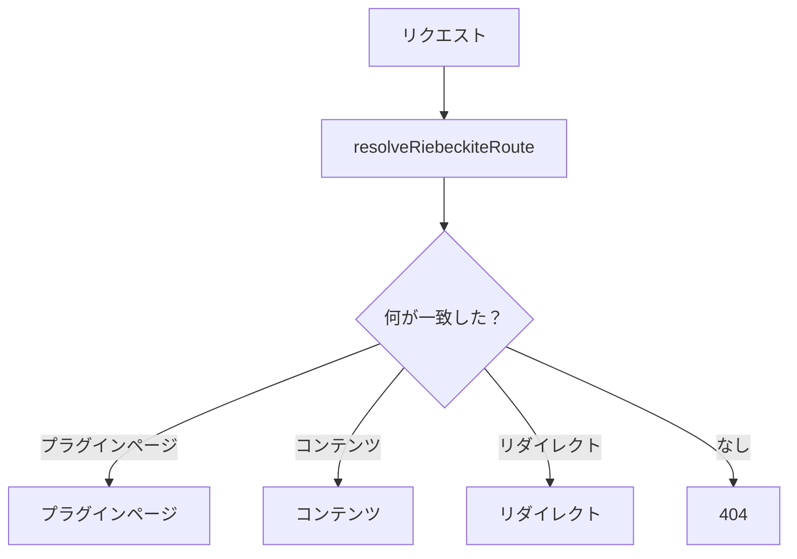
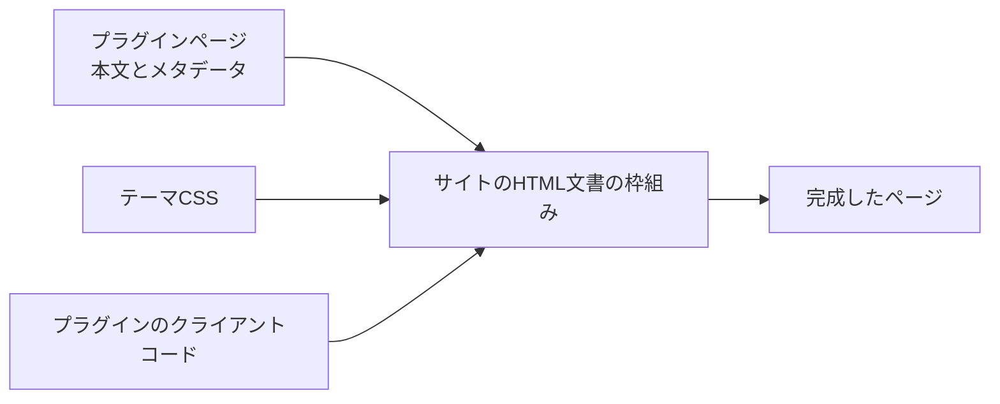
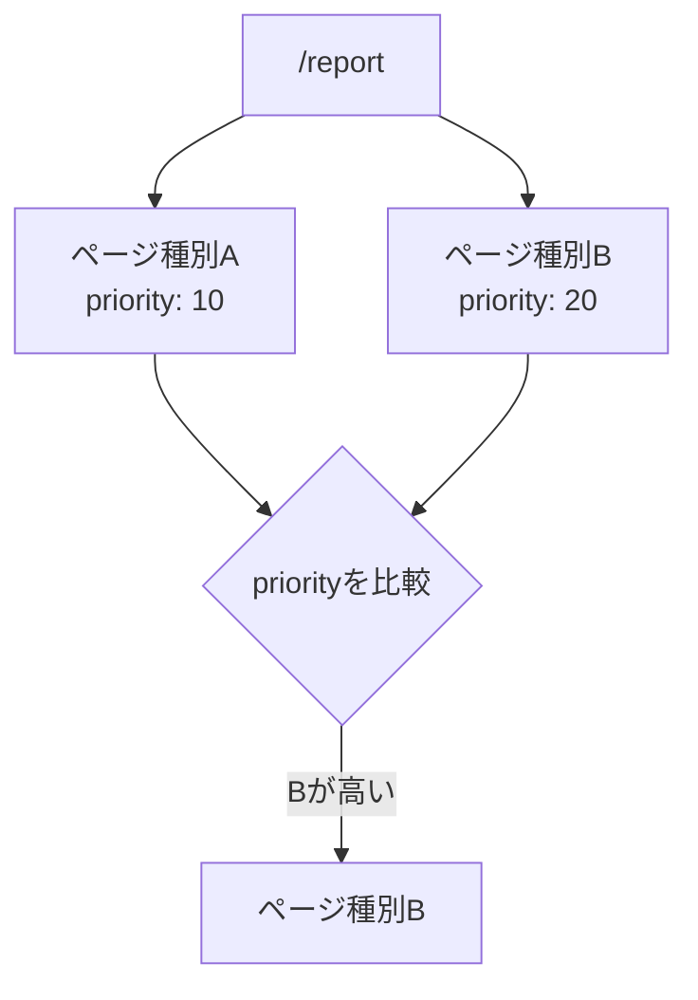
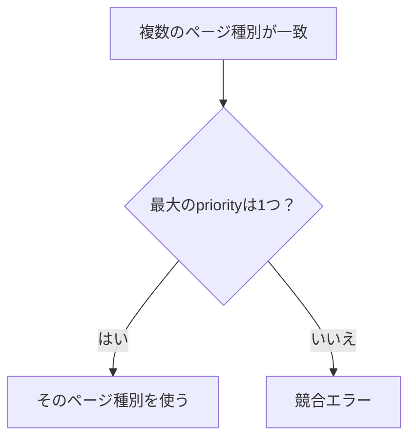

# ページの流れと定義

## ビルド時とリクエスト時の流れ

処理は、ビルド時とリクエスト時の2つに分かれます。

### ビルド時

ビルド時には、プラグインが提供するページ種別から、静的に生成する URL を集めます。


たとえばプラグインが次の URL を提供していれば、その URL を[[glossary/ssg|SSG]]の生成対象にできます。

```text id="9ifm52"
/report
```

### リクエスト時

リクエストが届くと、共通の解決処理がページの種類を判断します。



プラグインページが見つかった場合は、その本文をサイトの HTML 文書の枠組みの中へ描画します。



## ページの種類を定義する

ページの種類（Page Type）は、プラグインの `pageTypes` に定義します。

```ts id="1ql4hf"
import { definePlugin } from "@riebeckite/core";

export function report() {
  return definePlugin({
    name: "report",

    pageTypes: [
      {
        id: "example.report",
        paths: ["/report"],

        resolve: ({ pathname, manifest }) =>
          pathname === "/report"
            ? {
                type: "example.report",
                pathname,
                title: "Report",
                body: `<p>${manifest.publicEntries.length} published entries</p>`,
              }
            : null,
      },
    ],
  });
}
```

この例では、プラグインが `/report` というページを提供します。ページ本文には、公開されている記事の数を表示しています。

プラグインが HonoX のコンポーネントやルートファイルを作る必要はありません。

## 公開済みコンテンツだけを参照する

ページ種別の `resolve` には `PluginPageContext` が渡されます。その中の `PluginPageContext.manifest` は、解決済みの[[glossary/manifest|マニフェスト]]です。

```ts id="dw2bby"
PluginPageContext.manifest
```

`entries` には `draft` と `scheduled` も含まれるため、ページの出力には使わないでください。

公開 URL をすべて列挙する場合は `publicEntries`（`public` と `unlisted`）を、読者へ一覧として見せる場合は `discoverableEntries`（`public` のみ）を使います。記事ごとに分岐が必要な場合だけ、解決済みの `entry.publishing` を読みます。


ページ側で非公開コンテンツを独自に探して表示するのではなく、この[[glossary/publication-boundary|公開境界]]を通してください。通常のページと同じ[[glossary/visibility|公開範囲]]を保てます。

## ページ種別の識別子

各ページ種別には ID が必要です。

```ts id="0evifc"
id: "example.report"
```

ID は、すべてのプラグインを通して一意でなければなりません。次のように、プラグインや用途が分かる名前空間を付けると衝突を避けやすくなります。

```text id="tvplf6"
riebeckite.garden-explorer
example.report
example.search
```

## 公開するURL

静的なページは、`paths` に公開 URL を指定します。

```ts id="7rvyz2"
paths: ["/report"]
```

複数のページを提供することもできます。

```ts id="wea35u"
paths: [
  "/report",
  "/report/archive",
]
```

動的ページを静的生成する場合は、SSG の URL を **`manifest.publicEntries` から導出**します。ファイルシステムを独自に走査して URL を作るのではなく、Content System が解決した公開状態を利用してください。

## 同じURLに複数のページが一致する場合

複数のページ種別が同じ URL に一致することがあります。その場合は `priority` で優先順位を決めます。



最も高い `priority` を持つページ種別が選ばれます。

ただし、最大の `priority` を持つページ種別が複数一致した場合は、どちらかを暗黙に選びません。



競合をエラーにすることで、プラグインの登録順などによって結果が変わることを防ぎます。
