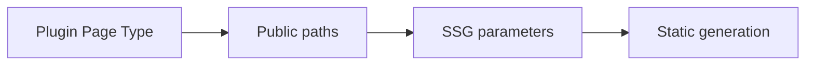
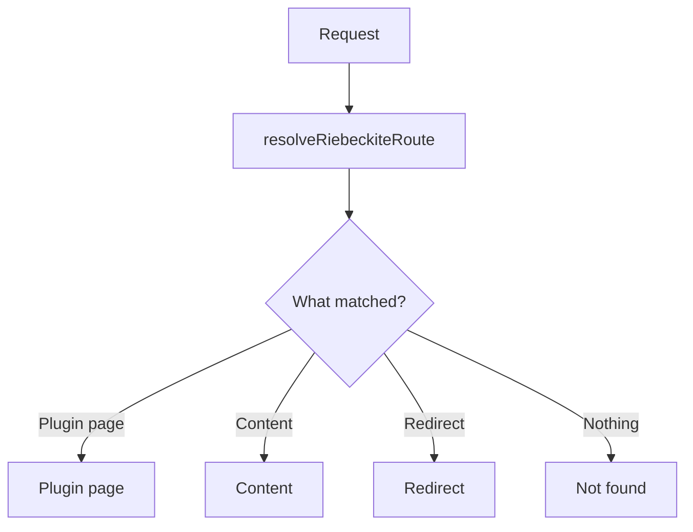
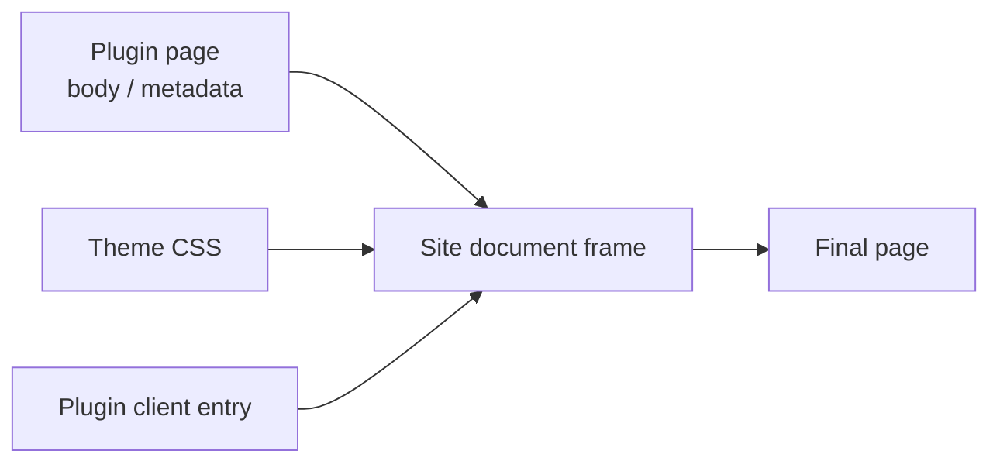
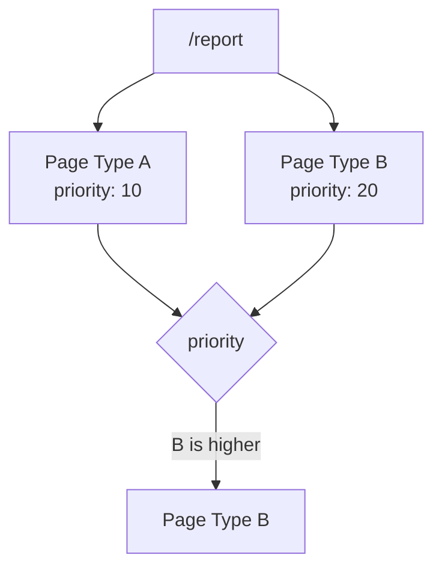
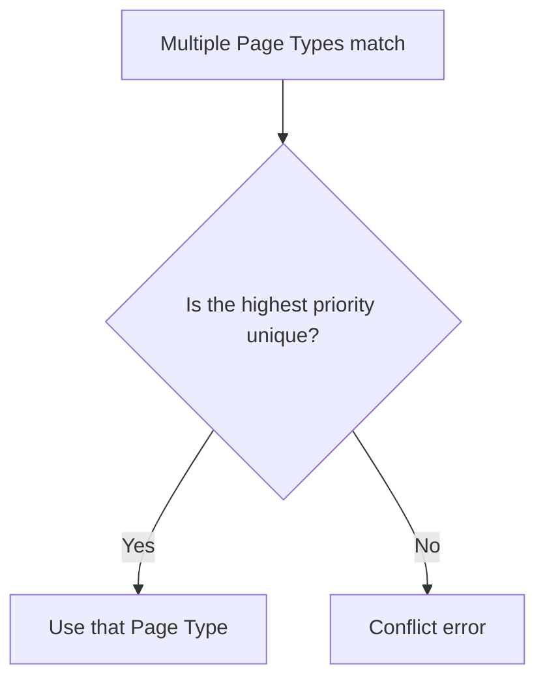

# Flow and authoring

## Build and request flow

The Page System has two main phases.

### At build time

At build time, the Page Types a plugin provides are collected into the URLs to
statically generate:



For example, if a plugin provides:

```text
/report
```

that path can become an SSG generation target.

### At request time

When a request arrives, the shared resolver decides which kind of page it is:



When a plugin page is resolved, its body is rendered inside the site's document
frame:



## Rendering pipeline

Before Page Types, a standalone plugin feature needed a dedicated route:

```text
request -> plugin-specific application route -> plugin component -> document frame
```

With the Page System, plugins participate through one generic route:

```text
build: plugin Page Types -> public paths -> SSG parameters
request: catch-all route -> resolveRiebeckiteRoute
                           -> plugin page | content | redirect
plugin page -> site document frame -> theme CSS and plugin client entries
```

The route and frame remain site-owned. Plugins return a body fragment and
optional `title`, `description`, `headTags`, and `language`; the site decides how
those values are represented in the document.

## Authoring a Page Type

Use `pageTypes` when the feature is an independent screen. Use `renderers` for
content embeds such as Canvas, Bases, and Excalidraw: they belong inside an
article and do not need a page of their own.

```ts
import { definePlugin } from "@riebeckite/core";

export function report() {
  return definePlugin({
    name: "report",
    pageTypes: [{
      id: "example.report",
      paths: ["/report"],
      resolve: ({ pathname, manifest }) => pathname === "/report"
        ? {
            type: "example.report",
            pathname,
            title: "Report",
            body: `<p>${manifest.publicEntries.length} published entries</p>`,
          }
        : null,
    }],
  });
}
```

In this example the plugin provides a page at:

```text
/report
```

The page body shows the number of reachable entries. The plugin does not need to
create a HonoX component or route file.

IDs are globally unique. A request with multiple matching Page Types selects
the greatest `priority`; equal priorities are an explicit error. Declare
`paths` for every static page and derive dynamic paths from
`manifest.publicEntries` when SSG must emit them.

## Page Type IDs

Every Page Type needs an ID:

```ts
id: "example.report"
```

A Page Type ID must be unique across all plugins. A namespace that identifies
the plugin or its purpose avoids collisions:

```text
riebeckite.garden-explorer
example.report
example.search
```

## Paths

Static pages declare their public path in `paths`:

```ts
paths: ["/report"]
```

A plugin can provide several pages:

```ts
paths: [
  "/report",
  "/report/archive",
]
```

To statically generate dynamic pages, derive the SSG paths from
**`manifest.publicEntries`**. Do not scan the filesystem to build paths; use the
publication state resolved by the [[framework/content-system|Content System]].

## Page Type conflicts

Several Page Types may match the same URL. `priority` resolves the conflict:



The Page Type with the greatest `priority` is selected. If several Page Types
share the highest priority, one is not chosen implicitly:



Making the conflict an explicit error prevents the result from depending on
plugin registration order.
