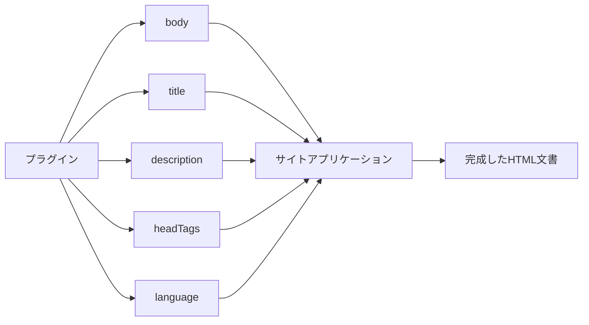
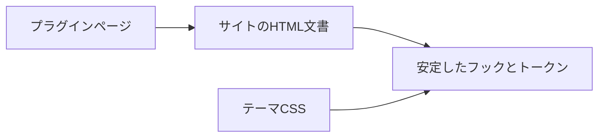
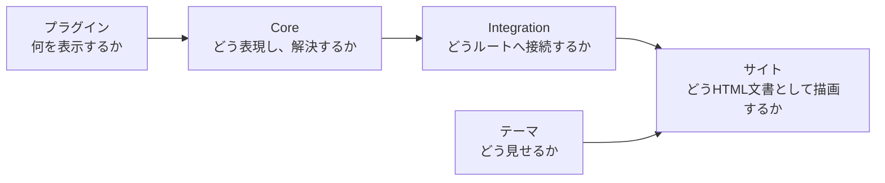

# サイトとの接続

## HonoXサイトへ接続する

プラグインページを利用する HonoX サイトには、すべてのパスを受け取る共通ルートが必要です。`create-riebeckite` などで生成したサイトには、必要な構成があらかじめ含まれています。

概念的には次のように接続します。

```tsx id="xxj9rm"
import {
  contentRouteSsgParams,
  resolveRiebeckiteContentRequest,
  riebeckiteSsgParams,
} from "@riebeckite/honox/server";
import { PageBody } from "@riebeckite/honox/ui";
import { createRoute } from "honox/factory";

export default createRoute(
  contentRouteSsgParams("/:slug{.+}", () => riebeckiteSsgParams(content)),
  async (c) => {
    const resolved = await resolveRiebeckiteContentRequest(c, content);

    if (resolved.kind === "response") return resolved.response;

    if (resolved.kind === "page") {
      return c.render(<PageBody html={resolved.page.body} />);
    }

    return c.render(/* Site 固有の article composition */);
  },
);
```

サイトを利用する人が、プラグインごとにこのルートを追加する必要はありません。共通ルートがプラグインページをまとめて解決します。ルート `/` も、同じ仕組みを共有する `resolveRiebeckiteHomeRequest(c, content)` が解決します。

## ページが返せる情報

プラグインのページは、HTML 本文に加えて、必要に応じてページのメタデータを提供できます。

たとえば、次のような情報です。

```text id="m7yad8"
body
title
description
headTags
language
```

ただし、プラグインが**どこへ描画するかまで決めるわけではありません**。



サイトアプリケーションがこれらを受け取り、既存の HTML 文書の枠組みへ反映します。そのため、プラグインのページでも、サイト全体のナビゲーション、ヘッダー、フッター、テーマをそのまま利用できます。

## HTMLの安全性

ページ種別の `body` は HTML として描画されます。そのためプラグインは、**自分で安全に生成できる HTML だけを返す**必要があります。

たとえば、リクエストの値をそのまま HTML へ埋め込まないでください。

```ts id="8m9qrl"
// 避ける例
body: `<p>${untrustedRequestValue}</p>`
```

信頼できない入力を扱う場合は、適切にエスケープまたは無害化してから使います。最終的に HTML をどう描画するかは、サイトアプリケーション側の境界で決まります。ページ種別がサイトの HTML 安全性の方針を回避できる仕組みにはしません。

## テーマとの関係

テーマはページ種別の ID を知る必要がありません。たとえば、`example.report` 専用のテーマ処理を作るのではなく、次の仕組みで見た目を変えます。

```text id="z67p3o"
example.report
```

- [[glossary/semantic-token|セマンティックトークン]]
- 安定した CSS フック
- `data-*` 属性
- CSS のカスケード



これにより、新しいページ種別が増えても、テーマとプラグインを直接結び付けずに済みます。

## この仕組みが定める境界

最も重要なのは、**プラグインはページを提供するが、アプリケーションを所有しない**という点です。



それぞれの責務は次のとおりです。

```text id="9w3k80"
プラグイン
  → ページの内容と公開URLを提供する

Core
  → ページ種別の共通の取り決めと解決規則を提供する

HonoX Integration
  → ページ種別をルーティングとSSGへ接続する

サイトアプリケーション
  → ルート、HTML文書の枠組み、メタデータ、HTMLの安全性を所有する

テーマ
  → サイトの見た目を変更する
```

この境界があるため、プラグインは HonoX や特定のサイト構造に依存せず、インストールするだけで独立ページを提供できます。

ページ種別の全フィールドと実行時検証については [プラグイン API](../../reference/plugin-api/content-processing.ja.md#プラグインが提供する独立ページ)、サイトとの接続については [HonoX との統合](../honox-integration.ja.md) を参照してください。
