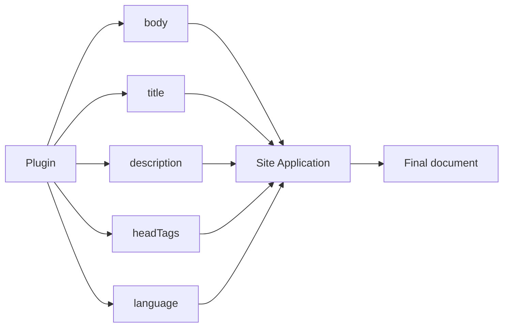
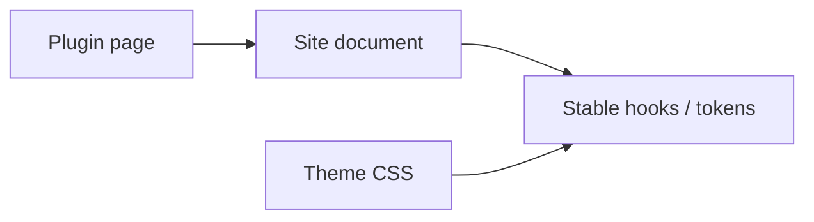
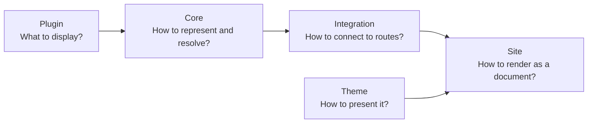

# Integration

## HonoX application wiring

Every HonoX site that uses plugin pages needs the generic catch-all route. The
scaffolded site already includes it. The root `/` is resolved by
`resolveRiebeckiteHomeRequest(c, content)`, which shares the same mechanics:

```tsx
import {
  contentRouteSsgParams,
  resolveRiebeckiteContentRequest,
  riebeckiteSsgParams,
} from "@riebeckite/honox/server";
import { PageBody } from "@riebeckite/honox/ui";
import { createRoute } from "honox/factory";

export default createRoute(
  contentRouteSsgParams("/:slug{.+}", () => riebeckiteSsgParams(content)),
  async (c) => {
    const resolved = await resolveRiebeckiteContentRequest(c, content);

    if (resolved.kind === "response") return resolved.response;

    if (resolved.kind === "page") {
      return c.render(<PageBody html={resolved.page.body} />);
    }

    return c.render(/* site-specific article composition */);
  },
);
```

A normal site user does not need to add this route per plugin. The shared route
resolves plugin pages together, and the root `/` is resolved by
`resolveRiebeckiteHomeRequest(c, content)`, which shares the same mechanics.

## What a page can return

A plugin page can provide page metadata in addition to the HTML body, for
example:

```text
body
title
description
headTags
language
```

It does not decide **where** those values are rendered:



The site application receives them and reflects them in the existing document
frame. A plugin page therefore still uses the site's navigation, header,
footer, and theme.

## HTML safety

A Page Type's `body` is rendered as HTML, so a plugin must only return HTML it
can generate safely. Do not embed a request parameter directly into HTML:

```ts
// Avoid
body: `<p>${untrustedRequestValue}</p>`
```

Escape or sanitize untrusted input before using it. The final decision on how
HTML is rendered lives at the site application boundary; a Page Type is not a
mechanism to bypass the site's HTML safety policy.

## Page Types and themes

A theme does not need to know a Page Type ID. Instead of writing theme logic for
`example.report`, use:

- semantic tokens
- stable CSS hooks
- `data-*` attributes
- the CSS cascade



A new Page Type can therefore be added without coupling the theme directly to
the plugin.

## Page System boundaries

The most important rule is that **a plugin provides a page but does not own the
application**:



The responsibilities are:

```text
Plugin
  → provides the page content and public path

Core
  → provides the shared Page Type contract and resolution rules

HonoX Integration
  → connects Page Types to routing / SSG

Site Application
  → owns routes, the document frame, metadata, and HTML safety

Theme
  → changes the site's appearance
```

This boundary lets a plugin provide standalone pages without depending on
HonoX or a specific site structure.

Keep the frame's HTML policy at the application boundary. A plugin must only
return HTML it is responsible for generating; an application must not treat
untrusted request input as a page body.

For the complete fields and runtime validation rules, see the
[Plugin API](../../reference/plugin-api/content-processing.md#pages). For the site connection, see
[HonoX Integration](../honox-integration.md).
