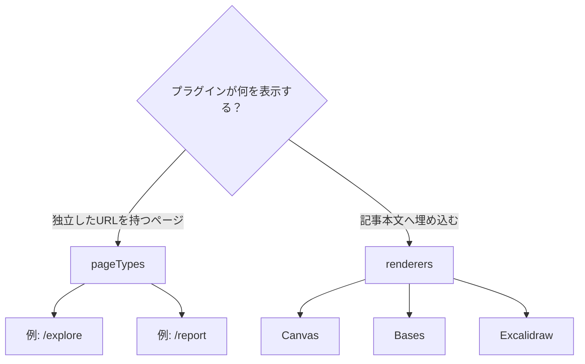
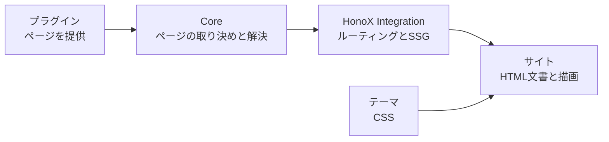
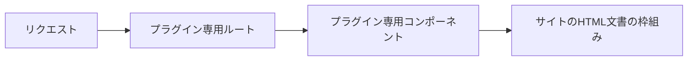
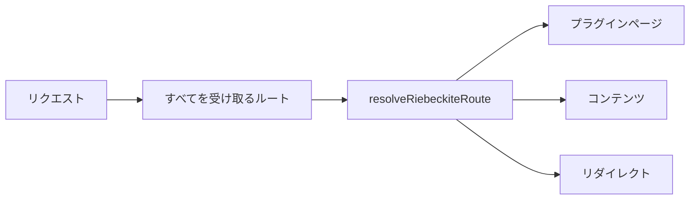

# 概要

## どんなときに使うか

独立したURLを持つページをプラグインから提供するときに使います。

たとえば、次のようなページです。

- Garden Explorer
- プラグインのレポート画面
- プラグインが生成する一覧ページ
- 独自の検索・閲覧ページ

一方、記事本文の中へ何かを表示するだけなら、[[glossary/page-type|ページ種別]]は必要ありません。



Canvas、Bases、Excalidraw のように記事本文へ埋め込む機能は `renderers` を使います。

## 役割の分担

プラグインがページ全体を所有するわけではありません。役割は次のように分かれます。

| 層 | 責務 |
| --- | --- |
| Core | ページ種別の取り決め、検証、URLの列挙、解決、競合の検出 |
| プラグイン | ページ種別ID、公開URL、フレームワークに依存しないHTML本文 |
| HonoX Integration | 共通ルートの解決、SSGパラメータの生成 |
| サイトアプリケーション | ルート、HTML文書の枠組み、メタデータ、HTMLの描画 |
| [[glossary/theme|テーマ]] | [[glossary/design-token|デザイントークン]]と安定したCSSフックによる見た目 |

全体では次のような関係になります。



**ルートとHTML文書の枠組みは、サイトアプリケーションが所有します**。プラグインはページの内容を提供しますが、次のようなHTML文書全体を生成するわけではありません。

```html id="snxwcb"
<html>
<head>
...
<body>
```

## 共通のルートへまとめる

以前は、独立ページを持つプラグインごとに、サイト側へ専用のルートが必要でした。



この方式では、プラグインを追加するだけでは動かず、サイトアプリケーションのルートも変更しなければなりません。プラグインとサイトが強く結び付いてしまいます。

そこで、すべてのプラグインページを共通のルート解決処理へ集めます。



新しいプラグインページを追加しても、HonoXのルートを増やす必要はありません。
