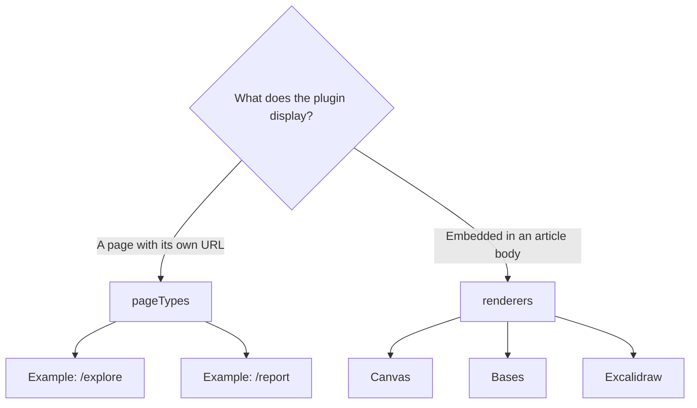
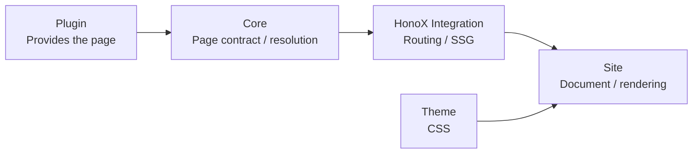
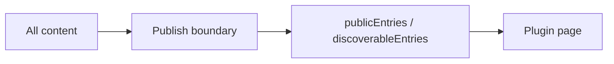
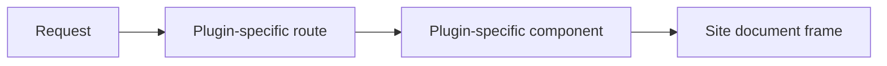
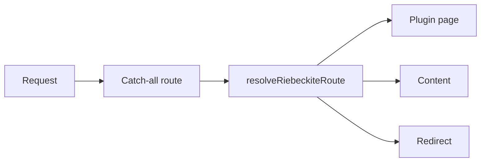

# Overview

## When to use it

Use a [[glossary/page-type|Page Type]] when a plugin provides a page with its own URL, for example:

- Garden Explorer
- A plugin report screen
- A listing page generated by a plugin
- A custom search or browse page

You do not need a Page Type when you only want to display something inside an
article body.



Features embedded inside an article, such as Canvas, Bases, and Excalidraw, use
`renderers` instead.

## Responsibilities

| Layer | Responsibility |
| --- | --- |
| Core | Page Type contract, validation, path enumeration, resolution, and conflicts |
| [[glossary/plugin|Plugin]] | Page Type ID, public paths, and a framework-independent HTML body |
| HonoX integration | Generic route resolver and [[glossary/ssg|SSG]] parameter helper |
| Site application | Catch-all route, document frame, metadata, and safe HTML rendering |
| [[glossary/theme|Theme]] | Tokens and stable hooks; no knowledge of a Page Type ID is required |

A plugin does not own the whole page. The overall relationship looks like this:



**The route and document frame are owned by the site application.** A plugin
provides the page content, but it does not generate a whole document:

```html
<html>
<head>
...
<body>
```

`PluginPageContext.manifest` is the resolved manifest. Its `entries` still
contains `draft` and `scheduled`, so a Page Type must read `publicEntries`
(routable) or `discoverableEntries` (public only) for page output instead.



A Page Type should not search for non-public content on its own. This keeps the
Page System on the same publication boundary as a normal site.

## The problem the Page System solves

Before the Page System, every plugin with a standalone page needed a dedicated
route on the site side:



That approach did not work by adding a plugin alone; it also required changing
the site application's routes, which coupled plugins tightly to the site.

With the Page System, every plugin page participates in one shared route
resolver:



Adding a new plugin page no longer requires adding a HonoX route.
