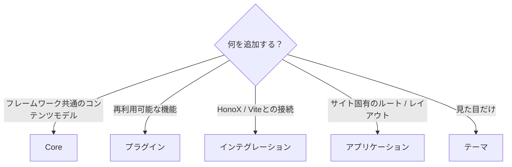
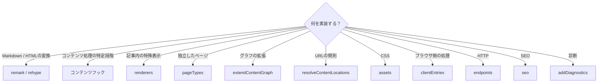
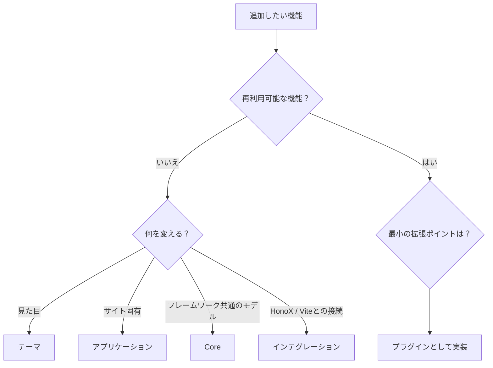

# プラグイン作成の詳細

このページは、Riebeckiteのプラグインを実際に設計・実装するときの詳細ガイドです。初めてプラグインを作る場合は、先に[はじめてのプラグイン作成](../plugins/writing-a-plugin.ja.md)を読んでください。

このページでは、その先に必要になる次の内容を扱います。

- どの拡張ポイントを使うか
- プラグイン同士の依存関係
- ライフサイクル
- コンテンツパイプライン
- レンダラーとページ種別
- CSSとブラウザ側の処理
- キャッシュと診断
- パッケージとしての配布

各型やフィールドの完全な定義は[プラグインAPI](../reference/plugin-api.ja.md)を参照してください。

## このページの構成

- [プラグインの依存関係とライフサイクル](./plugin-system/lifecycle.ja.md)
- [コンテンツ処理のパイプラインと拡張ポイント](./plugin-system/pipeline.ja.md)
- [ダイアグラムプラグインの基盤](./diagram-infrastructure.ja.md)
- [派生データ](./derived-data.ja.md)
- [プラグインの配布と検証](./plugin-system/distribution.ja.md)

## 1. プラグインが担う機能

プラグインは、**Riebeckiteに再利用可能な機能を追加する仕組み**です。たとえば、次のような機能を実装できます。

- Markdown / HTMLの解釈
- コンテンツの変換
- 独自形式のレンダラー
- ブラウザ上の動作
- 診断
- HTTPエンドポイント
- SEO
- 独立したページ

一方、すべての拡張をプラグインにするわけではありません。



特に、責務は次のように分かれます。

```text id="6pgq3j"
見た目だけ
  → テーマ

サイト固有のルート / レイアウト
  → アプリケーション

HonoX / Viteとの接続
  → インテグレーション

フレームワーク全体のコンテンツモデル
  → Core
```

「何でもプラグインにする」のではなく、その機能がどの責務に属するかを先に判断してください。

## 2. 最小のプラグイン

プラグインは`definePlugin()`で定義します。

```ts id="sf8rf2"
import { definePlugin } from "@riebeckite/core";

export function example() {
  return definePlugin({
    name: "example",
  });
}
```

サイトでは`riebeckite.config.ts`の`plugins`に追加します。

```ts id="32z2wh"
export default defineConfig({
  plugins: [
    example(),
  ],
});
```

これが最小構成です。

## 3. オプションを追加する

プラグインに設定が必要な場合は、ファクトリ関数の引数として受け取ります。

```ts id="m8h0dc"
type ExampleOptions = {
  enabled?: boolean;
};

export function example(
  options: ExampleOptions = {},
) {
  return definePlugin({
    name: "example",
    options,
  });
}
```

利用側では次のように指定します。

```ts id="xw3gy8"
export default defineConfig({
  plugins: [
    example({
      enabled: true,
    }),
  ],
});
```

条件付きでプラグインを有効にすることもできます。

```ts id="d7esfe"
plugins: [
  condition && my(),
]
```

`false`、`null`、`undefined`は、プラグインの入力解決時に除外されます。また、`enabled: false`のプラグインも実行されません。

```ts id="3ud7ge"
enabled: false
```

## 4. 拡張ポイントを選ぶ

プラグインを実装するときは、必要な最小の拡張ポイントを選びます。



現在の主な取り決めは次のとおりです。

| 領域 | API |
| --- | --- |
| 識別情報 | `name`, `enabled`, `order`, `options` |
| 依存関係 | `provides`, `requires`, `optional` |
| 設定の検証 | `validateOptions` |
| キャッシュ | `cacheVersion`, `context.cache` |
| ライフサイクル | `setup`, `buildStart`, `buildEnd`, `dispose` |
| コンテンツフック | `onConfigResolved`, `onContentLoaded`, `onPostParsed`, `onPostProcessed`, `onManifestCreated` |
| 公開ロケーション | `resolveContentLocations` |
| パイプライン | `remarkPlugins`, `rehypePlugins`, `extendMarkdownPipeline`, `extendHtmlPipeline` |
| グラフ | `extendContentGraph` |
| 診断 | `addDiagnostics` |
| 本文内の描画 | `renderers` |
| 独立ページ | `pageTypes` |
| ブラウザ | `assets`, `clientEntries` |
| HTTP | `endpoints` |
| SEO | `seo` |

すべてを実装する必要はありません。

UIや出力の拡張ポイントは複数あり、優劣ではなく選択肢です。Markdown / HTMLの変換、レンダラー、ページ種別、公開するHono JSXコンポーネント、クライアントエントリがあります。どれを選ぶかは[UIや出力を追加する方法](../plugins/writing-a-plugin.ja.md#ui-や出力を追加する方法)を参照してください。

## 実装前の確認

プラグインを作り始める前に、次の順番で考えると責務を分離しやすくなります。



プラグインにすると決めた後も、**その機能に本当に必要な拡張ポイントだけを使う**ことが重要です。

ファイルシステムを再走査する前に、マニフェストやコンテンツグラフを使えないか確認してください。独自のルートを追加する前に、ページ種別を使えないか確認してください。クライアントJavaScriptを追加する前に、SSRやビルド時だけで完結できないか確認してください。

これにより、プラグインを小さく保ち、Core、インテグレーション、アプリケーションとの不要な結合を避けられます。

## 関連資料

- [[writing-a-plugin|はじめてのプラグイン作成]]：最初のプラグインを作る
- [[plugin-system|プラグインシステム]]：プラグインシステム全体の考え方
- [[plugin-api|プラグインAPI]]：APIの取り決め
- [[page-system|ページシステム]]：独立したページ
- [[content-system|コンテンツシステム]]：マニフェスト、グラフ、パイプライン
- [[architecture|アーキテクチャ]]：Core、プラグイン、インテグレーション、テーマ、アプリケーションの責務
- [[reference/README|フレームワークリファレンス]]：公開API
