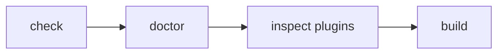

# プラグインの配布と検証

このページは[プラグイン作成の詳細](../plugin-system.ja.md)の一部で、[[glossary/plugin|プラグイン]]のパッケージ化、配布、検証を扱います。

## 4. 配布用にパッケージ化する

プラグインは npm へ公開しなくても利用できます。サイトの中に置いて `definePlugin()` で定義することもできます。

```text id="17msvn"
site/
└─ extensions/
   └─ local-plugin.ts
```

```ts id="mqm2gv"
// site/extensions/local-plugin.ts

return definePlugin({
  name: "site-local",

  assets: [
    {
      pluginName: "site-local",
      kind: "style",
      moduleSpecifier:
        "/extensions/plugin.css",
    },
  ],
});
```

サイト内のプラグインも、公開されたプラグインと同じ取り決めを利用します。対象は依存関係の解決、[[glossary/pipeline|パイプライン]]、フック、診断、[[glossary/renderer|レンダラー]]、[[glossary/page-type|ページ種別]]です。

`createStyleAsset()` と `createClientEntry()` には、パッケージのサブパスを明示して渡します。サイト内のプラグインでも、任意の名前で公開するパッケージでも、ホスト側のバンドラーが解決できるサブパスを指定してください。

再利用可能なパッケージとして配布する場合は、`packages/plugins/backlinks` を雛形にできます。推奨する構成は次のとおりです。

```text id="fs7fzp"
packages/plugins/example/
├─ index.ts          # definePluginを呼ぶファクトリ。公開する部品を再エクスポートする
├─ components/       # コンポーネント（必要な場合）
├─ client.ts         # 必要な場合のみ
├─ src/
│  ├─ remark.ts
│  ├─ rehype.ts
│  ├─ renderer.ts
│  └─ types.ts
├─ style.css         # 必要な場合のみ
├─ package.json
├─ README_ja.md
└─ README.md
```

配布するプラグインは `@riebeckite/core` だけに依存し、`./client`、`./components`、`./style.css` などのサブパスを自身の `exports` で公開します。`@riebeckite/core/src/**` のような内部パスを import したり、monorepo 内のパスを参照したりしないでください。

```ts id="y6jy1n"
import {
  something,
} from "@riebeckite/core/src/...";
```

すべてのプラグインに `client.ts`、`style.css`、`components/` が必要なわけではありません。実際に使うものだけを作成してください。

公開するときは、ビルド済みの ESM と型定義を公開し、`exports` をビルド成果物へ向けます。`prepack` スクリプトでビルドし、パッケージングと公開のたびに新しい成果物を含めます。リポジトリのビルドスクリプトは公開されないため、小さなビルドを用意してください。`esbuild`（`format: "esm"`、`packages: "external"`、`external: ["@riebeckite/*"]`）でエントリをまとめ、`tsc --emitDeclarationOnly` で型定義を出力します。最小構成の `package.json` は[リポジトリ外へプラグインを配布する](../../reference/plugin-api/distribution.ja.md#リポジトリ外へプラグインを配布する)を参照してください。

NodeNext / ESM のパッケージでは、ビルド後も Node.js が import を解決できる必要があります。開発時の TypeScript ローダーが拡張子なしの import を解決できている状態に依存しないでください。パッケージの正しさはソースコードだけでなく、**ビルド後の配布形式でも確認する**必要があります。

## 5. 検証する

`riebeckite plugin verify <path>` は、サイトへ組み込む前に配布パッケージの境界を検証します。任意の第三者プラグインを安全に実行・隔離できるとは主張せず、契約の結果を報告するコマンドです。

```sh
riebeckite plugin verify ./packages/my-plugin
riebeckite plugin verify ./packages/my-plugin --level full --json
```

既定の `basic` は `package.json`、exports、型定義の参照先、公開した client/CSS サブパスを確認します。`integration` は、パッケージ名とディレクトリが完全一致する信頼済み fixture を実行します。fixture は通常、パッケージを pack し、隔離した consumer へ install し、HonoX サイトをビルドして[[glossary/generated-output|生成物]]を検証します。integration はブラウザ検証を意味しません。`full` は登録されたブラウザ fixture も実行します。さらに `full` は `pnpm pack` を実行し、tarball に配布用 manifest と `dist/` があることを確認します。結果は `FAIL`、`SKIP`、`UNSUPPORTED`、`UNVERIFIED` を区別します。実行して成功した検証だけが `PASS` です。

実行できるのはこのリポジトリに登録された fixture だけで、パッケージ名と実パスの両方が一致する場合に限ります。パッケージ側から登録を有効にすることはできません。登録は `packages/cli/src/commands/plugin_contract_fixtures.ts` にあり、リポジトリ所有の runner と、パッケージ名・ディレクトリを指定する entry の両方が必要です。未登録のパッケージで integration または full を指定すると `UNVERIFIED` になり、検証器は未登録プラグインのコードを実行しません。JSON の各結果には `executed` があり、レポートには `complete` があります。`complete` は `FAIL`、`UNVERIFIED`、`UNSUPPORTED` が1件もない場合だけ true になり、不完全なレポートではコマンドは非ゼロで終了します。full fixture の成功はその fixture が対象とする契約の証拠であって、完全な互換性の証明ではありません。

`pnpm pack` はライフサイクルスクリプトと pnpmfile フックを無効にして実行し（`--config.ignore-scripts=true --config.ignore-pnpmfile=true`）、tarball は実行せず内容だけを確認します。一時ディレクトリはセキュリティ sandbox ではありません。ブラウザを起動する fixture だけをブラウザ fixture として扱い、ビルドだけの fixture をブラウザ検証済みとは報告しません。

Markdown 変換、Plugin Runtime と capability 解決、HonoX 描画、[[glossary/publication-boundary|公開境界]]、ブラウザのライフサイクルは、プラグインまたはサイト fixture の対象を絞ったテストで確認してください。`tests/plugin-contracts/meta-bind` の fixture は、Meta Bind の tarball、HonoX 出力、client の遅延読み込み、DOM 操作、CSS、SPA 再マウントを確認します。`tests/plugin-dx` は汎用の tarball consumer fixture で、`@riebeckite/test/e2e` が pack と隔離 install の再利用部品です。

実装後は、小さい範囲から順番に確認します。



まず設定とプラグインの解決を確認します。

```sh id="bgxy4d"
pnpm exec riebeckite check
```

次にプロジェクト全体の状態を確認します。

```sh id="8bfj5k"
pnpm exec riebeckite doctor
```

解決されたプラグインを確認します。

```sh id="ad0h9x"
pnpm exec riebeckite inspect plugins
```

最後に実際の生成物まで確認します。

```sh id="f7grlr"
pnpm exec riebeckite build
```

プラグインが解決されない場合は、まず `check` の出力から次の点を確認してください。

- import 時のエラー
- 不足している[[glossary/capability|ケイパビリティ]]
- 重複した提供者
- 依存関係の循環
- 不正なオプション

あわせて、本当にプラグインが必要かも考えてください。設定やアプリケーション側の実装だけで足りる場合もあります。
