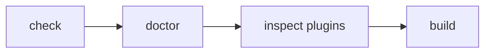

# プラグインの配布と検証

このページは[プラグイン作成の詳細](../plugin-system.ja.md)の一部で、プラグインのパッケージ化、配布、検証を扱います。

## 4. 配布用にパッケージ化する

プラグインはnpmへ公開しなくても利用できます。サイトの中に置いて`definePlugin()`で定義することもできます。

```text id="17msvn"
site/
└─ extensions/
   └─ local-plugin.ts
```

```ts id="mqm2gv"
// site/extensions/local-plugin.ts

return definePlugin({
  name: "site-local",

  assets: [
    {
      pluginName: "site-local",
      kind: "style",
      moduleSpecifier:
        "/extensions/plugin.css",
    },
  ],
});
```

サイト内のプラグインも、公開されたプラグインと同じ取り決めを利用します。対象は依存関係の解決、パイプライン、フック、診断、レンダラー、ページ種別です。

`createStyleAsset()`と`createClientEntry()`には、パッケージのサブパスを明示して渡します。サイト内のプラグインでも、任意の名前で公開するパッケージでも、ホスト側のバンドラーが解決できるサブパスを指定してください。

再利用可能なパッケージとして配布する場合は、`packages/plugins/backlinks`を雛形にできます。推奨する構成は次のとおりです。

```text id="fs7fzp"
packages/plugins/example/
├─ index.ts          # definePluginを呼ぶファクトリ。公開する部品を再エクスポートする
├─ components/       # コンポーネント（必要な場合）
├─ client.ts         # 必要な場合のみ
├─ src/
│  ├─ remark.ts
│  ├─ rehype.ts
│  ├─ renderer.ts
│  └─ types.ts
├─ style.css         # 必要な場合のみ
├─ package.json
├─ README_ja.md
└─ README.md
```

配布するプラグインは`@riebeckite/core`だけに依存し、`./client`、`./components`、`./style.css`などのサブパスを自身の`exports`で公開します。`@riebeckite/core/src/**`のような内部パスをimportしたり、monorepo内のパスを参照したりしないでください。

```ts id="y6jy1n"
import {
  something,
} from "@riebeckite/core/src/...";
```

すべてのプラグインに`client.ts`、`style.css`、`components/`が必要なわけではありません。実際に使うものだけを作成してください。

公開するときは、ビルド済みのESMと型定義を公開し、`exports`をビルド成果物へ向けます。`prepack`スクリプトでビルドし、パッケージングと公開のたびに新しい成果物を含めます。リポジトリのビルドスクリプトは公開されないため、小さなビルドを用意してください。`esbuild`（`format: "esm"`、`packages: "external"`、`external: ["@riebeckite/*"]`）でエントリをまとめ、`tsc --emitDeclarationOnly`で型定義を出力します。最小構成の`package.json`は[リポジトリ外へプラグインを配布する](../../reference/plugin-api.ja.md#リポジトリ外へプラグインを配布する)を参照してください。

NodeNext / ESMのパッケージでは、ビルド後もNode.jsがimportを解決できる必要があります。開発時のTypeScriptローダーが拡張子なしのimportを解決できている状態に依存しないでください。パッケージの正しさはソースコードだけでなく、**ビルド後の配布形式でも確認する**必要があります。

## 5. 検証する

`riebeckite plugin verify <path>`は、サイトへ組み込む前に配布パッケージの境界を検証します。任意の第三者プラグインを安全に実行・隔離できるとは主張せず、契約の結果を報告するコマンドです。

```sh
riebeckite plugin verify ./packages/my-plugin
riebeckite plugin verify ./packages/my-plugin --level full --json
```

既定の`basic`は`package.json`、exports、型定義の参照先、公開したclient/CSSサブパスを確認します。`integration`では、プラグイン自身のfixtureが実行しないランタイム契約を`UNVERIFIED`として記録します。`full`はさらに`pnpm pack`を実行し、tarballに配布用manifestと`dist/`があることを確認します。結果は`FAIL`、`SKIP`、`UNSUPPORTED`、`UNVERIFIED`を区別します。実行して成功した検証だけが`PASS`です。

Markdown変換、Plugin Runtimeとcapability解決、HonoX描画、公開境界、ブラウザのライフサイクルは、プラグインまたはサイトfixtureの対象を絞ったテストで確認してください。リポジトリ内では`tests/plugin-dx`がtarball consumer fixture、`@riebeckite/test/e2e`がpackと隔離installの再利用部品です。

実装後は、小さい範囲から順番に確認します。



まず設定とプラグインの解決を確認します。

```sh id="bgxy4d"
pnpm exec riebeckite check
```

次にプロジェクト全体の状態を確認します。

```sh id="8bfj5k"
pnpm exec riebeckite doctor
```

解決されたプラグインを確認します。

```sh id="ad0h9x"
pnpm exec riebeckite inspect plugins
```

最後に実際の生成物まで確認します。

```sh id="f7grlr"
pnpm exec riebeckite build
```

プラグインが解決されない場合は、まず`check`の出力から次の点を確認してください。

- import時のエラー
- 不足しているケイパビリティ
- 重複した提供者
- 依存関係の循環
- 不正なオプション

あわせて、本当にプラグインが必要かも考えてください。設定やアプリケーション側の実装だけで足りる場合もあります。
