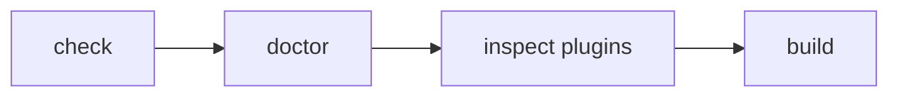

This page is part of [Plugins in Depth](../plugin-system.md) and covers packaging and verification.

# Packaging and verification

## 4. Packaging for distribution

A plugin does not have to be published to npm to be used. A site can define one
directly, for example:

```text
site/
└─ extensions/
   └─ local-plugin.ts
```

```ts
// site/extensions/local-plugin.ts

return definePlugin({
  name: "site-local",

  assets: [
    {
      pluginName: "site-local",
      kind: "style",
      moduleSpecifier: "/extensions/plugin.css",
    },
  ],
});
```

A site-local plugin uses the same contracts as a published one — dependency
resolution, pipeline, hooks, diagnostics, renderers, and Page Types.
`createStyleAsset()` and `createClientEntry()` accept the package subpath as an
explicit argument. Use the subpath the host bundler can resolve, whether the
plugin is site-local or published under any package name.

To distribute a plugin as a reusable package, use `packages/plugins/backlinks`
as a template. Recommended layout:

```text
packages/plugins/example/
├─ index.ts          ← factory calling definePlugin, re-exports public parts
├─ components/       ← components (if any)
├─ client.ts         ← only when needed
├─ src/
│  ├─ remark.ts
│  ├─ rehype.ts
│  ├─ renderer.ts
│  └─ types.ts
├─ style.css         ← only when needed
├─ package.json
├─ README_ja.md
└─ README.md
```

A distributed plugin depends only on `@riebeckite/core` and declares its own subpaths (`./client`, `./components`, `./style.css`) in `exports`. Never import `@riebeckite/core/src/**` or reference monorepo paths:

```ts
import {
  something,
} from "@riebeckite/core/src/...";
```

Not every plugin needs `client.ts`, `style.css`, or `components/` — create only
what it actually uses. For the package surface and current constraints, see "Public packages and import paths" in [Framework Reference](../../reference/README.md).

Publish built ESM plus type declarations and point `exports` at the built files; build them in a `prepack` script so packing and publishing ship fresh output. The repository's build script is not published, so supply a small build: bundle the entry points with `esbuild` (`format: "esm"`, `packages: "external"`, `external: ["@riebeckite/*"]`) and emit declarations with `tsc --emitDeclarationOnly`. See [Distributing a Plugin outside this repository](../../reference/plugin-api.md#distributing-a-plugin-outside-this-repository) for a minimal manifest.

In NodeNext/ESM packages, keep imports resolvable by Node after the build. Do not rely on the development TypeScript loader accidentally resolving extensionless imports. A package's correctness must be checked not only from its source code but also **from the built distribution form**.

## 5. Verify

`riebeckite plugin verify <path>` checks the distributable package boundary before
it is added to a site. It is intentionally a contract reporter, not a sandbox:
it never claims to safely execute arbitrary third-party plugin code.

```sh
riebeckite plugin verify ./packages/my-plugin
riebeckite plugin verify ./packages/my-plugin --level full --json
```

`basic` (the default) checks `package.json`, exports, declaration targets, and
declared client/CSS subpaths. `integration` runs a trusted fixture registered
for the exact package name and directory. Such a fixture typically packs the
package, installs it in an isolated consumer, builds a HonoX site, and asserts
the generated output; integration does not imply browser verification. `full`
also runs the registered browser fixture. `full` additionally runs `pnpm pack`
and verifies the tarball contains the distribution manifest and `dist/`. The
report distinguishes `FAIL`, `SKIP`, `UNSUPPORTED`, and `UNVERIFIED`; only a
check that ran successfully is `PASS`.

Only fixtures registered in this repository can run, and only when both the
package name and the real package directory match. A package cannot opt itself
in. Registration lives in `packages/cli/src/commands/plugin_contract_fixtures.ts`
and requires both a repository-owned runner and an entry that names the package
and directory. Integration or full on an unregistered package reports
`UNVERIFIED`; the verifier does not execute unregistered plugin code. Every JSON
result has an `executed` field, and the report has `complete`, which is true only
when no requested result is `FAIL`, `UNVERIFIED`, or `UNSUPPORTED`. An
incomplete report makes the command exit nonzero. A passing full fixture is
evidence for that fixture's contracts, not proof of complete compatibility.

`pnpm pack` runs with lifecycle scripts and pnpmfile hooks disabled
(`--config.ignore-scripts=true --config.ignore-pnpmfile=true`), and the tarball
is inspected rather than executed. A temporary directory is not a security
sandbox. A fixture is marked as a browser fixture only when it launches a
browser; a build-only fixture is never reported as browser-verified.

For Markdown transforms, Plugin Runtime/capability resolution, HonoX rendering,
publication boundaries, and browser lifecycle behavior, keep focused tests in
the plugin or site fixture. The Meta Bind fixture under
`tests/plugin-contracts/meta-bind` covers its tarball, HonoX output, client
lazy-load, DOM interaction, CSS, and SPA remount. `tests/plugin-dx` is the
repository's general tarball consumer fixture and `@riebeckite/test/e2e`
provides its reusable packing and isolated-install primitives.



```sh
npm exec riebeckite check               # validate config and plugin resolution
npm exec riebeckite doctor              # health check
npm exec riebeckite inspect plugins     # list resolved plugins
npm exec riebeckite build               # confirm it appears in the output
```

If a plugin does not resolve, start with `check` for capability or import errors. Look for:

- import error
- missing capability
- duplicate provider
- dependency cycle
- invalid options

Also ask whether you really need a plugin — perhaps configuration or an app implementation suffices.
