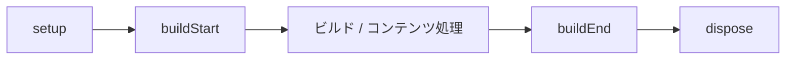
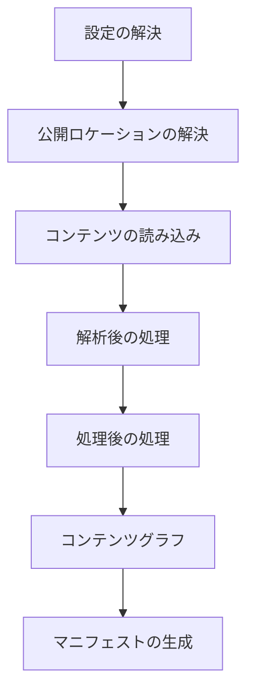

# プラグインの依存関係とライフサイクル

このページは[プラグイン作成の詳細](../plugin-system.ja.md)の一部で、プラグイン同士の依存関係、オプションの検証、プラグインコンテキスト、ライフサイクルを扱います。

## 3-1. 依存関係とケイパビリティ

プラグイン同士に実際の依存関係がある場合は、ケイパビリティの取り決めを使用します。

```ts id="mdj2qn"
definePlugin({
  name: "consumer",

  provides: [
    "example.output",
  ],

  requires: [
    "content.graph",
  ],

  optional: [
    "example.optional",
  ],
});
```

各フィールドの意味は次のとおりです。

| フィールド | 意味 |
| --- | --- |
| `provides` | このプラグインが提供するケイパビリティ |
| `requires` | 必須のケイパビリティ |
| `optional` | あれば利用するケイパビリティ |

リゾルバーは依存関係をもとに実行順を解決します。


次の状態は設定エラーになります。

- 必須のケイパビリティがない
- 提供者が重複している
- 依存関係に循環がある

`order`は依存解決前の基本順序です。実際の依存関係を表現するために`order`を使わないでください。

## 3-2. `validateOptions` で設定を検証する

TypeScriptの型だけでは、実行時の値が正しいことを完全には保証できません。必要なプラグインは`validateOptions`を実装します。

```text id="09xj48"
オプション
   ↓
validateOptions
   ↓
構造化された問題
   ↓
riebeckite check
```

検証関数には副作用を持たせません。特に、次の処理を行わないでください。

- ファイルシステムの走査
- ビルド
- キャッシュの書き込み
- 外部状態の変更

問題は構造化された指摘として返し、設定の検証からまとめて表示できるようにします。

## 3-3. プラグインコンテキスト

プラグインは、フレームワークのサービスを`PluginContext`から受け取ります。基本的なコンテキストは概念的に次のような形です。

```ts id="jrp2vo"
type PluginContext = {
  config?: ResolvedRiebeckiteConfig;
  isDevelopment?: boolean;
  contentIndex: Map<string, string>;
  diagnostics: Diagnostic[];
  cache: PluginCache;
  output: GeneratedOutputSink;
  logger: Logger;
  tracer: Tracer;
  contentSource?: ContentSource;
};
```

`isDevelopment` は Vite の開発ランタイムでのみ `true` になり、そこで配信されない静的出力をプラグインが遅延させられます。

フックによって、次のような情報が追加されます。

```text id="2t18qa"
slug
markdown
content
manifest
entries
location input
```

プラグインの中でフレームワークのサービスをグローバルなシングルトンとして作るのではなく、コンテキストから必要なサービスを受け取ることを優先してください。

## 3-4. ライフサイクル

フレームワークのライフサイクルには、次の4つの段階があります。

```text id="oy9iqs"
setup
buildStart
buildEnd
dispose
```

概念的な流れは次のとおりです。



`setup`、`buildStart`、`onConfigResolved`、コンテンツ処理、`buildEnd`は、1つの`ContentManager`につき一度だけ実行されます。`buildEnd`は、診断の収集後に完成したマニフェストを受け取る唯一の終端フックです。`dispose`は確保したリソースの解放に使い、解決済みプラグインの逆順で実行されます。

ライフサイクルの実行順は、解決済みプラグインの順序に従います。フックでエラーが発生した場合は、プラグイン名、フック名、元の原因が分かる形で上位へ伝播させてください。

## 3-5. コンテンツ処理の段階

コンテンツは複数の段階を通って処理されます。



全体の順序は、`setup` → `buildStart` → `onConfigResolved` → 公開ロケーションの解決 → `onContentLoaded` → Markdown / HTMLパイプライン → `onPostParsed` → `onPostProcessed` → `extendContentGraph` → `onManifestCreated` → 診断 → `buildEnd`です。

代表的なフックは次のとおりです。

```text id="6idgbj"
onConfigResolved
onContentLoaded
onPostParsed
onPostProcessed
onManifestCreated
```

必要な段階のフックだけを使用してください。たとえば、マニフェストにすでに存在する情報を`onContentLoaded`で独自に再構築するような実装は避けます。
