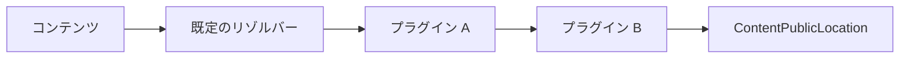
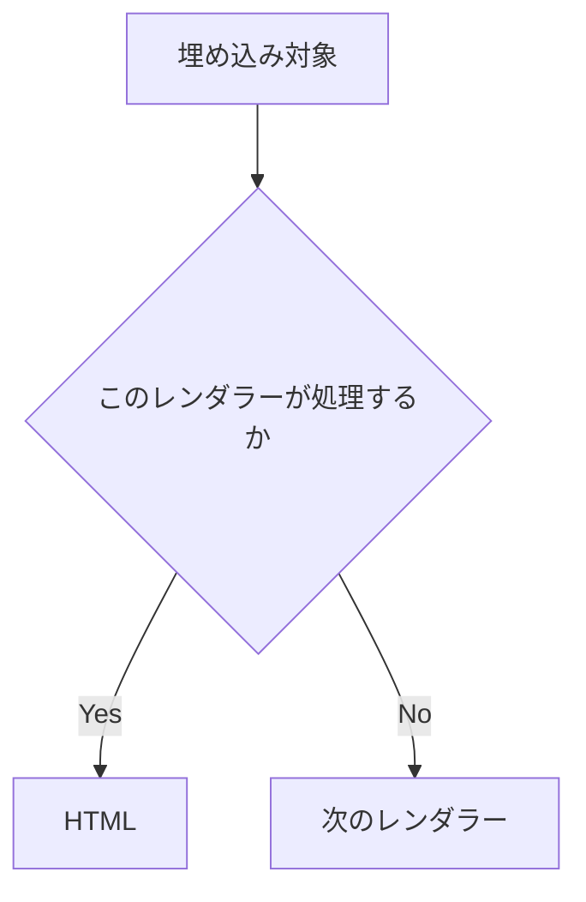
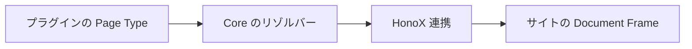
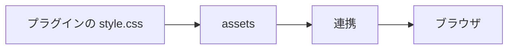
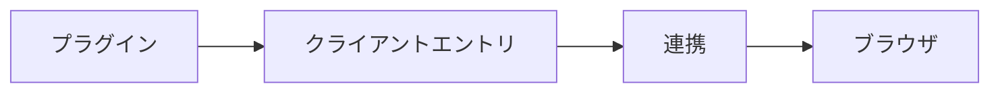
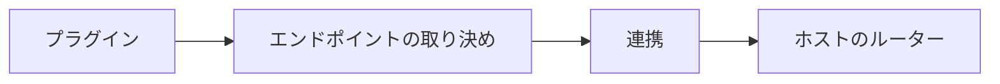
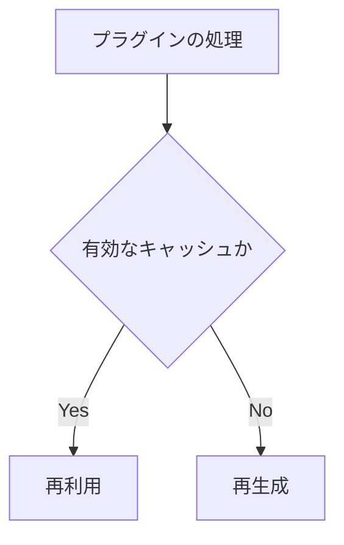

# コンテンツ処理のパイプラインと拡張ポイント

このページは [プラグイン作成の詳細](../plugin-system.ja.md) の一部で、コンテンツの処理と拡張ポイントを扱います。Markdown / HTML パイプライン、Content Graph、レンダラー、Page Type などを取り上げます。

## 3-6. Markdown / HTML パイプライン

Markdown や HTML の意味を変換する場合は remark / rehype を使います。単純なプラグインなら、変換関数を配列として宣言するだけで済みます。

```ts id="twapvp"
definePlugin({
  name: "example",

  remarkPlugins: [
    remarkExample,
  ],

  rehypePlugins: [
    rehypeExample,
  ],
});
```

パイプライン自体を構成する必要がある場合は、`extendMarkdownPipeline` と `extendHtmlPipeline` を使います。

```ts id="5fj1xn"
definePlugin({
  name: "example",

  extendMarkdownPipeline(pipeline) {
    pipeline.use(remarkExample);
  },

  extendHtmlPipeline(pipeline) {
    pipeline.use(rehypeExample);
  },
});
```

Markdown / HTML の意味変換はプラグイン側に置き、AST の処理をアプリケーションのコンポーネントへ持ち込まないでください。

fenced block、figure、ブラウザでのレンダリングを共有する Diagram プラグインでは、[Diagram Plugin Infrastructure](../diagram-infrastructure.ja.md) を利用できます。

## 3-7. Content Graph と公開ロケーション

Content Graph を拡張する場合は `extendContentGraph` を使います。Backlinks などグラフ系の機能を実装するためにファイルシステムを再走査せず、すでに解決済みの manifest / Content Graph を利用してください。


コンテンツの公開 URL を変更するプラグインは `resolveContentLocations` を使います。Core はまず既定のリゾルバー（`resolveDefaultContentLocation`）で公開ロケーションを解決します。

```text id="dug8by"
index
  → /

その他
  → /{slug}
```

続いて、解決済みのプラグインの順に、各プラグインのフックが実行されます。



結果は `ContentPublicLocation` として manifest、Content Graph、Markdown パイプラインから参照されます。URL の規則はプラグインが所有し、Core は特定のプラグインの URL 規則を知りません。利用側が読むのは、最終的に解決された次の値です。

```ts id="b9m3p8"
entry.permalink
```

公開ロケーションを解決できない場合は、slug へ暗黙にフォールバックせず、明示的なエラーにします。

## 3-8. レンダラー

`renderers` は記事本文内の埋め込み対象をプラグイン固有の HTML に変換します。対象には次のようなものがあります。

```text id="o4apio"
Canvas
Bases
Excalidraw
Attachment
Media
```

レンダラーのコンテキストには、次の値と通常の `PluginContext` が含まれます。

```text id="pbh0ss"
kind
path
raw
label
url
embed
```



自分が処理する対象でなければ `null` を返してください。ほかのレンダラーが順に試されます。

## 3-9. ページ種別

独立した URL を持つ画面をプラグインが提供する場合は `pageTypes` を使います。たとえば、次のようなページです。

```text id="9tlwkd"
/explore
/report
/tags/example
```

Page Type は、一意な `id`、静的または manifest から導出する `paths`、任意の `priority`、`resolve` を持ちます。

`resolve` はフレームワークに依存しない HTML の body か `null` を返します。必要であれば、次の値を返すこともできます。

```text id="pjgd7n"
title
description
headTags
```

Document Frame はサイトのアプリケーションが所有し、これらの値を使って描画します。



Page Type の `id` は実行時に検証されます。複数の Page Type が同じリクエストを解決した場合は、`priority` が最も大きいものが使われ、同点はエラーになります。

Taxonomy の一覧や Explorer のような独立した画面には Page Type を使い、Canvas、Bases、Excalidraw のような記事本文への埋め込みにはレンダラーを使います。プラグインが HonoX のルートファイルや Document Frame を所有しないことが重要です。

Page Type の詳しい仕組みは [Page System](../page-system.ja.md) を参照してください。

## 3-10. アセット

プラグイン固有のスタイルシートはプラグインのパッケージ内に置き、`assets` でモジュール指定子を宣言します。

```ts id="b4qrvi"
assets: [
  {
    pluginName: "example",
    kind: "style",
    moduleSpecifier:
      "@riebeckite/plugin-example/style.css",
  },
]
```

連携側がこのモジュール指定子を解決し、ブラウザへ届けます。



プラグイン固有の CSS を `apps/web` へコピーしたり、ブラウザから `/node_modules` を直接参照させたりしないでください。

## 3-11. CSS フック

プラグインの CSS はプラグインのパッケージに置き、`assets` を通してブラウザへ届けます。プラグインが独立した再利用可能な機能を描画する場合は、最外要素に安定したルートフックを付けてください。

プラグイン / 機能のフックは `rr-<feature>` とします。

```text id="59lz7m"
rr-<feature>
```

たとえば、次のとおりです。

```text id="gj2f5a"
rr-search
rr-callout
rr-query
rr-code
```

ルートより内側では BEM の形を使えます。

```text id="9lq6se"
rr-search
rr-search__input
rr-search__result
rr-search--loading
```

名前空間の役割は次のとおりです。

| 名前空間 | 用途 |
| --- | --- |
| `rb-*` | フレームワークの構造フック |
| `--rb-*` | フレームワークのセマンティックトークン |
| `rr-*` | プラグイン / 機能のフック |
| `--rr-*` | プラグイン固有のトークン |

既存のクラスは同じ要素に残してください。`rr-` のフックは追加であり、既存のセレクタやサイト側の上書きはそのまま動作します。プラグインの出力を `rb-` 名前空間に置かないでください。プラグインの出力では、フックとして `rr-*` だけを使います。

また、次のクラスは原則として内部実装です。

```text id="21g4wg"
rr-feature__*
rr-feature--*
```

テーマから装飾してよい子孫クラスだけを公開フックとして文書化してください。

## 3-12. クライアントエントリ

ブラウザ上での初期化処理が必要な場合にだけ `clientEntries` を使います。

```ts id="a8cjlk"
clientEntries: [
  {
    pluginName: "example",
    moduleSpecifier:
      "@riebeckite/plugin-example/client",
    exportName: "initExample",

    publicConfig: {
      selector: ".example",
    },
  },
]
```



SSR やビルド時だけで完結するプラグインにクライアント JavaScript を追加しないでください。

`publicConfig` はクライアントの初期化処理へ渡され、静的ホストから利用できるよう manifest にも記録されます。そのため、次のような値を含めてはいけません。

- トークン
- 認証情報
- シークレット
- プライベートなサービス URL

プラグインの `options` が自動的にクライアントへ渡されることはありません。

## 3-13. エンドポイントと SEO

HTTP エンドポイントを提供する場合は `endpoints` の取り決めを使います。HonoX などのルートフレームワークの実装を、プラグイン本体へ直接組み込まないでください。エンドポイントの取り決めをホストのルーターへ接続するのは連携側の役割です。



SEO に参加する場合は `seo` を使います。プラグインはメタデータやフィードの処理に参加できます。プラグイン固有の SEO ロジックをアプリケーションのルート側で再実装しないでください。

## 3-14. 診断

プラグイン固有の問題は `addDiagnostics` から報告します。

```ts id="1xq5te"
addDiagnostics(context) {
  return [
    {
      // Diagnostic contract
    },
  ];
}
```

診断は可能な限り構造化データとして返してください。プラグインから次のように独自の CLI 出力を作るのではなく、診断またはロガーを使ってください。

```ts id="c4x89a"
console.log(...)
```

## 3-15. プラグインのキャッシュ

`context.cache` はプラグインごとに分離された**ビルド時のキャッシュ**です。保存してよいのは、次の条件を満たす値だけです。

- 再生成できる
- JSON にシリアライズできる
- プラグインの名前空間内で完結する
- 壊れていても安全にキャッシュミスとして扱える

`cacheVersion` を使うと、キャッシュ形式の互換性を切り替えられます。書き込みはアトミックに行われます。



これは実行環境のデータベースではありません。Cloudflare Workers などの永続ストレージとして使わないでください。

## 3-16. ロガーとトレーサー

プラグインからはフレームワークのロガーとトレーサーを利用できます。

```ts id="j7ad6k"
context.logger.info("...");

await context.tracer.span(
  "plugin.example.work",
  {
    plugin: "example",
  },
  async () => {
    // work
  },
);
```

ロガーは処理内容を記録し、トレーサーは処理時間などを構造化トレースとして記録します。Profiler はこのトレースを利用するため、プラグインごとに独自のストップウォッチやレポートの仕組みを用意する必要はありません。
