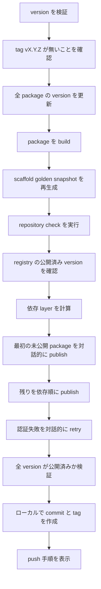

# Release Operations

このページは、Riebeckite の workspace package を npm へ公開する手順を説明します。リリースを実行する maintainer 向けであり、`create-riebeckite` で Site を作るだけの場合には必要ありません。

リリースの entrypoint は次のとおりです。

```bash id="r3xk1a"
pnpm release <version>
```

これは repository root で `node scripts/release.mjs <version>` を実行します。

この script は **冪等かつ再開可能** になるように設計されています。同じ version を中断後に再実行しても、まだ公開されていない package だけを処理します。

## 前提条件

- すべての `@riebeckite/*` package への書き込み権限が必要です。

release script は独自の認証や one-time password の prompt を実装しません。npm / pnpm CLI に委譲するため、既存の npm login、security key、passkey、OTP の設定がそのまま使われます。

## 通常のリリース



通常の実行では次を行います。

1. version を検証し、tag が既に存在する場合は続行しません。
2. `scripts/bump_version.mjs` で全公開 package の version を更新します。
3. `pnpm build:packages` で package を build します。
4. scaffold golden snapshot を再生成し、repository check を実行します。
5. npm にその version で公開済みの package を問い合わせます。
6. npm / pnpm が認証できるよう、最初の未公開 package を対話的に publish し、残りを依存 layer 順に上限付きの並列度で publish します。
7. 全 package の version が registry 上で公開済みか検証します。
8. ローカルの `release vX.Y.Z` commit と tag を作成し、push の command を表示します。

push は自動実行されません。表示された command を自分で実行してください。

### Option

| Option | 用途 |
| --- | --- |
| `--dry-run` | publish や git object の作成を行わず、検証・bump・build のみ行う |
| `--check-only` | repository check だけを実行する |
| `--help`, `-h` | usage を表示する |

## 冪等なリリースと再開

判断の基準は registry です。script はローカルの記録を公開成功の根拠として扱いません。

- **公開済み package は skip します**。 各 publish の前に registry を確認するため、同じ version を再実行しても公開済みを再 publish しません。
- **version bump は冪等です**。 既にその version の package へ bump しても同じ内容を書き直すだけです。
- **失敗した実行は version を bump 済みのまま残します**。 原因を直した後 `pnpm release <version>` を再実行すると、残りの package だけを処理します。
- **最終検証で registry を再確認します**。 全 package の version が公開済みと確認できた後にだけ commit と tag を作成します。

commit はあるが tag が無い（またはその逆）場合も、release を再実行してください。publish は skip され、足りない git object が作成されます。

## リリースの状態

| 状態 | 意味 | 情報源 |
| --- | --- | --- |
| 未公開 | `name@version` に対して registry が 404 を返した | `npm view` |
| 公開済み | registry がその version を返した | `npm view` |
| 状態不明 | registry を確実に問い合わせられなかった | なし |

**状態不明は停止状態です**。 script は推測しません。registry の状態を確定できない場合（network 障害、timeout、想定外の応答）、未公開と仮定せず、release を停止して確認すべき内容を表示します。

## E409 への対応

`409 Conflict` は成功として扱いません。publish command の失敗後に `npm view` を再確認し、公開済みと確認できた場合だけ続行します。未公開または registry の状態を確定できない場合は、競合した publish を retry せず停止します。

## 公開済み version の確認

release を実行せずに 1 つの package を確認するには次を使います。

```bash id="8hs4lp"
npm view @riebeckite/<package>@<version> version
```

`npm view` が version を返せば公開済みです。`npm view` が `E404` を返せば未公開です。

## 中断後の再開

1. 失敗時の出力を読んでください。script は package、version、分類した状態、次に必要な操作を表示します。
2. 原因を解消します。
   - **version conflict（409）:** 新しい version を選ぶか retry する前に package version の状態を確認します。
   - **権限エラー（403）:** 組織の membership、package の access、account の二要素 policy を確認します。403 は単純な sign-in 失敗としては扱われません。
   - **not found（404）:** package 名が正しいか、作成可能かを確認します。
   - **一時的な network エラー:** script が上限付きで retry 済みです。再実行して続行します。
   - **状態不明:** retry する前に registry を手動で確認します。
3. `pnpm release <version>` を再実行します。公開済み package は skip され、残りの作業だけを行います。

## 部分公開中にしてはいけない操作

- 同じリリース中に version を再度 bump しないでください。同じ version を再実行します。
- script が処理する package に対して `npm publish` や `pnpm publish` を手動実行しないでください。version conflict や重複 publish の原因になります。
- registry に到達できるか、名前が正しいかを確認せずに、404 を未公開と決めつけないでください。
- script が全 version の公開を確認する前に、release tag を手動で作成しないでください。
- ローカルの検証が成功する前に、release commit や tag を push しないでください。

## リリースの検証

script の最終手順では最大 15 分間 registry を再確認し、全 package の version が公開済みであることを確認できたときだけ次の完了行を表示します。

```text id="4jn2wr"
RELEASE COMPLETE: 84/84 package versions published as <version>.
```

1 つでも未確認の version があれば、この行は表示されず、commit や tag も作成されません。

## Test

リリースの挙動は、npm へ公開しない test で検証されています。

```bash id="c9t6ym"
pnpm test:release
```

この suite は npm / pnpm の呼び出しを mock し、未公開・公開済み version、部分公開からの再開、認証・権限エラー、E409 version conflict、registry 問い合わせ失敗、publish 応答喪失、反映遅延、上限付き retry、重複 publish 防止、最終検証失敗を検証します。

責務の全体像は [Architecture](./architecture.ja.md)、テスト方針は [Testing](./testing.ja.md)、CLI については [CLI](../reference/cli.ja.md) を参照してください。
