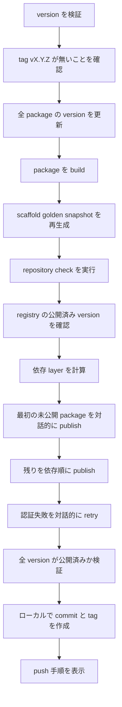
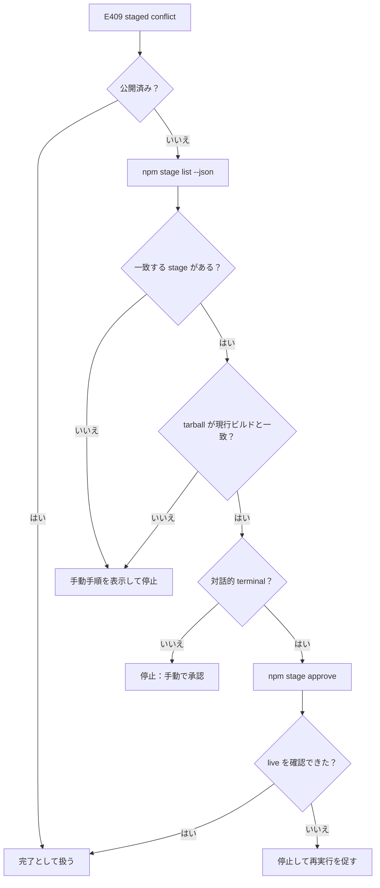

# Release Operations

このページは、Riebeckite の workspace package を npm へ公開する手順を説明します。リリースを実行する maintainer 向けであり、`create-riebeckite` で Site を作るだけの場合には必要ありません。

リリースの entrypoint は次のとおりです。

```bash id="r3xk1a"
pnpm release <version>
```

これは repository root で `node scripts/release.mjs <version>` を実行します。

この script は **冪等かつ再開可能** になるように設計されています。同じ version を中断後に再実行しても、まだ公開されていない package だけを処理します。

## 前提条件

- staged publishing の command（`npm stage ...`）を使うには npm CLI 11.15.0 以降と Node.js 22.14.0 以降が必要です。
- すべての `@riebeckite/*` package への書き込み権限が必要です。
- account で二要素認証を有効にしておく必要があります。`npm stage approve` は npm CLI 自身の対話的な二要素 prompt を開きます。

release script は独自の認証や one-time password の prompt を実装しません。npm / pnpm CLI に委譲するため、既存の npm login、security key、passkey、OTP の設定がそのまま使われます。

## 通常のリリース



通常の実行では次を行います。

1. version を検証し、tag が既に存在する場合は続行しません。
2. `scripts/bump_version.mjs` で全公開 package の version を更新します。
3. `pnpm build:packages` で package を build します。
4. scaffold golden snapshot を再生成し、repository check を実行します。
5. npm にその version で公開済みの package を問い合わせます。
6. npm / pnpm が認証できるよう、最初の未公開 package を対話的に publish し、残りを依存 layer 順に上限付きの並列度で publish します。
7. 全 package の version が registry 上で公開済みか検証します。
8. ローカルの `release vX.Y.Z` commit と tag を作成し、push の command を表示します。

push は自動実行されません。表示された command を自分で実行してください。

### Option

| Option | 用途 |
| --- | --- |
| `--dry-run` | publish や git object の作成を行わず、検証・bump・build のみ行う |
| `--check-only` | repository check だけを実行する |
| `--help`, `-h` | usage を表示する |

## 冪等なリリースと再開

判断の基準は registry です。script はローカルの記録を公開成功の根拠として扱いません。

- **公開済み package は skip します**。 各 publish の前に registry を確認するため、同じ version を再実行しても公開済みを再 publish しません。
- **version bump は冪等です**。 既にその version の package へ bump しても同じ内容を書き直すだけです。
- **失敗した実行は version を bump 済みのまま残します**。 原因を直した後 `pnpm release <version>` を再実行すると、残りの package だけを処理します。
- **最終検証で registry を再確認します**。 全 package の version が公開済みと確認できた後にだけ commit と tag を作成します。

commit はあるが tag が無い（またはその逆）場合も、release を再実行してください。publish は skip され、足りない git object が作成されます。

## リリースの状態

| 状態 | 意味 | 情報源 |
| --- | --- | --- |
| 未公開 | `name@version` に対して registry が 404 を返した | `npm view` |
| 公開済み | registry がその version を返した | `npm view` |
| staging 済み・承認待ち | staged version として存在し、直接 publish できない | `npm stage list` |
| 状態不明 | registry を確実に問い合わせられなかった | なし |

**状態不明は停止状態です**。 script は推測しません。registry の状態を確定できない場合（network 障害、timeout、想定外の応答）、未公開と仮定せず、release を停止して確認すべき内容を表示します。

## staging と承認

staged publishing を使うと、version が live になる前にレビューできます。staged version は公開済み version と同じ version index を共有するため、その version の直接 publish を妨げます。

staged 操作には必ず公式の npm CLI を使用してください。

| Command | 用途 |
| --- | --- |
| `npm stage list <package-name> --json` | package の staged version を一覧表示する |
| `npm stage view <stage-id>` | staged version を 1 件表示する |
| `npm stage approve <stage-id>` | staged version を承認して publish する（対話的な二要素認証） |
| `npm stage reject <stage-id>` | staged version を削除する（二要素認証が必要） |

release script は `npm stage list` で staged version を確認します。一覧を取得できない場合は publish せず停止します。未公開 package に対応する staged version があり、その tarball が現行ビルドと一致すると確認できた場合のみ、対話的に承認して公開済みとして扱います。一致を確認できない場合は停止し、stage を確認・reject する command を表示します。script 自身が staging を行うことはなく、二要素認証を迂回することもありません。

## E409 への対応

`Cannot publish over previously staged version "<version>".` を伴う `409 Conflict` は、その version が既に staging され承認待ちであることを意味します。成功でもなく、無視してもいけません。

script は package の E409 を検出すると次を行います。

1. その version が公開済みか再確認します。
2. `npm stage list <package-name> --json` で staged version を一覧表示します。
3. staged された tarball が現行ビルドと一致することを確認します。
4. terminal が対話的であれば `npm stage approve <stage-id>` で該当 stage を承認します。
5. 続行する前に、その version が live であることを確認します。

自動で完了できない手順がある場合（`npm stage list` を取得できない場合や、staged された tarball の一致を確認できない場合を含む）、release は実行すべき正確な command を表示して停止します。同じ publish を retry しないため、staged conflict が無限 loop になることはありません。



## 公開済み・承認待ちの確認

release を実行せずに 1 つの package を確認するには次を使います。

```bash id="8hs4lp"
npm view @riebeckite/<package>@<version> version
npm stage list @riebeckite/<package> --json
```

`npm view` が version を返せば公開済みです。`npm view` が `E404` を返せば未公開です。`npm stage list` は staging され承認待ちの version を表示します。

## 中断後の再開

1. 失敗時の出力を読んでください。script は package、version、分類した状態、次に必要な操作を表示します。
2. 原因を解消します。
   - **staged conflict:** 上記のとおり staged version を承認または reject します。
   - **権限エラー（403）:** 組織の membership、package の access、account の二要素 policy を確認します。403 は単純な sign-in 失敗としては扱われません。
   - **not found（404）:** package 名が正しいか、作成可能かを確認します。
   - **一時的な network エラー:** script が上限付きで retry 済みです。再実行して続行します。
   - **状態不明:** retry する前に registry を手動で確認します。
3. `pnpm release <version>` を再実行します。公開済み package は skip され、残りの作業だけを行います。

## 部分公開中にしてはいけない操作

- 同じリリース中に version を再度 bump しないでください。同じ version を再実行します。
- script が処理する package に対して `npm publish` や `pnpm publish` を手動実行しないでください。staged conflict や重複 publish の原因になります。
- registry に到達できるか、名前が正しいかを確認せずに、404 を未公開と決めつけないでください。
- script が全 version の公開を確認する前に、release tag を手動で作成しないでください。
- ローカルの検証が成功する前に、release commit や tag を push しないでください。

## リリースの検証

script の最終手順は、全 package の version が公開済みであることを確認し、すべて確認できたときだけ次の完了行を表示します。

```text id="4jn2wr"
RELEASE COMPLETE: 84/84 package versions published as <version>.
```

1 つでも未確認の version があれば、この行は表示されず、commit や tag も作成されません。

## Test

リリースの挙動は、npm へ公開しない test で検証されています。

```bash id="c9t6ym"
pnpm test:release
```

この suite は npm / pnpm の呼び出しを mock し、全 package 未公開、全 package 公開済み、部分公開、E409 の staged conflict、権限エラー、E404 応答、反映遅延、network timeout、重複 publish の防止、最終検証の失敗を検証します。さらに、CLI エントリポイント経由で staged conflict からの再開を通しで検証し、実 `npm stage list` の JSON の出力形式を mock registry に対して検証します。

責務の全体像は [Architecture](./architecture.ja.md)、テスト方針は [Testing](./testing.ja.md)、CLI については [CLI](../reference/cli.ja.md) を参照してください。
