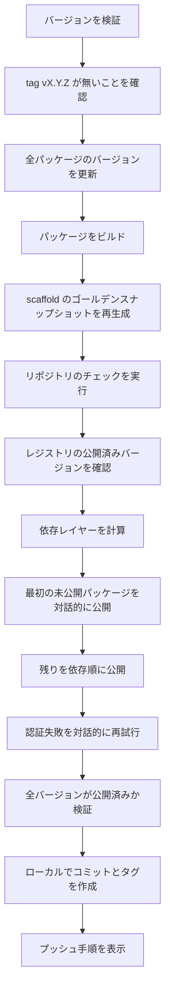

# リリース作業

このページは、Riebeckite のワークスペースパッケージを npm へ公開する手順を説明します。リリースを実行するメンテナー向けであり、`create-riebeckite` でサイトを作るだけの場合には必要ありません。

リリースのエントリーポイントは次のとおりです。

```bash id="r3xk1a"
pnpm release <version>
```

これはリポジトリのルートで `node scripts/release.mjs <version>` を実行します。

このスクリプトは **冪等かつ再開可能** になるように設計されています。同じバージョンを中断後に再実行しても、まだ公開されていないパッケージだけを処理します。

## 前提条件

- すべての `@riebeckite/*` パッケージへの書き込み権限が必要です。

リリーススクリプトは独自の認証やワンタイムパスワードの入力処理を実装しません。npm / pnpm CLI に委譲するため、既存の npm login、セキュリティキー、パスキー、OTP の設定がそのまま使われます。

## 通常のリリース



通常の実行では次を行います。

1. バージョンを検証し、タグが既に存在する場合は続行しません。
2. `scripts/bump_version.mjs` で全公開パッケージのバージョンを更新します。
3. `pnpm build:packages` でパッケージをビルドします。
4. scaffold のゴールデンスナップショットを再生成し、リポジトリのチェックを実行します。
5. npm にそのバージョンで公開済みのパッケージを問い合わせます。
6. npm / pnpm が認証できるよう、最初の未公開パッケージを対話的に公開し、残りを依存レイヤー順に上限付きの並列度で公開します。
7. 全パッケージのバージョンがレジストリ上で公開済みか検証します。
8. ローカルの `release vX.Y.Z` コミットとタグを作成し、プッシュ用のコマンドを表示します。

プッシュは自動実行されません。表示されたコマンドを自分で実行してください。

### オプション

| オプション | 用途 |
| --- | --- |
| `--dry-run` | 公開や Git オブジェクトの作成を行わず、検証・バージョン更新・ビルドのみを行う |
| `--check-only` | リポジトリのチェックだけを実行する |
| `--help`, `-h` | 使い方を表示する |

## 冪等なリリースと再開

判断の基準はレジストリです。スクリプトはローカルの記録を公開成功の根拠として扱いません。

- **公開済みのパッケージはスキップします。** 各公開の前にレジストリを確認するため、同じバージョンを再実行しても公開済みのものを再公開しません。
- **バージョン更新は冪等です。** 既にそのバージョンのパッケージへ更新しても、同じ内容を書き直すだけです。
- **失敗した実行はバージョンを更新済みのまま残します。** 原因を直した後に `pnpm release <version>` を再実行すると、残りのパッケージだけを処理します。
- **最終検証でレジストリを再確認します。** 全パッケージのバージョンが公開済みと確認できた後にだけ、コミットとタグを作成します。

コミットはあるがタグが無い（またはその逆）場合も、リリースを再実行してください。公開はスキップされ、足りない Git オブジェクトが作成されます。

## リリースの状態

| 状態 | 意味 | 情報源 |
| --- | --- | --- |
| 未公開 | `name@version` に対してレジストリが 404 を返した | `npm view` |
| 公開済み | レジストリがそのバージョンを返した | `npm view` |
| 状態不明 | レジストリを確実に問い合わせられなかった | なし |

**状態不明は停止状態です**。スクリプトは推測しません。レジストリの状態を確定できない場合（ネットワーク障害、タイムアウト、想定外の応答）、未公開と仮定せず、リリースを停止して確認すべき内容を表示します。

## E409 への対応

`409 Conflict` は成功として扱いません。公開コマンドの失敗後に `npm view` を再確認し、公開済みと確認できた場合だけ続行します。未公開、またはレジストリの状態を確定できない場合は、競合した公開を再試行せず停止します。

## 公開済みバージョンの確認

リリースを実行せずに 1 つのパッケージを確認するには、次を使います。

```bash id="8hs4lp"
npm view @riebeckite/<package>@<version> version
```

`npm view` がバージョンを返せば公開済みです。`npm view` が `E404` を返せば未公開です。

## 中断後の再開

1. 失敗時の出力を読んでください。スクリプトはパッケージ、バージョン、分類した状態、次に必要な操作を表示します。
2. 原因を解消します。
   - **バージョン競合（409）:** 新しいバージョンを選ぶか再試行する前に、パッケージバージョンの状態を確認します。
   - **権限エラー（403）:** 組織のメンバーシップ、パッケージのアクセス権、アカウントの二要素認証ポリシーを確認します。403 は単純なサインイン失敗としては扱われません。
   - **見つからない（404）:** パッケージ名が正しいか、作成可能かを確認します。
   - **一時的なネットワークエラー:** スクリプトが上限付きで再試行済みです。再実行して続行します。
   - **状態不明:** 再試行する前にレジストリを手動で確認します。
3. `pnpm release <version>` を再実行します。公開済みのパッケージはスキップされ、残りの作業だけを行います。

## 部分公開中にしてはいけない操作

- 同じリリース中にバージョンを再度更新しないでください。同じバージョンを再実行します。
- スクリプトが処理するパッケージに対して `npm publish` や `pnpm publish` を手動実行しないでください。バージョン競合や重複公開の原因になります。
- レジストリに到達できるか、名前が正しいかを確認せずに、404 を未公開と決めつけないでください。
- スクリプトが全バージョンの公開を確認する前に、リリースタグを手動で作成しないでください。
- ローカルの検証が成功する前に、リリースコミットやタグをプッシュしないでください。

## リリースの検証

スクリプトの最終手順では最大 15 分間レジストリを再確認し、全パッケージのバージョンが公開済みであることを確認できたときだけ、次の完了行を表示します。

```text id="4jn2wr"
RELEASE COMPLETE: 84/84 package versions published as <version>.
```

1 つでも未確認のバージョンがあれば、この行は表示されず、コミットやタグも作成されません。

## テスト

リリースの挙動は、npm へ公開しないテストで検証されています。

```bash id="c9t6ym"
pnpm test:release
```

このテストスイートは npm / pnpm の呼び出しをモックし、未公開・公開済みバージョン、部分公開からの再開、認証・権限エラー、E409 のバージョン競合、レジストリ問い合わせの失敗、公開応答の喪失、反映遅延、上限付きの再試行、重複公開の防止、最終検証の失敗を検証します。

責務の全体像は [アーキテクチャ](./architecture.ja.md)、テスト方針は [テスト](./testing.ja.md)、CLI については [CLI](../reference/cli.ja.md) を参照してください。
