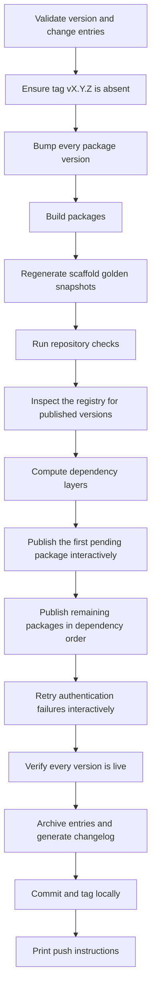

# Release Operations

This page describes how to publish the Riebeckite workspace packages to npm. It is for maintainers who run releases; it is not needed to build a site with `create-riebeckite`.

The release entrypoint is:

```bash
pnpm release <version>
```

This runs `node scripts/release.mjs <version>` from the repository root.

The script is designed to be **idempotent and resumable**. Re-running the same version after an interruption only processes the packages that are still missing.

## Change entries

User-facing changes are recorded before release as Markdown entries under `changes/unreleased/`. An entry lists the affected packages, one Keep a Changelog type (`added`, `changed`, `deprecated`, `removed`, `fixed`, or `security`), whether it is breaking, the migration steps, and related PR, issue, or ADR links. See [`changes/README.md`](../../../changes/README.md) for the format.

```bash
pnpm changes:new my-change   # create an entry from the template
pnpm changelog       # regenerate CHANGELOG.md and the release notes pages
pnpm check:changes   # validate entries and generated files
```

A release validates every pending entry before it builds or publishes anything. After the registry confirms that every package version is live, it moves the entries to `changes/released/<version>/entries/` and generates:

- `CHANGELOG.md` at the repository root
- `docs/docs/releases.md` and `docs/docs/releases.ja.md`
- `changes/released/<version>/release-notes.md` for GitHub Releases

Re-running a release after the entries were archived regenerates the same files instead of appending the version twice.

## Versioning before 1.0

Riebeckite is below 1.0. Patch releases should contain compatible fixes. Minor releases may contain breaking changes, and every breaking change must be marked in its entry with migration steps. From 1.0 onward, breaking changes follow semantic versioning and require a major release.

The changelog starts when change entries were introduced. Earlier releases remain available as Git tags and GitHub Releases; their notes are not reconstructed from commit messages.

## Documentation and npm versions

The documentation site is built from `main`, while the npm `latest` tag changes only when a release completes. A page can therefore describe a feature that is not in the version a reader installs.

- Treat the registry, not this site, as the source of truth for what is installable: run `npm view @riebeckite/cli version`.
- Publish every workspace package in the same release. A partial release leaves `@riebeckite/honox` and its dependencies at incompatible versions.
- Publish the npm release before announcing the corresponding feature. When the site is ahead of the registry, the installation page tells readers how to check the installable version.
- After a release, confirm the installation path with a fresh `npx create-riebeckite` outside the repository.

## Prerequisites

- Write access to every `@riebeckite/*` package.

The release script never implements its own authentication or one-time-password prompt. It delegates to the npm and pnpm CLI, so your existing npm login, security key, passkey, or OTP configuration is used as-is.

## Transactional site output

Production HonoX builds stage client assets and generated SSG output under `.riebeckite/`. The final `build.outDir` is replaced only after the complete staged output and its cache inventory have been written. A failed build discards the staged directory and leaves the last published output in place. Do not deploy `.riebeckite/build-output` directly; deploy only the configured `build.outDir` after the build succeeds.

## Normal release



A normal run does the following:

1. Validates the version, the pending change entries, and the absence of the tag.
2. Bumps every public package with `scripts/bump_version.mjs`.
3. Builds the packages with `pnpm build:packages`.
4. Regenerates the scaffold golden snapshots and runs the repository checks.
5. Queries npm for the packages already published at that version.
6. Publishes one pending package interactively so that npm/pnpm can authenticate, then publishes the rest in dependency-layer order with bounded concurrency.
7. Verifies that every package version is live on the registry.
8. Archives the change entries and regenerates the changelog and release notes.
9. Creates the local `release vX.Y.Z` commit and tag, and prints the push commands.

Pushing the tag lets the `Release` GitHub Actions workflow create the GitHub Release from `changes/released/<version>/release-notes.md`. The release script still does not push anything.

The push is never performed automatically. Run the printed commands yourself.

### Options

| Option | Purpose |
| --- | --- |
| `--dry-run` | Validate the version and change entries, bump in dry-run mode, and build without publishing, archiving entries, or creating git objects. |
| `--check-only` | Run the repository checks only. |
| `--help`, `-h` | Show usage. |

## Idempotent and resumable releases

The registry is the single source of truth. The script never treats a local record as proof that a package was published.

- **Published packages are skipped.** Each publish is preceded by a registry lookup, so re-running the same version does not republish what is already live.
- **Version bumping is idempotent.** Bumping to a version that the packages already use rewrites the same content.
- **A failed run leaves the version bumped.** After fixing the cause, re-run `pnpm release <version>`; only the remaining packages are processed.
- **The final verification re-checks the registry.** A commit and tag are only created after every package version is confirmed live.

If a commit already exists but the tag does not (or the reverse), re-run the release: publishing is skipped and the missing git object is created.

## Release states

| State | Meaning | Source of truth |
| --- | --- | --- |
| Unpublished | The registry returned 404 for `name@version`. | `npm view` |
| Published | The registry returned the version. | `npm view` |
| Unknown | The registry could not be queried reliably. | None |

**Unknown is a stop state.** The script refuses to guess. If the registry state cannot be determined (network failure, timeout, unexpected response), the release stops and prints what to check instead of assuming a package is unpublished.

## Handling E409

A `409 Conflict` is not treated as success. The script re-checks `npm view` once the publish command has failed. If the version is confirmed published, it continues; if the registry says it is unpublished or cannot be queried reliably, it stops without retrying the conflicting publish.

## Checking published versions

To check a single package without running a release:

```bash
npm view @riebeckite/<package>@<version> version
```

`npm view` returning a version means it is published. `npm view` returning `E404` means it is not published.

## Resuming after an interruption

1. Read the failure output. The script prints the package, the version, the classified state, and the next action.
2. Resolve the cause:
   - **Version conflict (409):** inspect the package version before choosing a new version or retrying.
   - **Permission error (403):** check organization membership, package access, and the account two-factor policy. A 403 is not treated as a simple sign-in failure.
   - **Not found (404):** verify the package name and that it can be created.
   - **Transient network error:** the script already retries a bounded number of times; re-run to continue.
   - **Unknown state:** inspect the registry manually before retrying.
3. Re-run `pnpm release <version>`. Published packages are skipped and only the remaining work is done.

## What not to do during a partial release

- Do not bump the version again during the same release. Re-run the same version.
- Do not manually run `npm publish` or `pnpm publish` for packages that the script will handle; this can create a version conflict or a duplicate publish.
- Do not assume a 404 means the package is unpublished without checking that the registry is reachable and the name is correct.
- Do not create the release tag manually before the script confirms every version is live.
- Do not push the release commit or tag before the local verification succeeds.

## Verifying the release

The script's final step polls the registry for up to 15 minutes to confirm that every package version is live, and prints a single completion line only when all of them are verified:

```text
RELEASE COMPLETE: 84/84 package versions published as <version>.
```

If even one version is unconfirmed, the script does not print that line and does not create the commit or tag.

## Tests

The release behavior is covered by tests that never publish to npm:

```bash
pnpm test:release
```

The suite mocks npm and pnpm calls and covers unpublished and published versions, partial-release resumption, authentication and permission failures, E409 version conflicts, registry failures, lost publish responses, propagation lag, bounded retries, duplicate-publish prevention, and final verification failure.

The change-entry and changelog behavior has its own tests:

```bash
pnpm test:changelog
```

They cover multiple entries, duplicate prevention, breaking-change classification, idempotent finalization, interrupted finalization recovery, deterministic release notes, and generated-file checks.

See [Architecture](./architecture.md), [Testing](./testing.md), and [CLI](../reference/cli.md).
