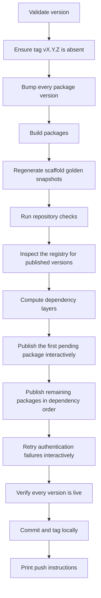
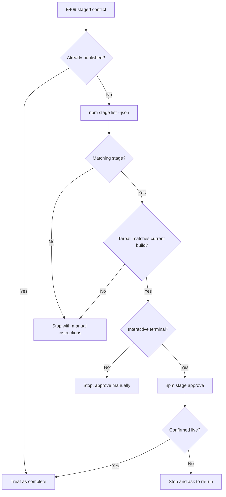

# Release Operations

This page describes how to publish the Riebeckite workspace packages to npm. It is for maintainers who run releases; it is not needed to build a site with `create-riebeckite`.

The release entrypoint is:

```bash
pnpm release <version>
```

This runs `node scripts/release.mjs <version>` from the repository root.

The script is designed to be **idempotent and resumable**. Re-running the same version after an interruption only processes the packages that are still missing.

## Prerequisites

- npm CLI 11.15.0 or newer and Node.js 22.14.0 or newer for staged publishing commands (`npm stage ...`).
- Write access to every `@riebeckite/*` package.
- Two-factor authentication enabled on the account: `npm stage approve` opens the npm CLI's own interactive two-factor prompt.

The release script never implements its own authentication or one-time-password prompt. It delegates to the npm and pnpm CLI, so your existing npm login, security key, passkey, or OTP configuration is used as-is.

## Normal release



A normal run does the following:

1. Validates the version and refuses to continue if the tag already exists.
2. Bumps every public package with `scripts/bump_version.mjs`.
3. Builds the packages with `pnpm build:packages`.
4. Regenerates the scaffold golden snapshots and runs the repository checks.
5. Queries npm for the packages already published at that version.
6. Publishes one pending package interactively so that npm/pnpm can authenticate, then publishes the rest in dependency-layer order with bounded concurrency.
7. Verifies that every package version is live on the registry.
8. Creates the local `release vX.Y.Z` commit and tag, and prints the push commands.

The push is never performed automatically. Run the printed commands yourself.

### Options

| Option | Purpose |
| --- | --- |
| `--dry-run` | Validate, bump, and build without publishing or creating git objects. |
| `--check-only` | Run the repository checks only. |
| `--help`, `-h` | Show usage. |

## Idempotent and resumable releases

The registry is the single source of truth. The script never treats a local record as proof that a package was published.

- **Published packages are skipped.** Each publish is preceded by a registry lookup, so re-running the same version does not republish what is already live.
- **Version bumping is idempotent.** Bumping to a version that the packages already use rewrites the same content.
- **A failed run leaves the version bumped.** After fixing the cause, re-run `pnpm release <version>`; only the remaining packages are processed.
- **The final verification re-checks the registry.** A commit and tag are only created after every package version is confirmed live.

If a commit already exists but the tag does not (or the reverse), re-run the release: publishing is skipped and the missing git object is created.

## Release states

| State | Meaning | Source of truth |
| --- | --- | --- |
| Unpublished | The registry returned 404 for `name@version`. | `npm view` |
| Published | The registry returned the version. | `npm view` |
| Staged, pending approval | The version exists as a staged version and cannot be published directly. | `npm stage list` |
| Unknown | The registry could not be queried reliably. | None |

**Unknown is a stop state.** The script refuses to guess. If the registry state cannot be determined (network failure, timeout, unexpected response), the release stops and prints what to check instead of assuming a package is unpublished.

## Staging and approval

Staged publishing lets a version be reviewed before it goes live. Staged versions share the same version index as published versions, so a staged version blocks a direct publish of that version.

Use the official npm CLI for every staged operation:

| Command | Purpose |
| --- | --- |
| `npm stage list <package-name> --json` | List staged versions of a package. |
| `npm stage view <stage-id>` | Show one staged version. |
| `npm stage approve <stage-id>` | Approve and publish a staged version (interactive two-factor). |
| `npm stage reject <stage-id>` | Remove a staged version (requires two-factor). |

The release script inspects staged versions with `npm stage list`. If the list cannot be read, the release stops instead of publishing blindly. When a pending package already has a matching staged version whose tarball matches the current build, the script approves it (interactively) and treats it as published; if the tarball cannot be proven to match, it stops and prints the commands to inspect or reject the stage. It never stages packages itself, and it never bypasses two-factor authentication.

## Handling E409

A `409 Conflict` with `Cannot publish over previously staged version "<version>".` means the version is already staged and waiting for approval. It is not a success and it is not ignored.

When the script sees E409 for a package it:

1. Re-checks whether the version is published.
2. Lists staged versions with `npm stage list <package-name> --json`.
3. Proves that the staged tarball matches the current build.
4. Approves the matching stage with `npm stage approve <stage-id>` when the terminal is interactive.
5. Confirms the version is live before continuing.

If npm reports an E409 before the staged package appears in `npm stage list`, the release waits for registry propagation before deciding that the stage is absent. If any step still cannot be completed automatically — including when `npm stage list` cannot be read or the staged tarball cannot be proven to match — the release stops with the exact commands to run. It never retries the same publish, so a staged conflict cannot produce an infinite loop.



## Checking published and pending versions

To check a single package without running a release:

```bash
npm view @riebeckite/<package>@<version> version
npm stage list @riebeckite/<package> --json
```

`npm view` returning a version means it is published. `npm view` returning `E404` means it is not published. `npm stage list` shows versions that are staged and waiting for approval.

## Resuming after an interruption

1. Read the failure output. The script prints the package, the version, the classified state, and the next action.
2. Resolve the cause:
   - **Staged conflict:** approve or reject the staged version as described above.
   - **Permission error (403):** check organization membership, package access, and the account two-factor policy. A 403 is not treated as a simple sign-in failure.
   - **Not found (404):** verify the package name and that it can be created.
   - **Transient network error:** the script already retries a bounded number of times; re-run to continue.
   - **Unknown state:** inspect the registry manually before retrying.
3. Re-run `pnpm release <version>`. Published packages are skipped and only the remaining work is done.

## What not to do during a partial release

- Do not bump the version again during the same release. Re-run the same version.
- Do not manually run `npm publish` or `pnpm publish` for packages that the script will handle; this can create a staged conflict or a duplicate publish.
- Do not assume a 404 means the package is unpublished without checking that the registry is reachable and the name is correct.
- Do not create the release tag manually before the script confirms every version is live.
- Do not push the release commit or tag before the local verification succeeds.

## Verifying the release

The script's final step polls the registry for up to 15 minutes to confirm that every package version is live, and prints a single completion line only when all of them are verified:

```text
RELEASE COMPLETE: 84/84 package versions published as <version>.
```

If even one version is unconfirmed, the script does not print that line and does not create the commit or tag.

## Tests

The release behavior is covered by tests that never publish to npm:

```bash
pnpm test:release
```

The suite mocks the npm and pnpm calls and covers an all-unpublished run, a fully published run, partial releases, E409 staged conflicts, permission errors, E404 responses, propagation lag, network timeouts, duplicate-publish prevention, and final verification failure. It also drives the CLI entry point through a full staged-conflict resume and verifies the real `npm stage list` JSON contract against a mock registry.

See [Architecture](./architecture.md), [Testing](./testing.md), and [CLI](../reference/cli.md).
