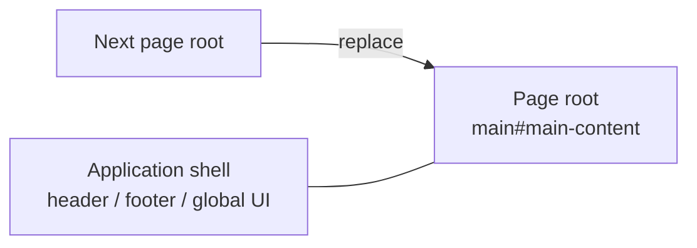

# SPA Navigation

このページでは、SPA navigation を支える構造を説明します。どの Package が関与するか、
通常の load と Page transition がどう違うか、Page ごとの動作をどう置き換えるかを
扱います。Maintainer 向けの内容です。有効にする手順はガイドを参照してください。

## 全体像

Riebeckite は Server rendering を基準にします。SPA navigation は browser 側の
拡張です。

- 通常の load: browser が document を要求し、Server が Page 全体を返し、HonoX が
  island を hydrate する。
- SPA transition: browser が次の document を取得し、runtime が main element を
  置き換え、HonoX が新しい island を hydrate する。Shell は残る。

置き換える単位は Page root であり、document 全体ではありません。



## 最小例

```ts
export default defineConfig({
  site: { title: "My site", baseUrl: "https://example.com" },
  spa: true,
});
```

Renderer の取り決めは、各 Page に安定した `main#main-content` を1つ置くことだけです。
現在の app と scaffold では、`_renderer.tsx` で route content の周りに配置しています。

## 通常の navigation と SPA navigation

通常の navigation:

1. Browser が URL を要求する。
2. Server が HTML を描画する。
3. Browser が document を parse する。
4. HonoX client が island を hydrate する。
5. app と page の initializer が mount する。

SPA navigation:

1. Runtime が click を intercept する。
2. Runtime が対象 URL の HTML を取得する。
3. Runtime が page scope を unmount する。
4. Runtime が head metadata を reconcile する。
5. Runtime が `main#main-content` を置き換える。
6. HonoX の `createClient()` が新しい island を hydrate する。
7. Runtime が新しい root に page scope を mount する。
8. Runtime が history、scroll、focus、announcement を更新する。
9. `riebeckite:navigation` event が発火する。

順序が重要です。Page の cleanup は置き換えの前、Page の初期化は hydration の
後に行います。

## Package の責務

| Package | 責務 |
| --- | --- |
| `@riebeckite/core` | `spa` 設定の解決、`ClientLifecycle`、scope、cleanup の取り決め、plugin client entry の metadata を提供する |
| `@riebeckite/honox` | `virtual:riebeckite/client` を生成し、SPA runtime を条件付きで import し、page の unmount/mount と island hydration を接続する |
| `@riebeckite/spa` | Link interception、fetch、置き換え、head reconciliation、history、scroll、focus、announcement、prefetch を担当する |
| Site application | 安定した page root と app shell を提供し、island または plugin client entry として page の動作を登録する |

SPA package は HonoX や Plugin を知りません。Runtime と `createClient()`、
`ClientLifecycle` を接続するのは HonoX integration だけです。

## app scope と page scope

`ClientLifecycle` は initializer を2つの scope に分けます。

| Scope | Root | 寿命 | 用途 |
| --- | --- | --- | --- |
| `app` | `document` | 最初の client 初期化から dispose まで | Navigation をまたいで残る shell UI |
| `page` | `main#main-content` | 1つの page root | Content ごとの動作 |

`app` initializer は一度だけ mount します。`page` initializer は page root を
置き換える前に unmount し、新しい root に mount し直します。

Initializer は cleanup function を返せます。Unmount は先に initializer の
signal を abort し、その後に cleanup を待ちます。初期化と cleanup の error は
隔離して記録するため、1つの失敗で他の initializer は止まりません。

Lifecycle が cleanup できるのは、initializer が返したものだけです。
`document` に listener を追加し、cleanup を返さない page initializer は、その
Page より長く残ります。Page の動作は渡された root を検索し、置き換わる DOM の
外に作ったものは cleanup で解放してください。

## Island の hydration

HonoX の `createClient()` は、まだ hydrate していない island を hydrate します。
SPA integration は、新しい main element が document に挿入された後にこれを呼びます。
これにより、新しい Page の island は document 全体を reload せずに動作します。

`createClient()` は汎用の unmount API ではありません。古い main element を削除すると、
その DOM と DOM に紐づく listener は消えますが、HonoX が任意の island state を破棄
するわけではありません。Timer、observer、network request など、明示的に解放する
ものは page scope の cleanup で扱います。

## 失敗時の fallback

Transition を完了できない場合、runtime は通常の document navigation に
fallback します。例:

- fetch に失敗した、または成功 status 以外が返った
- 取得した response に `main#main-content` がない
- 現在の Page に `main#main-content` がない
- page commit または head の置き換えで例外が起きた

新しい navigation が始まると、古い navigation は abort されます。Abort された
navigation は fallback せず、新しい navigation が Page を引き継ぎます。

View transition は任意です。Browser が API に対応していない場合や、動きの抑制が要求
されている場合は、transition なしで commit します。

## 設計上の制約

- SPA navigation は progressive enhancement であり、router ではありません。
  各 URL は Server が描画します。
- 対象は同一 origin の GET link だけです。Form と programmatic な navigation
  は対象外です。
- Application shell は `main#main-content` の外側に置く必要があります。
- Head reconciliation の対象は決まった metadata だけです。任意の Page script
  を clone したり実行したりしません。
- Plugin の page entry は lifecycle に合わせる必要があります。渡された root を
  使い、cleanup を返し、abort signal を尊重してください。
- SPA 無効時の build は SPA package を import しません。

## 関連ページ

- [SPA navigation を有効にする](../guides/spa-navigation.ja.md)
- [SPA runtime の内部実装](./spa-runtime.ja.md)
- [HonoX Integration](./honox-integration.ja.md)
- [Page System](./page-system.ja.md)
