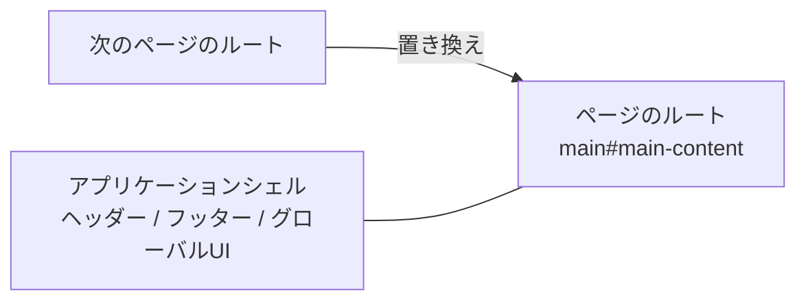

# SPAナビゲーションの構成

このページでは、SPAナビゲーションを支える構造を、保守する開発者向けに説明します。どのパッケージが関与するか、通常の読み込みとページ移動がどう違うか、ページごとの動作をどう置き換えるかを扱います。有効にする手順は [利用者向けガイド](../guides/spa-navigation.ja.md) を参照してください。

## SPAナビゲーションの全体像

Riebeckiteは、サーバーでの描画を基準にします。SPAナビゲーションは、その仕組みを保ったままブラウザ側だけを強化する拡張です。

- 通常の読み込みでは、ブラウザがHTML文書を要求し、サーバーがページ全体を返し、HonoXがislandをhydrateします。
- SPAナビゲーションでは、ブラウザが次のHTML文書を取得し、ランタイムがmain要素を置き換え、HonoXが新しいislandをhydrateします。アプリケーションシェルは残ります。

置き換える単位はページのルートであり、HTML文書全体ではありません。



## 最小構成

```ts
export default defineConfig({
  site: { title: "My site", baseUrl: "https://example.com" },
  spa: true,
});
```

ページを描画する側の取り決めは、各ページに安定した `main#main-content` を1つ置くことだけです。現在のアプリケーションと雛形では、`_renderer.tsx` でルートの内容を囲む位置に配置しています。

## 通常の読み込みとSPAナビゲーション

通常の読み込みでは、次の順序で処理が進みます。

1. ブラウザがURLを要求する。
2. サーバーがHTMLを描画する。
3. ブラウザがHTML文書を解析する。
4. HonoXのクライアントがislandをhydrateする。
5. アプリケーションとページの初期化処理が実行される。

SPAナビゲーションでは、次の順序で処理が進みます。

1. ランタイムがクリックを横取りする。
2. ランタイムが対象URLのHTMLを取得する。
3. ランタイムがページスコープをunmountする。
4. ランタイムがheadのメタデータを更新する。
5. ランタイムが `main#main-content` を置き換える。
6. HonoXの `createClient()` が新しいislandをhydrateする。
7. ランタイムが新しいルートにページスコープをmountする。
8. ランタイムが履歴、スクロール位置、フォーカス、通知を更新する。
9. `riebeckite:navigation` イベントが発火する。

順序が重要です。ページの後始末は置き換えの前に、ページの初期化はhydrationの後に行います。

## パッケージごとの役割

| パッケージ | 責務 |
| --- | --- |
| `@riebeckite/core` | `spa` 設定の解決、`ClientLifecycle`、スコープ、クリーンアップの取り決め、Pluginのクライアントエントリのメタデータを提供する |
| `@riebeckite/honox` | `virtual:riebeckite/client` を生成し、SPAランタイムを条件付きで読み込み、ページのunmount・mountとislandのhydrationを接続する |
| `@riebeckite/spa` | リンクの横取り、取得、mainの置き換え、headの更新、履歴、スクロール、フォーカス、通知、先読みを担当する |
| サイトアプリケーション | 安定したページのルートとアプリケーションシェルを提供し、islandまたはPluginのクライアントエントリとしてページの動作を登録する |

SPAパッケージは、HonoXやPluginの存在を知りません。ランタイムと `createClient()`、`ClientLifecycle` を接続するのはHonoXとの連携だけです。

## アプリケーションスコープとページスコープ

`ClientLifecycle` は、初期化処理を2つのスコープに分けます。

| スコープ | ルート | 寿命 | 用途 |
| --- | --- | --- | --- |
| `app` | `document` | 最初のクライアント初期化から破棄まで | ページ移動をまたいで残るシェルUI |
| `page` | `main#main-content` | 1つのページのルート | ページの内容に固有の動作 |

`app` の初期化処理は一度だけ実行されます。`page` の初期化処理は、ページのルートを置き換える前にunmountされ、新しいルートにmountし直されます。

初期化処理は、クリーンアップ関数を返せます。`initializerArguments: "context"` を指定すると、`{ root, config, signal, scope }` も受け取れます。`scope` では、イベントリスナー、タイムアウト、インターバル、独自のクリーンアップを登録できます。

unmountは共有スコープの `signal` を先に中断し、登録済みのリソースを破棄してから、クリーンアップの完了を待ちます。初期化とクリーンアップで起きたエラーは個別に記録されるため、1つの失敗でほかの初期化処理は止まりません。

ページの動作は、渡されたルートを基点にしてください。置き換わるDOMの外に作ったリソースは、リソーススコープへ登録するか、返したクリーンアップ関数で解放する必要があります。

## islandの初期化（hydration）

HonoXの `createClient()` は、まだhydrateしていないislandをhydrateします。SPAとの連携では、新しいmain要素がHTML文書に挿入された後にこれを呼びます。これにより、新しいページのislandは、HTML文書全体を再読み込みせずに動作します。

`createClient()` は、汎用的なunmount APIではありません。古いmain要素を削除すると、そのDOMとDOMに紐づくリスナーは消えますが、HonoXが任意のislandの状態を破棄するわけではありません。タイマー、オブザーバー、ネットワークリクエストなど、明示的に解放するものは、ページスコープのクリーンアップで扱います。

## 失敗時のフォールバック

ページ移動を完了できない場合、ランタイムはページ全体の読み込みにフォールバックします。たとえば、次のような場合です。

- 取得に失敗した、または成功以外のステータスが返った
- 取得したレスポンスに `main#main-content` がない
- 現在のページに `main#main-content` がない
- リダイレクト先が現在のオリジンの外である
- mainを置き換える前に、ページの後始末やheadの更新で例外が起きた
- mainを置き換えた後に、コミット処理のフックで例外が起きた

新しいページ移動が始まると、古いページ移動は中断されます。中断されたページ移動はフォールバックせず、新しいページ移動がページを引き継ぎます。

View Transitionは任意です。ブラウザがAPIに対応していない場合や、`prefers-reduced-motion` によって動きの抑制が要求されている場合は、トランジションなしでページ内容を反映します。

## 設計上の制約

- SPAナビゲーションは、サーバー描画を前提にした段階的な拡張であり、ルーターではありません。各URLはサーバーが描画します。
- 対象は同一オリジンのGETリンクだけです。フォームとプログラムからのページ移動は対象外です。
- アプリケーションシェルは、`main#main-content` の外側に置く必要があります。
- `data-riebeckite-head="page"` を付けたhead要素は置き換えます。`global` と `runtime` を付けた要素は残します。互換性のため、従来のメタデータのセレクタもページ所有として扱います。
- 実行可能な `<script>` は、ページ所有の属性が付いていても置き換えず、再実行しません。所有権を示す属性がない `<script>` と `<style>` は残ります。
- Pluginが生成するheadタグには、ページ所有の属性が自動で付きます。それ以外のPluginのページタグは、属性を明示して対象に含めます。
- Pluginのページエントリは、ライフサイクルに合わせる必要があります。渡されたルートを使い、外部のリソースは `scope` に登録するかクリーンアップ関数で解放し、中断用の `signal` を尊重してください。
- SPAを無効にしたビルドは、SPAパッケージを読み込みません。

## 関連ページ

- [SPAナビゲーションを有効にする](../guides/spa-navigation.ja.md)
- [SPAランタイムの内部実装](./spa-runtime.ja.md)
- [HonoXとの連携](./honox-integration.ja.md)
- [Page System](./page-system.ja.md)
