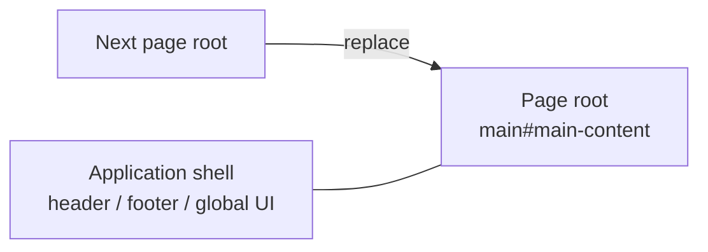

# SPA Navigation

This page explains the structure behind SPA navigation: which packages
participate, how a page transition differs from a normal load, and how
page-scoped behavior is replaced. It is for maintainers. To enable SPA
navigation in a site, see the guide.

## The big picture

Riebeckite keeps server rendering as the source of truth. SPA navigation is a
browser enhancement:

- Normal load: the browser requests a document, the server returns the full
  page, and HonoX hydrates islands.
- SPA transition: the browser fetches the next document, the runtime replaces
  the main element, HonoX hydrates the new islands, and the shell stays.

The unit of replacement is the page root, not the whole document.



## Minimal example

```ts
export default defineConfig({
  site: { title: "My site", baseUrl: "https://example.com" },
  spa: true,
});
```

The only renderer contract is one stable `main#main-content` per page. The
current app and scaffolds place it in `_renderer.tsx` around the route content.

## Normal navigation and SPA navigation

Normal navigation:

1. The browser requests the URL.
2. The server renders HTML.
3. The browser parses the document.
4. The HonoX client hydrates islands.
5. App and page initializers mount.

SPA navigation:

1. The runtime intercepts a click.
2. The runtime fetches HTML for the target URL.
3. The runtime unmounts page scope.
4. The runtime reconciles head metadata.
5. The runtime replaces `main#main-content`.
6. HonoX `createClient()` hydrates the new islands.
7. The runtime mounts page scope on the new root.
8. The runtime updates history, scroll, focus, and announcement.
9. The `riebeckite:navigation` event fires.

The order matters: page cleanup happens before replacement, and page
initialization happens after hydration.

## Package responsibilities

| Package | Responsibility |
| --- | --- |
| `@riebeckite/core` | Resolves `spa` config; defines `ClientLifecycle`, scopes, the cleanup contract, and plugin client-entry metadata. |
| `@riebeckite/honox` | Generates `virtual:riebeckite/client`; conditionally imports the SPA runtime; wires page unmount/mount and island hydration. |
| `@riebeckite/spa` | Owns link interception, fetch, replacement, head reconciliation, history, scroll, focus, announcement, and prefetch. |
| Site application | Provides the stable page root and app shell; registers page behavior through islands or plugin client entries. |

The SPA package does not know about HonoX or plugins. The HonoX integration is
the only place that connects the runtime to `createClient()` and
`ClientLifecycle`.

## app and page scopes

`ClientLifecycle` groups initializers into two scopes:

| Scope | Root | Lifetime | Use for |
| --- | --- | --- | --- |
| `app` | `document` | First client initialization until disposal | Shell UI that survives navigation |
| `page` | `main#main-content` | One page root | Content-specific behavior |

`app` initializers mount once. `page` initializers unmount before the page root
is replaced, then mount again on the new root.

An initializer may return a cleanup function. Unmount aborts the initializer's
signal first, then awaits cleanup. Initialization and cleanup errors are
isolated and logged; one failing initializer does not stop the others.

The lifecycle can only clean up what an initializer returns. A page initializer
that attaches a listener to `document` without returning cleanup will outlive
its page. Page behavior should query the supplied root and return cleanup for
anything outside the replaced DOM.

## Islands and hydration

HonoX `createClient()` hydrates islands that have not been hydrated yet. The SPA
integration calls it after the new main element is in the document. This is why
islands inside the new page work without a full reload.

`createClient()` is not a general unmount API. Removing the old main element
removes its DOM and DOM-bound listeners, but HonoX does not tear down arbitrary
island state. Page-scope cleanup is the place for timers, observers, network
requests, and other resources that must be released.

## Failure and fallback

The runtime falls back to a normal document navigation when it cannot complete a
transition, for example:

- the fetch fails or returns a non-success status
- the fetched response has no `main#main-content`
- the current page has no `main#main-content`
- page commit or head replacement throws

A newer navigation aborts the older one. An aborted navigation does not fall
back; the newer navigation owns the page.

View transitions are optional. If the browser does not support the API, or
reduced motion is requested, the commit runs without a transition.

## Design constraints

- SPA navigation is progressive enhancement, not a router. The server still
  renders every URL.
- Only same-origin GET links are handled; forms and programmatic navigation are
  out of scope.
- The application shell must stay outside `main#main-content`.
- Head reconciliation covers a fixed metadata set; arbitrary page scripts are
  not cloned or executed.
- Plugin page entries must cooperate with the lifecycle: use the supplied root,
  return cleanup, and respect the abort signal.
- SPA-off builds do not import the SPA package.

## Related

- [Enable SPA navigation](../guides/spa-navigation.md)
- [SPA runtime internals](./spa-runtime.md)
- [HonoX integration](./honox-integration.md)
- [Page system](./page-system.md)
