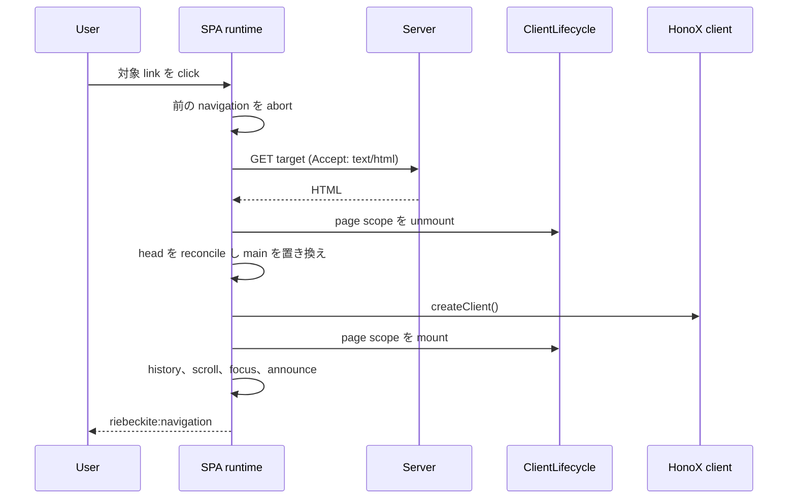

# SPA Runtime の内部実装

このページでは、SPA navigation を実現する browser runtime の実装を説明します。
Link の判定、navigation transaction、cancellation、head の更新、history と
scroll、prefetch、生成される client code、現在の検証範囲を扱います。Package
全体の構造は [構成のページ](./spa-navigation.ja.md) を先に読んでください。

## Transaction の全体像



## 生成される client module

HonoX integration は `virtual:riebeckite/client` を提供します。`spa` が有効な
場合、生成 module は runtime を一度だけ開始します。

```ts
stopSpaNavigation ??= startSpaNavigation({
  ...spaConfig,
  onBeforePageCommit: () => lifecycle.unmount("page"),
  onPageCommit: async ({ root }) => {
    await createClient();
    mountPageClientInitializers(root);
  },
});
```

`spaConfig` は serialize された options object です。Module は、解決済みの
`spa` 値がある場合だけ `honox/client` の `createClient` と
`@riebeckite/spa` の `startSpaNavigation` を import します。

生成 module の export:

- `initRiebeckiteClient()` — app と page の initializer を mount し、SPA
  navigation を開始する
- `remountRiebeckitePage(root)` — page scope を unmount し、指定した root に
  mount する
- `disposeRiebeckiteClient()` — SPA navigation を停止し、両方の scope を
  dispose する

Site の code が通常呼ぶのは `initRiebeckiteClient()` だけです。残りは custom
integration と破棄のための export です。

## Link の判定

`startSpaNavigation` は document の click を監視します。次の条件を満たす
click を処理します。

- `defaultPrevented` ではない
- 主 button である
- meta / ctrl / shift / alt が押されていない
- 最も近い `a[href]` が `shouldNavigate` を満たす
- 現在の Page の hash だけを変える navigation ではない

`shouldNavigate` の条件:

- `target` がない、または `_self`
- `download` がない
- `data-spa="false"` がない
- 同一 origin かつ同一 protocol

Hash だけの navigation は、同じ pathname と search を持ち、hash が空でない場合です。
これは browser の in-page anchor に任せます。

`popstate` は link の判定を使いません。現在の URL に対して `popstate: true`
で transaction を開始します。

## Navigation と cancellation

Navigation ごとに `AbortController` を作ります。新しい navigation が始まると、前の
navigation を abort します。

`navigate` の処理:

1. scroll restoration が有効なら、現在の scroll 位置を `history.state` に保存する。
2. `Accept: text/html` で target を fetch する。
3. `DOMParser` で response を parse する。
4. 取得した document と現在の document の両方に `main#main-content` があることを
   確認する。
5. Response URL から最終 URL を求め、redirect を反映する。
6. `onBeforePageCommit(signal)` を実行する。
7. Head を reconcile し、現在の main を取得した main で置き換える。
8. `onPageCommit({ root, signal })` を実行する。
9. View transition を使う場合は完了を待つ。
10. Click navigation なら history を push し、scroll を復元する。
11. Page root に focus し、新しい Page を announce する。
12. `riebeckite:navigation` を dispatch する。

Runtime は await の境界で signal を確認します。Abort された navigation は
history を更新せず、event も dispatch しません。

Abort されていない error が起きた場合、runtime は
`window.location.assign(url.href)` を呼びます。これが document navigation への
fallback です。

## Head reconciliation

Main element を置き換える前に、runtime は document head を更新します。

- 取得した Page の `document.title` を設定する。
- `<html lang>` と `<html dir>` をコピーし、取得元にない場合は削除する。
- 現在の head から、page-owned の selector に一致する child を削除する。
- 取得した Page の head から、同じ selector に一致する child を clone して追加する。

Page-owned として扱う selector:

- `link[rel="canonical"]`、`link[hreflang]`
- `script[type="application/ld+json"]`
- `meta[name="description"]`、`meta[name="author"]`、
  `meta[name="robots"]`
- `meta[name^="twitter:"]`
- `meta[property^="og:"]`、`meta[property^="article:"]`

それ以外の head child は残ります。任意の Plugin node を ownership key で判定する
仕組みはなく、JSON-LD 以外の script は clone も実行もしません。

## History、scroll、focus、announcement

Scroll restoration:

- 有効な場合、runtime は `history.scrollRestoration = "manual"` を設定し、停止時に
  元の値へ戻す。
- Entry を離れる前に、`replaceState` で
  `{ ...history.state, scroll: [x, y] }` を書き込む。
- Back/forward では `history.state` の保存位置を復元する。
- Click navigation では、commit 後に `{ scroll: [0, 0] }` を push し、先頭へ
  scroll する。
- URL に hash がある場合は、一致する element へ scroll する。

History:

- Click navigation は commit 成功後に新しい entry を push する。
- `popstate` の navigation は push しない。
- Redirect がある場合は response URL を使う。

Focus と announcement:

- URL に hash がない場合、必要なら `tabindex="-1"` を追加し、`preventScroll`
  付きで新しい main element に focus する。
- `#riebeckite-navigation-announcer` を作成または再利用し、
  `aria-live="polite"` の element に新しい document title を設定する。
- `riebeckite:navigation` event は `{ url, popstate }` を運ぶ。

## Prefetch

`prefetch: "hover"` は `pointerover` listener を追加します。Link の判定は
click と同じで、hash だけの link は無視します。

Cache:

- URL を key に最大20件
- hover prefetch だけが追加する
- 成功した response は runtime の寿命まで保持する
- 失敗した entry は削除する
- TTL と成功 entry の eviction はない

Prefetch request は、pointer が離れたときも navigation が始まったときも abort されません。
Navigation は、自分の signal が abort されていても cached promise を再利用し、fetch
が解決した後に signal を確認します。これは現在の動作であり、未使用の prefetch が
安価であることを保証するものではありません。

## HonoX integration と lifecycle

生成 module は plugin client entry の metadata に従って initializer を mount
します。

- `scope: "app"` は `document` に一度だけ mount する。
- `scope: "page"`（既定）は `main#main-content` に mount し、置き換えの前に
  unmount する。
- `initializerArguments` は引数を選ぶ。`config`（既定）、`root`、`context`。

生成 code の `ClientLifecycle.mount` は fire-and-forget です
（`void lifecycle.mount(...)`）。Async initializer は次の navigation が始まった
時点でまだ実行中かもしれません。Initializer は signal を受け取り、abort されたら
停止する必要があります。

同じ initializer 名を同じ scope に mount した場合:

- root が同じなら既存の mount を再利用する
- root が違うなら lifecycle は例外を投げる

`ClientLifecycle.unmount` は先に abort し、cleanup を待ちます。Cleanup の
error は報告され、他の initializer を止めません。

生成された `onPageCommit` は `createClient()` を待ってから page initializer を
mount します。Mount 前に navigation signal を再確認しません。素早い2回目の
navigation はこの処理と重なることがあるため、initializer は signal と
`isConnected` を安全境界として扱う必要があります。

Client entry がすべて SPA に対応済みというわけではありません。Lifecycle は page
initializer を unmount できますが、document-level の listener を消したり、signal
を無視する async renderer を停止したりはできません。cleanup を返して signal を
確認する entry もあれば、今も `document` を検索したり cleanup を返さなかったり
する entry もあります。Plugin entry ごとの取り決めとして、initializer を確認して
から依存してください。

## Build と SSG

SPA runtime が変えるのは client bundle であり、Server renderer や SSG の
output ではありません。

- `spa` を省略するか `false` にした場合、virtual module は
  `@riebeckite/spa` も `honox/client` も import しません。Runtime は bundle
  に含まれません。
- `spa` を有効にした場合、Vite は runtime を含め、生成 client module に
  `createClient` の import と SPA の開始処理が入ります。
- Server build と static output plan は変わりません。どちらの mode でも同じ
  HTML を描画します。

外部 fixture での実測（2026-10-21）では、SPA により unique JavaScript asset
が raw で 5,570 B、gzip で 1,715 B、brotli で 1,472 B 増えました。その local
の no-store fixture では、初回 load の median は実質的に変わらず、hover
prefetch は prefetch なしの SPA navigation median を短縮しました。数値は
fixture 固有です。

## 検証範囲

現在の自動検証:

- `packages/spa/test/spa.test.ts` の option validation と freeze
- `packages/integrations/honox/test/client_module.test.ts` の生成 import、
  app/page/context 引数、SPA on/off の接続
- SPA の保持、back navigation 後の island hydration、SPA 無効時の動作を確認
  する external fixture

Repository の browser test では、次を網羅していません。

- Click 判定の edge case
- Navigation が重なったときの abort race
- Head reconciliation の selector
- Scroll / focus の復元
- Prefetch の cancellation と cache eviction
- 実際の Plugin initializer での cleanup failure

これらの領域を変更するときは、対象を絞った test か手動確認が必要です。Test がない
ことは、動作が完成している証拠ではありません。

## 現在の制約

- Link 処理は同一 origin の anchor と `popstate` に限られます。Form と
  programmatic navigation は intercept しません。
- 安定した `main#main-content` が必要です。Root がない場合は document 全体の
  load に fallback します。
- Head の所有権は固定の selector list です。任意の page head node は
  reconcile せず、page script も実行しません。
- Page scope の cleanup は initializer が cleanup を返すことが前提です。
  Lifecycle は listener や timer の追加を検出できません。
- Prefetch には cancellation と TTL がありません。
- HonoX の `createClient()` は新しい island を hydrate しますが、汎用の
  island teardown API ではありません。
- SPA は offline cache でも client-side router でもありません。

## 関連ページ

- [SPA navigation を有効にする](../guides/spa-navigation.ja.md)
- [SPA navigation の構成](./spa-navigation.ja.md)
- [HonoX Integration](./honox-integration.ja.md)
- [Plugin System](./plugin-system.ja.md)
