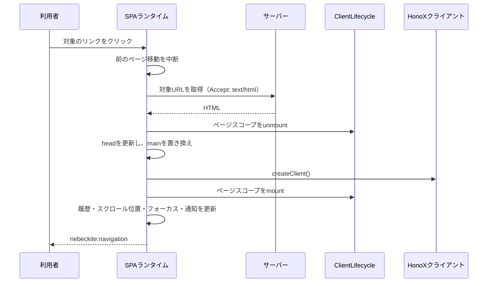

# SPAランタイムの内部実装

このページは、SPAナビゲーションを支えるブラウザ側のランタイムを、保守する開発者向けに説明します。リンクの判定、ページ移動の処理と中断、ページ情報の更新、履歴とスクロール位置の復元、先読み、ページ初期化処理との接続を扱います。ビルドへの影響と現在の検証範囲もまとめます。

パッケージ間の役割分担や設計の全体像は、先に [SPAナビゲーションの構成](./spa-navigation.ja.md) を読んでください。

## ページが切り替わるまでの流れ

SPAナビゲーションでは、ページ全体を読み直す代わりに、次のページのHTMLを取得して `<main id="main-content">` だけを置き換えます。ヘッダー、フッター、グローバルなスタイルなど、ページの外側にあるアプリケーションシェルはそのまま残ります。



処理の順序には意味があります。ページ固有の後始末は `main` を置き換える前に済ませ、新しいページの初期化処理は、HonoXがislandをhydrateした後に実行します。

新しいページ移動が始まると、進行中のページ移動は中断されます。中断された処理は、ページ情報、DOM、履歴、ページのライフサイクル、フォーカス、通知のいずれも更新できません。

## ページ移動の対象になるリンク

`startSpaNavigation` はdocumentのクリックを監視し、次の条件をすべて満たす場合だけページ移動を処理します。

- イベントが `defaultPrevented` ではない
- 主ボタン（左ボタン）でクリックされた
- Meta、Ctrl、Shift、Alt のいずれも押されていない
- クリック位置に最も近い `a[href]` が `shouldNavigate` の条件を満たす
- 現在のページのハッシュだけを変える移動ではない

`shouldNavigate` は、リンクが次の条件を満たすことを確認します。

- `target` がない、または `_self` である
- `download` 属性がない
- `data-spa="false"` が指定されていない
- 同一オリジンかつ同一プロトコルである

ハッシュだけの移動とは、パスとクエリが現在のページと同じで、ハッシュが空でない場合です。この場合はブラウザ本来のページ内アンカーに任せます。

戻る・進む操作（`popstate`）はリンクの判定を通りません。現在のURLに対して、`popstate: true` を指定したページ移動を開始します。

## ページ移動と中断処理

ページ移動ごとに `AbortController` を作成し、新しい移動が始まるたびに前の移動を中断します。

`navigate` は次の順序で処理します。

1. クリックによる移動で、スクロール位置の復元が有効な場合は、現在の位置を `history.state` に保存する
2. `Accept: text/html, application/xhtml+xml` を付けて対象URLを取得する
3. `DOMParser` でレスポンスを解析する
4. 取得したdocumentと現在のdocumentの両方に `main#main-content` があることを確認する
5. レスポンスURLから最終的なURLを求め、リダイレクトを反映する
6. `onBeforePageCommit(signal)` を実行する
7. `<head>` を更新し、現在の `main` を取得した `main` で置き換える
8. `onPageCommit({ root, signal })` を実行する
9. View Transitionを使う場合は、DOM更新の完了を待つ
10. クリックによる移動なら履歴を追加し、スクロール位置を復元する
11. ページのルートにフォーカスを移し、新しいページを読み上げ用に通知する
12. `riebeckite:navigation` イベントを発火する

ランタイムは、非同期処理の区切りごとに、ページ移動の世代と `signal` を確認します。最新の移動だけが、ページ情報、DOM、履歴、ページのライフサイクル、フォーカス、通知、イベントを更新できます。

同じページ内での戻る・進む操作では、HTMLを取得しません。保存済みのスクロール位置を復元し、ハッシュがあればその要素へ、なければページのルートへフォーカスを移します。

取得は15秒でタイムアウトし、HTML以外のContent-Typeが返された場合は失敗として扱います。リダイレクト先が別オリジンになった場合も失敗します。

中断されていないエラーが起きた場合、ランタイムは最終的な遷移先へ `window.location.assign()` を呼び、ページ全体の読み込みに切り替えます。ページ内容を置き換えた後にコミット処理が失敗した場合も同じです。どちらの経路でも、ブラウザにはサーバーが描画した完全なdocumentが表示されます。これをページ全体の読み込みへのフォールバックと呼びます。

## ページ情報の更新

`main` を置き換える前に、ランタイムはページごとに変わる `<head>` の内容を更新します。

- 取得したページの `document.title` を設定する
- `<html lang>` と `<html dir>` をコピーし、取得元にない場合は削除する
- 現在の `<head>` から、ページが所有する要素を削除する
- 取得したページの `<head>` から、ページが所有する要素を複製して追加する

ページごとに置き換える要素と、アプリケーション全体で残す要素は、`data-riebeckite-head` 属性で区別します。

- `data-riebeckite-head="page"` の要素は置き換える
- `data-riebeckite-head="global"` と `"runtime"` の要素は残す
- Pluginが生成する `meta` と `link` には、ページ所有の属性が自動的に付く
- Pluginのデータ用スクリプト（`application/ld+json`、`application/json`）もページ所有になる
- 実行可能なPluginスクリプトには所有権を付けず、複製も再実行もしない

互換性のため、次の従来のセレクタに一致する要素もページ所有として扱います。

- `link[rel="canonical"]`、`link[hreflang]`
- `script[type="application/ld+json"]`
- `meta[name="description"]`、`meta[name="author"]`、`meta[name="robots"]`
- `meta[name^="twitter:"]`
- `meta[property^="og:"]`、`meta[property^="article:"]`

上記以外の `<head>` の要素は残ります。実行可能な `<script>` は、`data-riebeckite-head="page"` が付いていても置き換えません。再実行を避けるためです。所有権の属性がない `<script>` と `<style>` も、そのまま残ります。

## 履歴・スクロール位置・フォーカス

スクロール位置の復元が有効な場合、ランタイムは `history.scrollRestoration = "manual"` を設定し、停止時に元の値へ戻します。

スクロール位置は、スクロールが落ち着いたときと、クリックによる移動を始める直前に、`replaceState` を使って `history.state` の `scroll` に保存します。戻る・進む操作では、保存された位置を復元します。保存がない場合は復元しません。

クリックによる移動では、コミットの成功後に `{ scroll: [0, 0] }` を持つ履歴を追加し、ページ先頭へ移動します。URLにハッシュがある場合は、代わりに一致する要素へスクロールします。

履歴の扱いは次のとおりです。

- クリックによる移動は、コミットの成功後に新しい履歴を追加する
- `popstate` による移動は履歴を追加しない
- リダイレクトがあった場合は、レスポンスURLを履歴に使う

フォーカスと通知の扱いは次のとおりです。

- URLにハッシュがない場合、必要なら `tabindex="-1"` を追加し、`preventScroll` を指定して新しい `main` にフォーカスする
- `#riebeckite-navigation-announcer` を作成または再利用し、`aria-live="polite"` の要素に新しいページタイトルを設定する
- `riebeckite:navigation` イベントの `detail` は `{ url, popstate }` を持つ

## リンク先の先読み

`prefetch: "hover"` を指定すると、`pointerover` のリスナーが追加されます。対象になるリンクの条件はクリック時と同じで、ハッシュだけのリンクは無視します。

先読みしたページは、URLをキーにしたキャッシュで管理します。

- 最近使った順に、完了した項目を最大20件保持する
- 先読みとページ移動の進行中リクエストを重複排除する
- 成功したレスポンスは30秒間保持する
- 失敗した項目と期限切れの項目は削除する
- ランタイムの停止時には、進行中のリクエストを中断する

先読みは、データ節約設定、`slow-2g`、`2g` 接続では実行しません。呼び出し元が `signal` を中断しても失敗するのはその呼び出し元だけで、共有されているリクエストは中断しません。

## ページ初期化処理の接続

ページを置き換えた後は、新しいページのislandをhydrateし、ページ単位の初期化処理を実行する必要があります。HonoXとの連携は、生成されたクライアントモジュールを通じてこの接続を提供します。

### 生成されるクライアントモジュール

HonoX連携は `virtual:riebeckite/client` を提供します。`spa` が有効な場合、生成されたモジュールはランタイムを一度だけ開始します。

```ts
stopSpaNavigation ??= startSpaNavigation({
  ...spaConfig,
  onBeforePageCommit: () => lifecycle.unmount("page"),
  onPageCommit: async ({ root, signal }) => {
    if (signal.aborted) return;
    await createClient();
    if (signal.aborted || !root.isConnected) return;
    mountPageClientInitializers(root);
  },
});
```

`spaConfig` はシリアライズされた設定オブジェクトです。このモジュールは、解決済みの `spa` 値がある場合だけ、`honox/client` の `createClient` と `@riebeckite/spa` の `startSpaNavigation` を読み込みます。

生成されたモジュールは、次の関数を公開します。

- `initRiebeckiteClient()` — アプリケーションとページの初期化処理を実行し、SPAナビゲーションを開始する
- `remountRiebeckitePage(root)` — ページスコープをunmountし、指定したルートにmountし直す
- `disposeRiebeckiteClient()` — SPAナビゲーションを停止し、両方のスコープを破棄する

通常のサイトコードが呼ぶのは `initRiebeckiteClient()` だけです。ほかの関数は、独自の連携処理と破棄のために用意されています。

### 初期化処理のライフサイクル

生成されたモジュールは、Pluginのクライアントエントリが持つメタデータに従って初期化処理を実行します。

- `scope: "app"` は `document` に一度だけmountする
- `scope: "page"`（既定）は `main#main-content` にmountし、ページを置き換える前にunmountする
- `initializerArguments` は引数の種類を選ぶ。`config`（既定）、`root`、`context` のいずれか

生成されたコードでは、`ClientLifecycle.mount` を待たずに呼び出します（`void lifecycle.mount(...)`）。そのため、非同期の初期化処理が次のページ移動の開始時点でも実行中の場合があります。初期化処理は `signal` を受け取り、中断されたら停止する必要があります。

同じ名前の初期化処理を同じスコープにmountした場合、ルートが同じなら既存のmountを再利用します。ルートが違う場合は、ライフサイクルが例外を投げます。

`ClientLifecycle.unmount` は、先にスコープを中断してから、クリーンアップの完了を待ちます。クリーンアップで起きたエラーは報告されますが、ほかの初期化処理の終了を妨げません。

生成された `onPageCommit` は、`createClient()` の完了後に、ページ移動が中断されていないことと、対象のページがまだdocumentに接続されていることを再確認してから、ページの初期化処理を実行します。これにより、hydrationに時間がかかった場合でも、古いページの初期化処理を現在のページに対して実行してしまうことを防ぎます。

`initializerArguments: "context"` を指定したクライアントエントリは、`{ root, config, signal, scope }` を受け取ります。`scope` は、イベントリスナー、タイムアウト、インターバル、独自のクリーンアップを管理します。グローバル環境を書き換えたり、初期化処理の外で作られたリソースを推測したりはしません。必要なリソースを明示的に登録する仕組みです。

## ビルド結果への影響

SPAランタイムが変えるのはクライアントバンドルであり、サーバー側のレンダラーやSSGの出力ではありません。

- `spa` を省略するか `false` にした場合、仮想モジュールは `@riebeckite/spa` も `honox/client` も読み込みません。ランタイムはバンドルに含まれません。
- `spa` を有効にした場合、Viteはランタイムを含め、生成されたクライアントモジュールに `createClient` の読み込みとSPAナビゲーションの開始処理を追加します。
- サーバービルドと静的出力の計画は変わりません。どちらの場合も同じHTMLを描画します。

外部のfixtureで測定した結果（2026-10-21）では、SPAを有効にすると、重複を除いたJavaScriptアセットがrawで5,570 B、gzipで1,715 B、brotliで1,472 B増えました。同じローカルのno-store fixtureでは、初回読み込みの中央値は実質的に変わらず、hoverによる先読みは、先読みなしのSPAナビゲーションの中央値を短縮しました。これらの数値は、そのfixtureに固有のものです。

## 検証範囲

現在、自動テストで確認している範囲は次のとおりです。

- `packages/spa/test/spa.test.ts` の設定値の検証と、`packages/spa/test/prefetch.test.ts` のキャッシュの有効期限（TTL）、重複排除、LRUによる削除、呼び出し元ごとの中断の分離
- `packages/integrations/honox/test/client_module.test.ts` の生成されたimport文、`app`・`page`・`context` 引数、SPAの有効・無効の接続
- `tests/spa-runtime/browser.test.ts` のブラウザ上でのページ移動の競合、headの所有権、履歴、ハッシュへのフォーカス、フォールバック、リダイレクト、先読み済みページの再利用

このリポジトリのブラウザテストでは、次の範囲を網羅していません。

- クリック判定の境界的なケース
- `popstate` 時のスクロール位置の復元
- 実際のPlugin初期化処理でのクリーンアップ失敗

これらの領域を変更するときは、対象を絞ったテストか手動での確認が必要です。テストがないことは、動作が完成している証拠ではありません。

## 現在の制約

- リンク処理の対象は、同一オリジンのアンカーと `popstate` に限られます。フォームとプログラムからのページ移動は横取りしません。
- 安定した `main#main-content` が必要です。ルートがない場合は、document全体の読み込みにフォールバックします。
- 生成されるPluginのメタデータとデータ用スクリプトについては、ページ所有であることが明示されます。それ以外の独自のhead要素は、所有権を示す属性を自分で付ける必要があります。実行可能なスクリプトは常に残り、再実行されません。
- リソーススコープが解放できるのは、そこに登録されたリソースだけです。管理外のリソースには、返り値のクリーンアップ関数が引き続き必要です。
- 先読みのキャッシュは短時間だけ有効で、オフライン用のキャッシュではありません。
- HonoXの `createClient()` は新しいislandをhydrateしますが、islandを汎用的に破棄するAPIではありません。
- SPAナビゲーションは、オフライン用のキャッシュでもクライアントサイドルーターでもありません。

## 関連ページ

- [SPAナビゲーションを有効にする](../guides/spa-navigation.ja.md)
- [SPAナビゲーションの構成](./spa-navigation.ja.md)
- [HonoXとの連携](./honox-integration.ja.md)
- [Plugin System](./plugin-system.ja.md)
