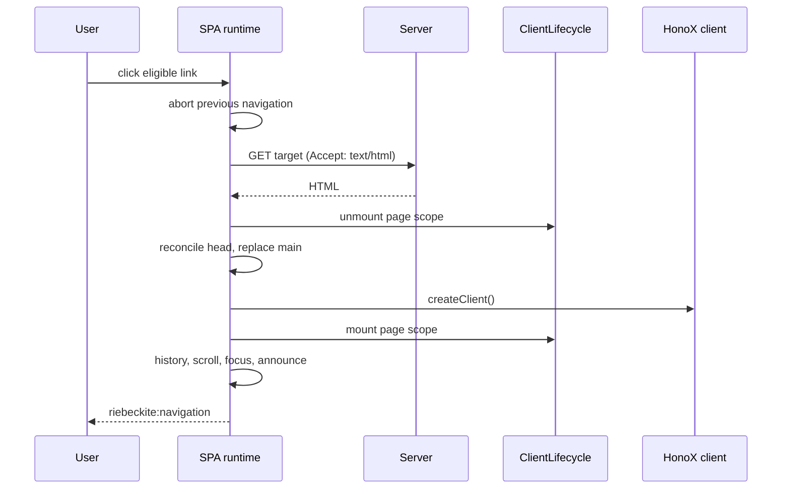

# SPA Runtime Internals

This page documents the browser runtime behind SPA navigation: link matching,
the navigation transaction, cancellation, head updates, history and scroll,
prefetching, generated client code, and the current verification gaps. Read the
[architecture overview](./spa-navigation.md) first if you need the package-level
picture.

## The transaction at a glance



## Generated client module

The HonoX integration serves `virtual:riebeckite/client`. When `spa` is enabled,
the generated module starts the runtime once:

```ts
stopSpaNavigation ??= startSpaNavigation({
  ...spaConfig,
  onBeforePageCommit: () => lifecycle.unmount("page"),
  onPageCommit: async ({ root, signal }) => {
    await createClient();
    if (signal.aborted || !root.isConnected) return;
    mountPageClientInitializers(root);
  },
});
```

`spaConfig` is the serialized options object. The module imports `createClient`
from `honox/client` and `startSpaNavigation` from `@riebeckite/spa` only when the
resolved `spa` value is present.

The generated module exports:

- `initRiebeckiteClient()` — mounts app and page initializers and starts SPA
  navigation.
- `remountRiebeckitePage(root)` — unmounts page scope and mounts it on a given
  root.
- `disposeRiebeckiteClient()` — stops SPA navigation and disposes both scopes.

Site code normally calls only `initRiebeckiteClient()`. The other exports
support custom integrations and disposal.

## Link matching

`startSpaNavigation` listens for clicks on the document. It handles a click when:

- `defaultPrevented` is false
- the primary button was pressed
- no meta, ctrl, shift, or alt key is pressed
- the closest `a[href]` passes `shouldNavigate`
- the destination is not a hash-only change

`shouldNavigate` requires:

- `target` is absent or `_self`
- no `download` attribute
- no `data-spa="false"`
- the same origin and protocol

Hash-only means the same pathname and search with a non-empty hash. Those clicks
are left to the browser so in-page anchors keep native behavior.

`popstate` does not use link matching. It starts a transaction for the current
URL with `popstate: true`.

## Navigation and cancellation

Each navigation creates an `AbortController`. Starting a new navigation aborts
the previous one.

`navigate` does the following:

1. Saves the current scroll position into `history.state` when scroll
   restoration is enabled.
2. Fetches the target with `Accept: text/html`.
3. Parses the response with `DOMParser`.
4. Requires `main#main-content` in both the fetched and current document.
5. Computes the final URL from the response URL, resolving redirects.
6. Runs `onBeforePageCommit(signal)`.
7. Reconciles the head and replaces the current main with the fetched main.
8. Runs `onPageCommit({ root, signal })`.
9. Waits for the view transition to finish, if one is used.
10. Pushes history for click navigations and restores scroll.
11. Focuses the page root and announces the new page.
12. Dispatches `riebeckite:navigation`.

The runtime checks both its navigation generation and the signal at each async
boundary. Only the newest navigation can update the head, DOM, history, page
lifecycle, focus, announcement, or navigation event.

If a non-aborted error occurs, the runtime calls
`window.location.assign(url.href)`. This is the document-navigation fallback.

## Head reconciliation

Before replacing the main element, the runtime updates the document head:

- sets `document.title` from the fetched page
- copies `<html lang>` and `<html dir>`, or removes them when absent
- removes current head children matching the page-owned set
- clones matching children from the fetched page into the current head

Head ownership is explicit:

- `data-riebeckite-head="page"` nodes are replaced.
- `data-riebeckite-head="global"` and `"runtime"` nodes persist.
- Plugin head tags emitted by `PluginHeadTags` are marked page-owned.

The following legacy selector set is also page-owned for compatibility:

- `link[rel="canonical"]`, `link[hreflang]`
- `script[type="application/ld+json"]`
- `meta[name="description"]`, `meta[name="author"]`,
  `meta[name="robots"]`
- `meta[name^="twitter:"]`
- `meta[property^="og:"]`, `meta[property^="article:"]`

Everything else in the head persists. Normal scripts and styles are not cloned
or executed during a navigation.

## History, scroll, focus, and announcement

Scroll restoration:

- When enabled, the runtime sets `history.scrollRestoration = "manual"` and
  restores the previous value on stop.
- Before leaving an entry, it writes `{ ...history.state, scroll: [x, y] }` with
  `replaceState`.
- Back/forward restores the saved position from `history.state`.
- A click navigation pushes `{ scroll: [0, 0] }` after the commit and scrolls
  to the top.
- A URL with a hash scrolls to the matching element instead.

History:

- Click navigations push a new entry after a successful commit.
- `popstate` navigations do not push.
- Redirects use the response URL.

Focus and announcement:

- Unless the URL has a hash, the runtime adds `tabindex="-1"` if needed and
  focuses the new main element with `preventScroll`.
- It creates or reuses `#riebeckite-navigation-announcer`, an
  `aria-live="polite"` element, and sets its text to the new document title.
- The `riebeckite:navigation` event carries `{ url, popstate }`.

## Prefetch

`prefetch: "hover"` adds a `pointerover` listener. It uses the same link
eligibility rules as click navigation and ignores hash-only links.

The cache:

- holds at most 20 least-recently-used entries, keyed by URL
- deduplicates active requests from prefetch and navigation
- keeps successful responses for 30 seconds
- removes failed and expired entries
- aborts pending work when the runtime stops

Prefetch is skipped for data-saving, slow-2G, and 2G connections. A caller's
abort signal rejects only that caller; it does not cancel a shared request.

## HonoX integration and lifecycle

The generated module mounts plugin client entries according to their metadata:

- `scope: "app"` mounts on `document` once.
- `scope: "page"` (the default) mounts on `main#main-content` and is unmounted
  before each replacement.
- `initializerArguments` selects the argument: `config` (the default), `root`,
  or `context`.

`ClientLifecycle.mount` is fire-and-forget in generated code:
`void lifecycle.mount(...)`. An async initializer can still be running when the
next navigation starts. It receives a signal and should stop when aborted.

When the same initializer name is mounted twice in the same scope:

- same root: the existing mount is reused
- different root: the lifecycle throws

`ClientLifecycle.unmount` aborts first, then awaits cleanup. Cleanup errors are
reported and do not block other initializers.

The generated `onPageCommit` awaits `createClient()` and re-checks both the
navigation signal and the page root's connection before mounting page
initializers. This prevents a completed hydration from mounting a stale page
scope.

For `initializerArguments: "context"`, a client entry receives `{ root, config,
signal, scope }`. Resource scope tracks listeners, timeouts, intervals, and
custom cleanup. It is deliberately opt-in: it does not monkey-patch globals or
infer resources created outside the initializer.

## Build and SSG

The SPA runtime changes the client bundle, not the server renderer or SSG
output.

- With `spa` omitted or `false`, the virtual module has no import of
  `@riebeckite/spa` or `honox/client`; the runtime is not in the bundle.
- With `spa` enabled, Vite includes the runtime and the generated client module
  gains the `createClient` import and SPA startup.
- The server build and static output plan are unchanged; both modes render the
  same HTML.

Measured impact on the external fixture (2026-10-21): SPA added 5,570 B raw,
1,715 B gzip, and 1,472 B brotli to the unique JavaScript assets. On that local
no-store fixture, the initial load median was effectively unchanged, and hover
prefetch reduced the SPA navigation median relative to SPA without prefetch.
These numbers are fixture-specific.

## Verification coverage

Automated checks currently cover:

- option validation in `packages/spa/test/spa.test.ts`, plus cache TTL,
  deduplication, LRU eviction, and caller abort isolation in
  `packages/spa/test/prefetch.test.ts`
- generated client imports, app/page/context arguments, and SPA on/off wiring in
  `packages/integrations/honox/test/client_module.test.ts`
- browser navigation races, head ownership, history, hash focus, fallbacks,
  redirects, and prefetched-page reuse in `tests/spa-runtime/browser.test.ts`

Not covered by automated browser tests in this repository:

- click eligibility edge cases
- scroll restoration on `popstate`
- cleanup failures in real plugin initializers

Treat changes to these areas as requiring targeted tests or manual verification.
The absence of a test is not evidence that the behavior is complete.

## Current constraints

- Link handling is limited to same-origin anchors and `popstate`; forms and
  programmatic navigation are not intercepted.
- The runtime requires a stable `main#main-content`; missing roots fall back to a
  full document load.
- Page ownership is explicit for generated plugin head tags; other custom head
  nodes must set an ownership attribute. Page scripts and styles are not run.
- Resource scope only releases resources registered through it; returned cleanup
  remains necessary for resources it cannot own.
- Prefetch is short-lived and is not an offline cache.
- HonoX `createClient()` hydrates new islands but is not a general island
  teardown API.
- SPA is not an offline cache or a client-side router.

## Related

- [Enable SPA navigation](../guides/spa-navigation.md)
- [SPA navigation architecture](./spa-navigation.md)
- [HonoX integration](./honox-integration.md)
- [Plugin system](./plugin-system.md)
