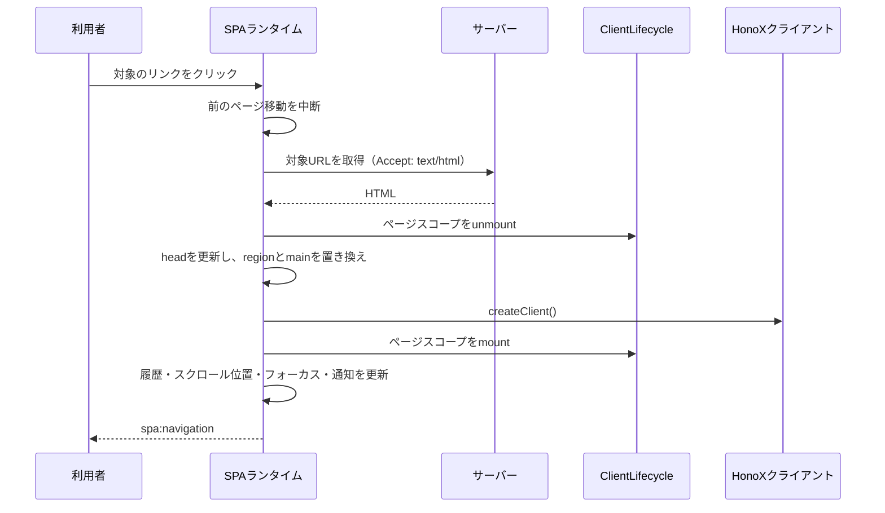

# ページ遷移

## ページが切り替わるまでの流れ

SPAナビゲーションでは、ページ全体を読み直す代わりに、次のページのHTMLを取得して `<main id="main-content">` と一致する `data-spa-region` 要素を置き換えます。グローバルなスタイルなど、属性のないアプリケーションシェルはそのまま残ります。

処理の順序には意味があります。ページ固有の後始末は `main` を置き換える前に済ませ、新しいページの初期化処理は、[[framework/honox-integration|HonoX]]がislandをhydrateした後に実行します。

新しいページ移動が始まると、進行中のページ移動は中断されます。中断された処理は、ページ情報、DOM、履歴、ページのライフサイクル、フォーカス、通知のいずれも更新できません。

## ページ移動の対象になるリンク

`startSpaNavigation` はdocumentのクリックを監視し、次の条件をすべて満たす場合だけページ移動を処理します。

- イベントが `defaultPrevented` ではない
- 主ボタン（左ボタン）でクリックされた
- Meta、Ctrl、Shift、Alt のいずれも押されていない
- クリック位置に最も近い `a[href]` が `shouldNavigate` の条件を満たす
- 現在のページのハッシュだけを変える移動ではない

`shouldNavigate` は、リンクが次の条件を満たすことを確認します。

- `target` がない、または `_self` である
- `download` 属性がない
- `data-spa="false"` が指定されていない
- 同一オリジンかつ同一プロトコルである

ハッシュだけの移動とは、パスとクエリが現在のページと同じで、ハッシュが空でない場合です。この場合はブラウザ本来のページ内アンカーに任せます。

戻る・進む操作（`popstate`）はリンクの判定を通りません。現在のURLに対して、`popstate: true` を指定したページ移動を開始します。

## ページ移動と中断処理

ページ移動ごとに `AbortController` を作成し、新しい移動が始まるたびに前の移動を中断します。

`navigate` は次の順序で処理します。

1. クリックによる移動で、スクロール位置の復元が有効な場合は、現在の位置を `history.state` に保存する
2. `Accept: text/html, application/xhtml+xml` を付けて対象URLを取得する
3. `DOMParser` でレスポンスを解析する
4. 取得したdocumentと現在のdocumentの両方に `main#main-content` があることを確認する
5. レスポンスURLから最終的なURLを求め、[[glossary/redirect|リダイレクト]]を反映する
6. `onBeforePageCommit(signal)` を実行する
7. `<head>` を更新し、一致するregionを置き換えた後に、現在の `main` を取得した `main` で置き換える
8. `onPageCommit({ root, signal })` を実行する
9. View Transitionを使う場合は、DOM更新の完了を待つ
10. クリックによる移動なら履歴を追加し、スクロール位置を復元する
11. ページのルートにフォーカスを移し、新しいページを読み上げ用に通知する
12. `spa:navigation` イベントを発火する

ランタイムは、非同期処理の区切りごとに、ページ移動の世代と `signal` を確認します。最新の移動だけが、ページ情報、DOM、履歴、ページのライフサイクル、フォーカス、通知、イベントを更新できます。

同じページ内での戻る・進む操作では、HTMLを取得しません。保存済みのスクロール位置を復元し、ハッシュがあればその要素へ、なければページのルートへフォーカスを移します。

取得は15秒でタイムアウトし、HTML以外のContent-Typeが返された場合は失敗として扱います。リダイレクト先が別オリジンになった場合も失敗します。

中断されていないエラーが起きた場合、ランタイムは最終的な遷移先へ `window.location.assign()` を呼び、ページ全体の読み込みに切り替えます。ページ内容を置き換えた後にコミット処理が失敗した場合も同じです。どちらの経路でも、ブラウザにはサーバーが描画した完全なdocumentが表示されます。これをページ全体の読み込みへのフォールバックと呼びます。
