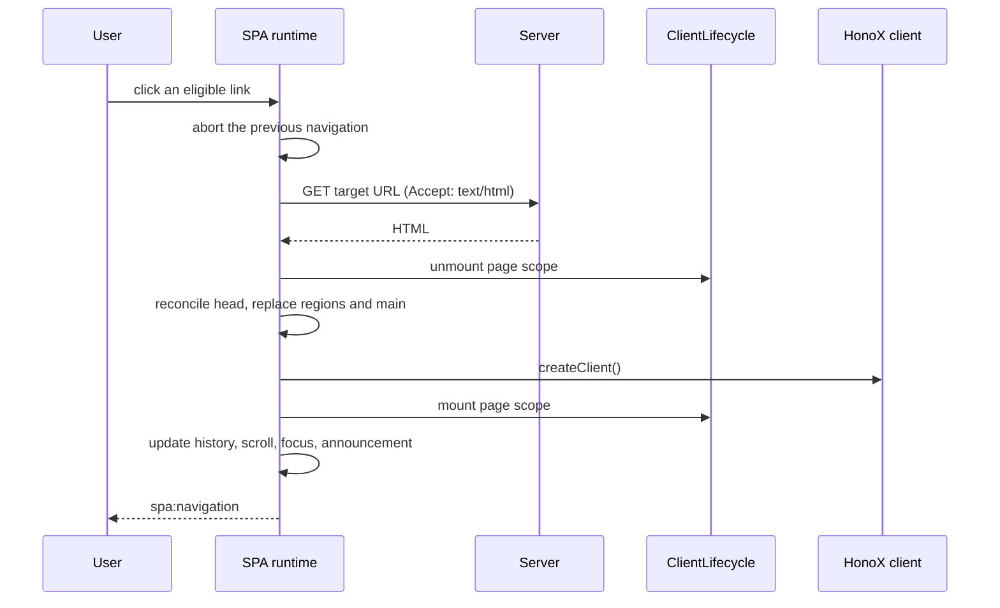

# Flow

## The page transition flow

During SPA navigation, the runtime fetches the next HTML document and replaces
`<main id="main-content">` plus any matching `data-spa-region` elements. The
unmarked application shell, including global styles, stays in place.

The order matters. Page-specific cleanup runs before the main element is
replaced, and page initialization runs after [[framework/honox-integration|HonoX]] hydrates the new islands.

Starting a new navigation aborts the one in progress. An aborted navigation
cannot update page metadata, the DOM, history, the page lifecycle, focus, the
announcement, or the navigation event.

## Which links use SPA navigation

`startSpaNavigation` listens for clicks on the document and handles a click only
when all of these are true:

- `defaultPrevented` is false
- the primary button was pressed
- no Meta, Ctrl, Shift, or Alt key is pressed
- the closest `a[href]` passes `shouldNavigate`
- the destination is not a hash-only change on the current page

`shouldNavigate` requires:

- `target` is absent or `_self`
- no `download` attribute
- no `data-spa="false"`
- the same origin and protocol

A hash-only change means the same pathname and search with a non-empty hash.
Those clicks are left to the browser so in-page anchors keep native behavior.

Back and forward navigation (`popstate`) does not use link matching. It starts a
navigation for the current URL with `popstate: true`.

## Navigation and cancellation

Each navigation creates an `AbortController`. Starting a new navigation aborts
the previous one.

`navigate` does the following:

1. For click navigations, saves the current scroll position into `history.state`
   when scroll restoration is enabled.
2. Fetches the target with `Accept: text/html, application/xhtml+xml`.
3. Parses the response with `DOMParser`.
4. Requires `main#main-content` in both the fetched and current document.
5. Computes the final URL from the response URL, resolving redirects.
6. Runs `onBeforePageCommit(signal)`.
7. Reconciles the head, replaces matching regions, and replaces the current
   main with the fetched main.
8. Runs `onPageCommit({ root, signal })`.
9. Waits for the view transition's DOM update to complete, if one is used.
10. Pushes history for click navigations and restores scroll.
11. Focuses the page root and announces the new page.
12. Dispatches `spa:navigation`.

The runtime checks both its navigation generation and the signal at each async
boundary. Only the newest navigation can update the head, DOM, history, page
lifecycle, focus, announcement, or navigation event.

A same-page `popstate` navigation does not fetch HTML. It restores the saved
scroll position and focuses the hash target when present, or the page root
otherwise.

Fetches time out after 15 seconds, and responses with a non-HTML content type
are treated as failures. A redirect to another origin also fails.

If a non-aborted error occurs, the runtime calls `window.location.assign()` for
the final destination and falls back to a normal document navigation. The same
happens when a commit hook fails after the page content has been replaced.
Either path leaves the browser on a fully rendered document. This is the
document-navigation fallback.
