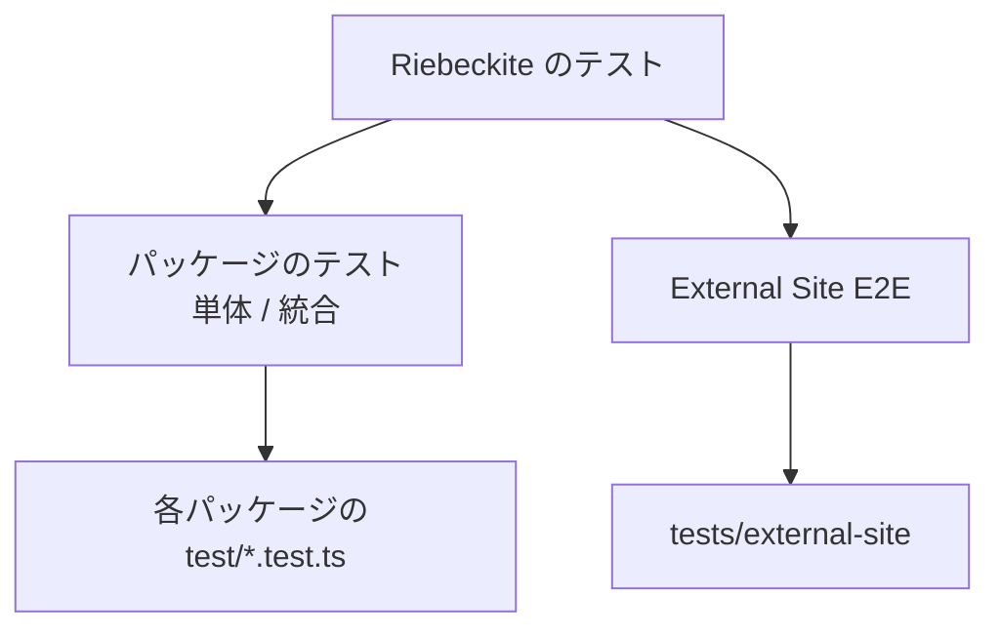
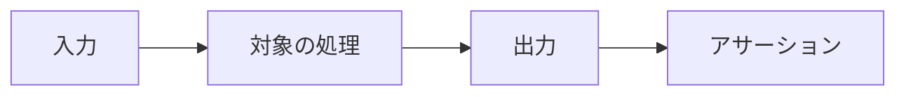
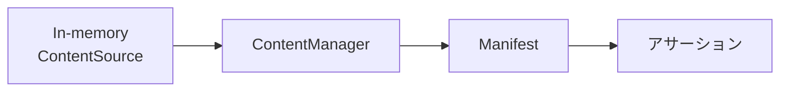
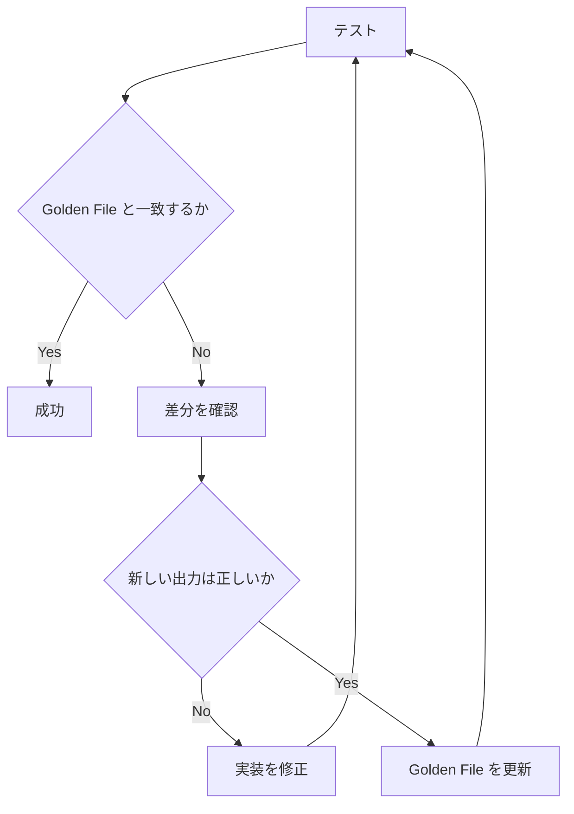
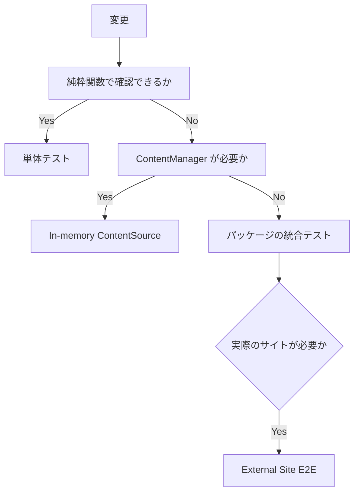
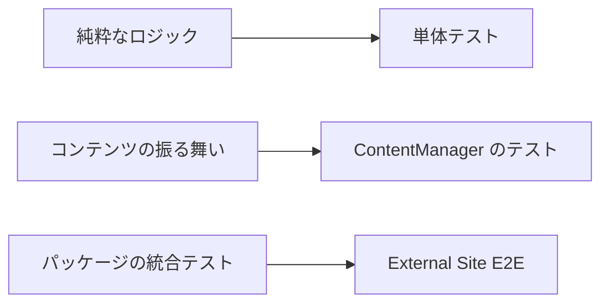

# テスト

Riebeckite のテストは、Node.js 組み込みのテストランナー（`node:test`）と、TypeScript を直接実行する `tsx` で動かします。Jest や Vitest のような追加のテストフレームワークは使いません。

手作業での確認が難しい大きな出力には **Golden File** を使います。期待する出力そのものをファイルとして保存しておけば、変更の影響を Pull Request の差分として確認できます。

実際のサイトを生成して検証する End-to-End テストは別に用意していて、`tests/external-site` にあります。E2E を動かす再利用可能なエンジンは `@riebeckite/test/e2e` にあり、このリポジトリ固有の Fixture、テスト対象パッケージの一覧、リポジトリ固有のアサーションは `tests/external-site` に置きます。

## テストの種類には何があるか

Riebeckite のテストは大きく2種類に分かれます。



このページで主に扱うのは、**各パッケージに置くテスト**です。External Site E2E は次のコマンドで実行します。

```sh
pnpm test:e2e:external
```

また、第三者プラグインを外部パッケージの立場で検証する Fixture は `tests/plugin-dx` にあります（独立した pnpm workspace です）。

```sh
pnpm test:plugin-dx            # Public API だけで書いた Plugin の Unit Test
pnpm test:plugin-dx:external   # packed tarball を隔離 Site へ install して検証
```

`test:plugin-dx:external` は `@riebeckite/core` と Fixture プラグインを `pnpm pack` し、monorepo の外にある隔離サイトへインストールします。公開済みパッケージだけでプラグインが動作することを確認するテストで、外部に配布するプラグインの回帰検知に使えます。

## テストを実行する

よく使うコマンドは次のとおりです。

| コマンド | 内容 |
| --- | --- |
| `pnpm test` | `test` スクリプトを持つすべてのパッケージをテストする |
| `pnpm --filter <package> test` | 特定のパッケージだけをテストする |
| `pnpm test:update` | すべての Golden File を現在の出力で更新する |
| `pnpm test:e2e:external` | External Site E2E を実行する |
| `pnpm test:plugin-dx` | 外部パッケージの視点でプラグイン Fixture をテストする |
| `pnpm test:plugin-dx:external` | packed tarball を隔離サイトへインストールしてプラグインを検証する |
| `pnpm test:registry` | Scaffold のインストールの取り決めを npm で公開済みの artifact に対して実行する |

Scaffold のインストールの取り決めは、既定では **workspace を `pnpm pack` した artifact** をインストールして検証します。そのため、新しいパッケージを追加したブランチでも公開前に検証できます。`pnpm test:registry` は同じ取り決めを npm からのインストールに切り替え、公開済みの artifact が解決できることを確認します。リリース後に実行してください。

通常は、変更した範囲に近いテストから実行します。たとえば TOC プラグインだけを変更した場合は次のとおりです。

```sh
pnpm --filter @riebeckite/plugin-toc test
```

その後、変更が他のパッケージに影響しうる場合は、リポジトリ全体のテストを実行します。

```sh
pnpm test
```

## 特定の Golden File だけを更新する

1つのパッケージの Golden File だけを更新したい場合は、テストの実行前に `UPDATE_GOLDEN=1` を設定します。PowerShell では次のようになります。

```powershell
$env:UPDATE_GOLDEN=1; pnpm --filter @riebeckite/plugin-toc test
```

Golden File の更新は、テストを通すための作業ではありません。**新しい出力が正しいことを確認してから更新してください。**

## テストはどこに置くか

各パッケージのテストは `test/*.test.ts` に置き、パッケージ自身が `test` スクリプトを宣言します。

```json
{
  "scripts": {
    "test": "node --import tsx --test \"test/*.test.ts\""
  }
}
```

たとえば、次のような構成です。

```text
packages/plugins/example/
├─ src/
├─ test/
│  ├─ example.test.ts
│  └─ __golden__/
│     └─ example.html
├─ package.json
└─ index.ts
```

`test/` ディレクトリとテストファイルは、型チェック、パッケージのビルド、公開パッケージの `files` から除外されます。そのため、テストコードが利用者へ配布されることも、利用側のビルドに影響することもありません。

## 共有テストユーティリティはどこにあるか

複数のパッケージから使うテスト用の機能は、workspace パッケージ `@riebeckite/test` にあります。必要なパッケージの `devDependencies` に追加し、公開 API からインポートします。

```ts
import {
  assertGolden,
} from "@riebeckite/test";
```

テスト専用の共通処理を各プラグインにコピーしないでください。

## プラグインはどうテストするか

プラグインのテストは、確認したい範囲に合わせて4つのレベルに分けられます。すべてを行う必要はありません。変更した振る舞いを確認できる最小のレベルから始めてください。

```text
Level 1  Pure logic            通常の test runner でよい
Level 2  Markdown / HTML       Pipeline に Plugin を渡して変換結果を検証
Level 3  Content / lifecycle   ContentManager + In-memory ContentSource
Level 4  外部パッケージ境界     packed tarball を隔離 Site へ install
```

### Level 1: 純粋なロジック

Option の解決、文字列変換、AST ヘルパーなど、Riebeckite に依存しない処理は `node:test` などの通常のテストランナーでテストします。このレベルでは `@riebeckite/test` も `ContentManager` も必要ありません。

### Level 2: Markdown / HTML の変換

Markdown / HTML の変換は、公開されている `Pipeline` にプラグインを渡して検証できます。

```ts
import { Pipeline } from "@riebeckite/core";
import { tipPlugin } from "../src/index.ts";

const pipeline = new Pipeline(new Map(), new Map(), undefined, {
  plugins: [tipPlugin()],
});

const { html } = await pipeline.execute(":::tip\nSave often.\n:::");
assert.match(html, /<aside class="rr-tip">/);
```

`Pipeline` の第1引数は content index、第2引数は permalink の `Map` です。単一のドキュメントを変換するだけなら、どちらも空の `Map` で構いません。第3引数は、プラグインが embed など他のコンテンツを解決する場合にだけ必要です。プラグインのテストで最もよく使うレベルです。

### Level 3: コンテンツとライフサイクル

コンテンツの読み込み、フック、manifest、Page Type を検証する場合は、In-memory の `ContentSource` と `ContentManager` を使います。後述の「Content System をテストする」で示す形と同じです。`getProcessedContent()` はパイプラインとコンテンツフックを通した結果を返し、`getManifest()` は解決済みのプラグインを含む manifest を返します。

### Level 4: 公開パッケージの境界

配布するパッケージは、`pnpm pack` した tarball を monorepo の外の隔離サイトへインストールして検証します。これにより、公開エクスポートの不足、`@riebeckite/core/src/**` への誤った依存、`dependencies` の宣言漏れ、型定義の欠落を検出できます。

このリポジトリでは `tests/plugin-dx` が実例で、`pnpm test:plugin-dx` と `pnpm test:plugin-dx:external` で実行します。

### `@riebeckite/test` は何を提供するか

`@riebeckite/test` は、複数のパッケージで共有するテストヘルパーを提供します。Golden File の比較（`assertGolden` / `assertGoldenJson`）などが含まれますが、必須ではありません。Level 1〜3 のほとんどは `node:test` と公開 Core API（`Pipeline` / `ContentManager`）だけで書けます。`@riebeckite/test/e2e` は外部サイトを生成して検証するリポジトリ向けのエンジンで、第三者のプラグインが通常使うものではありません。

## テストはどう書くか

基本は、対象パッケージの公開 API へ入力を渡し、その結果をアサートします。Riebeckite のプラグインのロジックには純粋関数として切り出せる処理が多いため、すべてのテストでビルドパイプライン全体を起動する必要はありません。

```ts
import assert from "node:assert/strict";
import { test } from "node:test";

import { renderBreadcrumbNav } from "../src/render.ts";

test("renders nothing for a single root item", () => {
  assert.equal(
    renderBreadcrumbNav([]),
    "",
  );
});
```



小さい処理は、可能な限りこの形で直接テストしてください。

## Content System をテストする

Content System の動作を確認したい場合は、実際のファイルシステムを用意するより、In-memory の `ContentSource` を使うのが基本です。

```ts
const source = {
  async scan() {
    return [
      {
        path: "notes/index.md",
      },
    ];
  },

  async read(entry) {
    return `# ${entry.path}`;
  },
};

const config = resolveConfig({
  content: {
    directory: ".",
  },
});

const manager = new ContentManager(
  source,
  [],
  { config },
);

const manifest =
  await manager.getManifest();
```



In-memory の `ContentSource` を `ContentManager` に渡し、得られた manifest を検証します。この小さい範囲で、Content System の動作を確認できます。

実際のサイトや Vite ビルドが必要な問題でなければ、テストのためだけにアプリケーション全体を組み立てないでください。

## Golden File はいつ使うか

HTML や大きな JSON のように、個別のアサーションを大量に書くより出力全体を確認したほうがわかりやすい場合は、Golden File を使います。`@riebeckite/test` には2つのヘルパーがあります。

| ヘルパー | 用途 |
| --- | --- |
| `assertGolden(actual, goldenUrl)` | HTML、Markdown、テキスト、シリアライズした JSON |
| `assertGoldenJson(value, goldenUrl)` | オブジェクト / JSON |

`assertGoldenJson()` は比較の前に、値を次の形に整形します。

```ts
JSON.stringify(value, null, 2)
```

## Golden File はどこに置くか

期待値は `test/__golden__/` に置きます。たとえば、次のような構成です。

```text
test/
├─ toc.test.ts
└─ __golden__/
   └─ toc.html
```

テストからは `import.meta.url` を基準に URL を渡します。

```ts
import { test } from "node:test";
import {
  assertGolden,
} from "@riebeckite/test";

test("renders the table of contents", () => {
  assertGolden(
    renderToc(entries),
    new URL(
      "./__golden__/toc.html",
      import.meta.url,
    ),
  );
});
```

絶対パスやカレントディレクトリに依存させないことが重要です。

## Golden File はどう比較されるか

既定では、出力を少し正規化してから比較します。具体的には、CRLF / CR を LF に、末尾の複数の改行を1つの改行に統一します。

```text
CRLF / CR
    ↓
LF

末尾の複数改行
    ↓
1つの改行
```

これにより、Windows / Linux の違いやエディタの設定による不要な差分を防げます。バイト単位で厳密に比較する必要がある場合は、`{ normalize: false }` を渡します。

```ts
assertGolden(
  actual,
  goldenUrl,
  {
    normalize: false,
  },
);
```

## Golden File が一致しないときはどうするか

Golden File が存在しない場合、または現在の出力と一致しない場合、テストは失敗します。出力の変更が意図したものであることを確認したら、次のコマンドで Golden File を更新します。

```sh
pnpm test:update
```



Golden File をコミットするのは意図的です。出力の変更を、次のような差分として Pull Request 上でレビューできるようにするためです。

```diff
- 以前の出力
+ 新しい出力
```

**Golden File の更新そのものを修正として扱わず、なぜ出力が変わったのかを必ず確認してください。**

## Node.js の Snapshot を使わない理由

Riebeckite では、Node.js 組み込みの Snapshot アサーションを使っていません。Node.js の Snapshot アサーションを更新するには、次のフラグを使います。

```text
--test-update-snapshots
```

このフラグは Node.js 22.3 以降を必要とします。Riebeckite は Node.js 20.19 以降も対象としているため、独自の Golden File ヘルパーを用意しています。

## パッケージにテストを追加する

まだテストがないパッケージに追加する場合は、次の順に設定します。

### 1. `tsx` を追加する

パッケージの `devDependencies` に `tsx` を追加します。

### 2. `test` スクリプトを追加する

```json
{
  "scripts": {
    "test": "node --import tsx --test \"test/*.test.ts\""
  }
}
```

### 3. 必要なら `@riebeckite/test` を追加する

Golden File のヘルパーなどを使う場合は、`@riebeckite/test` を `devDependencies` に追加します。

### 4. プラグインのメタデータを更新する

プラグインのパッケージでは、`scripts/package_metadata.mjs` の `hasTests` にパッケージのディレクトリ名を追加します。

### 5. パッケージのメタデータを検証する

依存関係を変更したら、次の2つのコマンドを実行します。

```sh
pnpm install
pnpm check:packages
```

`scripts/check_packages.mjs` は、各パッケージのメタデータを `scripts/package_metadata.mjs` の定義と比較します。たとえば、次のような問題を検出します。

- `test` スクリプトが必要なのに存在しない
- `hasTests` に追加されていない
- 期待するメタデータと一致しない

## 何をテストするか

テストでは、**決定的で再現可能な振る舞い**を優先します。特に次のような処理が向いています。

- Option の解決
- 検証
- デフォルト値の扱い
- permalink の解決
- TOC の構築
- メタデータの抽出
- HTML のレンダリング
- JSON の生成
- 空の入力
- frontmatter の欠落
- slug の重複
- 不正な属性

たとえば純粋関数なら、次のように同じ入力から常に同じ出力が得られるため、安定したテストを書きやすくなります。

```text
同じ入力
   ↓
同じ処理
   ↓
常に同じ出力
```

## どんなテストを避けるか

ネットワーク、実時刻、乱数、マシン固有の絶対パス、カレントディレクトリなどに依存するテストは可能な限り避けます。こうした外部の状態や予測できない値は、テストを非決定的にします。

```text
Network
Current Time
Random Value
Machine-specific Absolute Path
Current Working Directory
```

たとえば、テスト対象のコードの内部で次のように時刻を取得すると、テストを実行する時刻によって結果が変わります。

```ts
const now = new Date();
```

代わりに、必要な値を外から注入できるようにします。

```ts
function createEntry(now: Date) {
  // ...
}
```

テストでは固定値を渡します。

```ts
const now =
  new Date("2026-01-01T00:00:00Z");

const entry =
  createEntry(now);
```

乱数も同じです。テスト側で実際の時刻や乱数を予測するのではなく、**判断に必要な値を外から渡せる設計**にしてください。

## どこまでテストするか

変更した処理に最も近い、小さい範囲からテストします。



単純なレンダラーの修正を確認するために External Site E2E を使う必要はありません。逆に、次のような問題は単体テストだけでは十分ではないため、External Site E2E で確認します。

- パッケージの配布形式
- 外部の利用者からのインポート
- 実際のサイトのビルド
- 複数の Integration にまたがる問題

## 基本方針

Riebeckite のテストでは、**変更した振る舞いを確認できる最小の範囲で、決定的なテストを書く**ことを基本にします。



大きなビルドを毎回再現するのではなく、純粋関数や In-memory の `ContentSource` で確認できる処理は小さくテストします。パッケージ境界や実際の外部利用者に関わる問題は E2E で確認します。

Golden File は、テストを通すための Snapshot ではなく、**レビュー可能な期待出力**として扱ってください。
