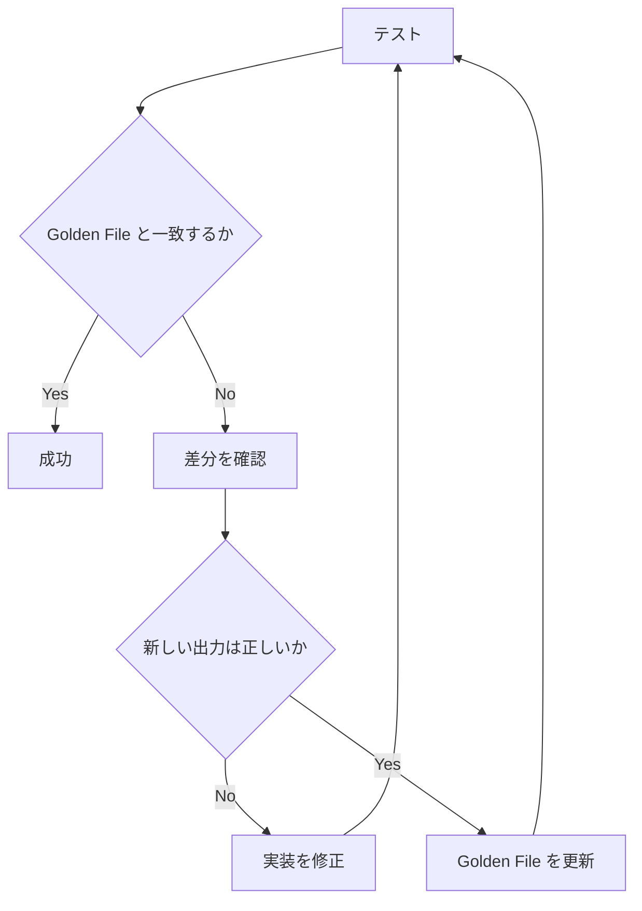

# Golden File

## Golden File はいつ使うか

HTML や大きな JSON のように、個別のアサーションを大量に書くより出力全体を確認したほうがわかりやすい場合は、Golden File を使います。`@riebeckite/test` には2つのヘルパーがあります。

| ヘルパー | 用途 |
| --- | --- |
| `assertGolden(actual, goldenUrl)` | HTML、Markdown、テキスト、シリアライズした JSON |
| `assertGoldenJson(value, goldenUrl)` | オブジェクト / JSON |

`assertGoldenJson()` は比較の前に、値を次の形に整形します。

```ts
JSON.stringify(value, null, 2)
```

## Golden File はどこに置くか

期待値は `test/__golden__/` に置きます。たとえば、次のような構成です。

```text
test/
├─ toc.test.ts
└─ __golden__/
   └─ toc.html
```

テストからは `import.meta.url` を基準に URL を渡します。

```ts
import { test } from "node:test";
import {
  assertGolden,
} from "@riebeckite/test";

test("renders the table of contents", () => {
  assertGolden(
    renderToc(entries),
    new URL(
      "./__golden__/toc.html",
      import.meta.url,
    ),
  );
});
```

絶対パスやカレントディレクトリに依存させないことが重要です。

## Golden File はどう比較されるか

既定では、出力を少し正規化してから比較します。具体的には、CRLF / CR を LF に、末尾の複数の改行を1つの改行に統一します。

```text
CRLF / CR
    ↓
LF

末尾の複数改行
    ↓
1つの改行
```

これにより、Windows / Linux の違いやエディタの設定による不要な差分を防げます。バイト単位で厳密に比較する必要がある場合は、`{ normalize: false }` を渡します。

```ts
assertGolden(
  actual,
  goldenUrl,
  {
    normalize: false,
  },
);
```

## Golden File が一致しないときはどうするか

Golden File が存在しない場合、または現在の出力と一致しない場合、テストは失敗します。出力の変更が意図したものであることを確認したら、次のコマンドで Golden File を更新します。

```sh
pnpm test:update
```



Golden File をコミットするのは意図的です。出力の変更を、次のような差分として Pull Request 上でレビューできるようにするためです。

```diff
- 以前の出力
+ 新しい出力
```

**Golden File の更新そのものを修正として扱わず、なぜ出力が変わったのかを必ず確認してください。**

## Node.js の Snapshot を使わない理由

Riebeckite では、Node.js 組み込みの Snapshot アサーションを使っていません。Node.js の Snapshot アサーションを更新するには、次のフラグを使います。

```text
--test-update-snapshots
```

このフラグは Node.js 22.3 以降を必要とします。Riebeckite は Node.js 20.19 以降も対象としているため、独自の Golden File ヘルパーを用意しています。
