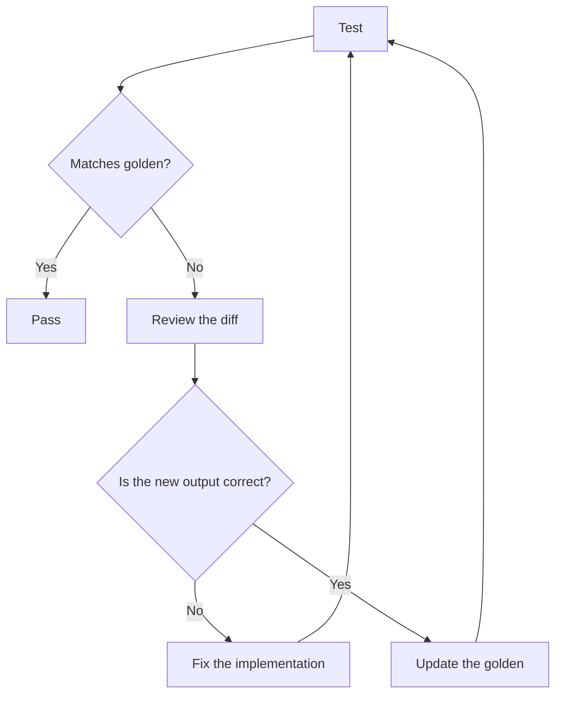

# Golden files

`@riebeckite/test` provides two helpers for large or structured output:

- `assertGolden(actual, goldenUrl)` for text (HTML, Markdown, serialized JSON).
- `assertGoldenJson(value, goldenUrl)` for objects, which formats the value
  with `JSON.stringify(value, null, 2)` before comparing.

Pass the expected file as a `URL` built from `import.meta.url` and keep the
recorded file under `test/__golden__/`:

```ts
import { assertGolden } from "@riebeckite/test";

test("renders the table of contents", () => {
  assertGolden(renderToc(entries), new URL("./__golden__/toc.html", import.meta.url));
});
```

On default normalization the helper converts CRLF/CR to LF and collapses
trailing newlines to one, so golden files stay stable across platforms and
editors. Pass `{ normalize: false }` when byte-exact output matters.

A missing or mismatched golden file fails the test. When the new output is
correct, regenerate it with `pnpm test:update` and review the resulting diff.
Golden files are committed on purpose: a change to recorded output should be
readable in a pull request.



Do not treat updating the golden file as the fix itself: confirm why the output
changed before regenerating it.

Node's built-in snapshot assertion (`--test-update-snapshots`) is intentionally
not used because it requires Node 22.3+, while Riebeckite supports Node 20.19+.
