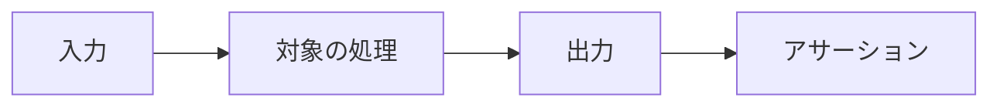
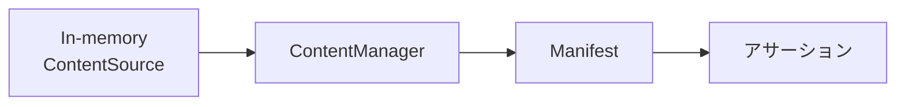

# プラグイン

## プラグインはどうテストするか

プラグインのテストは、確認したい範囲に合わせて4つのレベルに分けられます。すべてを行う必要はありません。変更した振る舞いを確認できる最小のレベルから始めてください。

```text
Level 1  Pure logic            通常の test runner でよい
Level 2  Markdown / HTML       Pipeline に Plugin を渡して変換結果を検証
Level 3  Content / lifecycle   ContentManager + In-memory ContentSource
Level 4  外部パッケージ境界     packed tarball を隔離 Site へ install
```

### Level 1: 純粋なロジック

Option の解決、文字列変換、AST ヘルパーなど、Riebeckite に依存しない処理は `node:test` などの通常のテストランナーでテストします。このレベルでは `@riebeckite/test` も `ContentManager` も必要ありません。

### Level 2: Markdown / HTML の変換

Markdown / HTML の変換は、公開されている `Pipeline` にプラグインを渡して検証できます。

```ts
import { Pipeline } from "@riebeckite/core";
import { tip } from "../src/index.ts";

const pipeline = new Pipeline(new Map(), new Map(), undefined, {
  plugins: [tip()],
});

const { html } = await pipeline.execute(":::tip\nSave often.\n:::");
assert.match(html, /<aside class="rr-tip">/);
```

`Pipeline` の第1引数は content index、第2引数は permalink の `Map` です。単一のドキュメントを変換するだけなら、どちらも空の `Map` で構いません。第3引数は、プラグインが embed など他のコンテンツを解決する場合にだけ必要です。プラグインのテストでは、このレベルを最もよく使います。

### Level 3: コンテンツとライフサイクル

コンテンツの読み込み、フック、manifest、Page Type を検証する場合は、In-memory の `ContentSource` と `ContentManager` を使います。後述の「Content System をテストする」で示す形と同じです。`getProcessedContent()` は[[glossary/pipeline|パイプライン]]と[[glossary/content-hook|コンテンツフック]]を通した結果を返し、`getManifest()` は解決済みのプラグインを含む manifest を返します。

### Level 4: 公開パッケージの境界

配布するパッケージは、`pnpm pack` した tarball を monorepo の外にある隔離サイトへインストールして検証します。これにより、公開エクスポートの不足、`@riebeckite/core/src/**` への誤った依存、`dependencies` の宣言漏れ、型定義の欠落を検出できます。

このリポジトリでは `tests/plugin-dx` が実例で、`pnpm test:plugin-dx` と `pnpm test:plugin-dx:external` で実行します。

### `@riebeckite/test` は何を提供するか

`@riebeckite/test` は、複数のパッケージで共有するテストヘルパーを提供します。Golden File の比較（`assertGolden` / `assertGoldenJson`）などが含まれますが、必須ではありません。Level 1〜3 のほとんどは `node:test` と公開 Core API（`Pipeline` / `ContentManager`）だけで書けます。`@riebeckite/test/e2e` は外部サイトを生成して検証するリポジトリ向けのエンジンで、第三者のプラグインが通常使うものではありません。

## テストはどう書くか

基本は、対象パッケージの公開 API へ入力を渡し、その結果をアサートします。Riebeckite のプラグインのロジックには純粋関数として切り出せる処理が多いため、すべてのテストでビルドパイプライン全体を起動する必要はありません。

```ts
import assert from "node:assert/strict";
import { test } from "node:test";

import { renderBreadcrumbNav } from "../src/render.ts";

test("renders nothing for a single root item", () => {
  assert.equal(
    renderBreadcrumbNav([]),
    "",
  );
});
```



小さい処理は、可能な限りこの形で直接テストしてください。

## Content System をテストする

Content System の動作を確認したい場合は、実際のファイルシステムを用意するより、In-memory の `ContentSource` を使うのが基本です。

```ts
const source = {
  async scan() {
    return [
      {
        path: "notes/index.md",
      },
    ];
  },

  async read(entry) {
    return `# ${entry.path}`;
  },
};

const config = resolveConfig({
  content: {
    directory: ".",
  },
});

const manager = new ContentManager(
  source,
  [],
  { config },
);

const manifest =
  await manager.getManifest();
```



In-memory の `ContentSource` を `ContentManager` に渡し、得られた manifest を検証します。この小さい範囲で、Content System の動作を確認できます。

実際のサイトや Vite ビルドが必要な問題でなければ、テストのためだけにアプリケーション全体を組み立てないでください。
