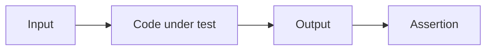

# Plugins

## Writing a test

Import the public surface of the package under test and assert on the output.
Most plugin logic is pure and can be tested without a full build pipeline.

```ts
import assert from "node:assert/strict";
import { test } from "node:test";

import { renderBreadcrumbNav } from "../src/render.ts";

test("renders nothing for a single root item", () => {
  assert.equal(renderBreadcrumbNav([]), "");
});
```



Content-facing behavior is usually exercised through an in-memory
`ContentSource` and `resolveConfig`, then `ContentManager`:

```ts
const source = {
  async scan() {
    return [{ path: "notes/index.md" }];
  },
  async read(entry) {
    return `# ${entry.path}`;
  },
};
const config = resolveConfig({ site: { title: "Test" }, content: { directory: "." } });
const manager = new ContentManager(source, [], { config });
const manifest = await manager.getManifest();
```


This exercises the [[framework/content-system|Content System]] in a small scope. Do not assemble the whole
application just for a test unless the problem needs a real site or a Vite build.

## Testing a plugin

A plugin can be tested at four levels. You do not need all of them; start from the smallest level that proves the behavior you changed.

```text
Level 1  Pure logic               A normal test runner is enough.
Level 2  Markdown / HTML          Pass the plugin to a Pipeline and assert the transformed output.
Level 3  Content / lifecycle      Use ContentManager with an in-memory ContentSource.
Level 4  Public package boundary  Pack the tarball and install it into an isolated site.
```

### Level 1: Pure logic

Option resolution, string transforms, and AST helpers that do not depend on Riebeckite run under any runner such as `node:test`. No `@riebeckite/test` or `ContentManager` is needed at this level.

### Level 2: Markdown / HTML transformation

Pass the plugin to the public `Pipeline`:

```ts
import { Pipeline } from "@riebeckite/core";
import { tip } from "../src/index.ts";

const pipeline = new Pipeline(new Map(), new Map(), undefined, {
  plugins: [tip()],
});

const { html } = await pipeline.execute(":::tip\nSave often.\n:::");
assert.match(html, /<aside class="rr-tip">/);
```

The first argument is the content index and the second is the permalink map; empty `Map`s are enough for a single document. The third argument is only needed when the plugin resolves embeds or other content. This is the level most plugin tests need.

### Level 3: Content / lifecycle

Use `ContentManager` with an in-memory `ContentSource` (the same shape shown above) to test content loading, hooks, manifests, or Page Types. `getProcessedContent()` returns the result of the pipeline plus content hooks; `getManifest()` returns the manifest including resolved plugins.

### Level 4: Public package boundary

For a package you distribute, `pnpm pack` it and install the tarball into an isolated site outside the monorepo. This catches missing public exports, accidental `@riebeckite/core/src/**` imports, undeclared dependencies, and missing declarations. `tests/plugin-dx` in this repository is the working example and runs with `pnpm test:plugin-dx` and `pnpm test:plugin-dx:external`.

### The role of `@riebeckite/test`

`@riebeckite/test` provides shared test helpers such as the golden-file assertions `assertGolden` and `assertGoldenJson`. It is **optional**: most Level 1-3 tests can be written with just `node:test` and the public core APIs (`Pipeline` / `ContentManager`). `@riebeckite/test/e2e` is the repository-oriented engine that builds an external site; third-party plugins do not normally need it.
