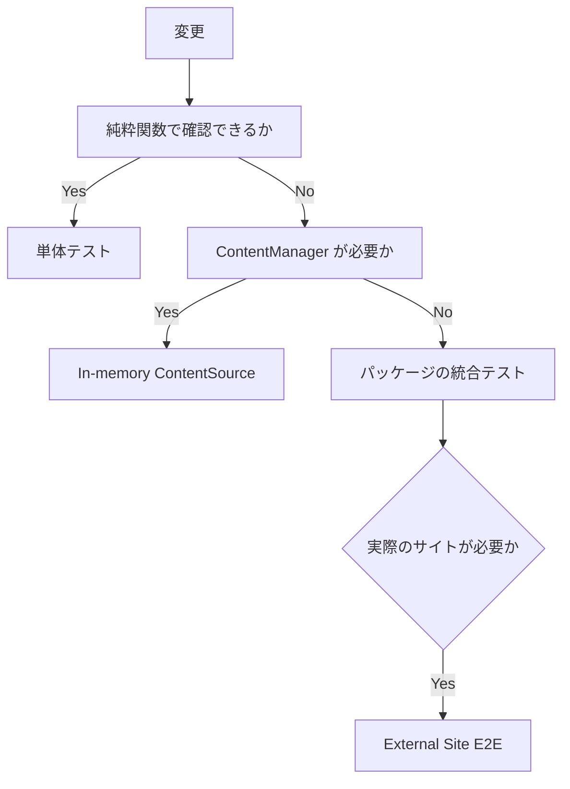
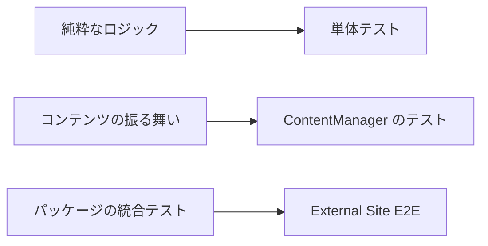

# 方針

## パッケージにテストを追加する

まだテストがないパッケージに追加する場合は、次の順に設定します。

### 1. `tsx` を追加する

パッケージの `devDependencies` に `tsx` を追加します。

### 2. `test` スクリプトを追加する

```json
{
  "scripts": {
    "test": "node --import tsx --test \"test/*.test.ts\""
  }
}
```

### 3. 必要なら `@riebeckite/test` を追加する

Golden File のヘルパーなどを使う場合は、`@riebeckite/test` を `devDependencies` に追加します。

### 4. プラグインのメタデータを更新する

プラグインのパッケージでは、`scripts/package_metadata.mjs` の `hasTests` にパッケージのディレクトリ名を追加します。

### 5. パッケージのメタデータを検証する

依存関係を変更したら、次の2つのコマンドを実行します。

```sh
pnpm install
pnpm check:packages
```

`scripts/check_packages.mjs` は、各パッケージのメタデータを `scripts/package_metadata.mjs` の定義と比較します。たとえば、次のような問題を検出します。

- `test` スクリプトが必要なのに存在しない
- `hasTests` に追加されていない
- 期待するメタデータと一致しない

## 何をテストするか

テストでは、**決定的で再現可能な振る舞い**を優先します。特に次のような処理が向いています。

- Option の解決
- 検証
- デフォルト値の扱い
- permalink の解決
- TOC の構築
- メタデータの抽出
- HTML のレンダリング
- JSON の生成
- 空の入力
- frontmatter の欠落
- slug の重複
- 不正な属性

たとえば純粋関数なら、次のように同じ入力から常に同じ出力が得られるため、安定したテストを書きやすくなります。

```text
同じ入力
   ↓
同じ処理
   ↓
常に同じ出力
```

## どんなテストを避けるか

ネットワーク、実時刻、乱数、マシン固有の絶対パス、カレントディレクトリなどに依存するテストは可能な限り避けます。こうした外部の状態や予測できない値は、テストを非決定的にします。

```text
Network
Current Time
Random Value
Machine-specific Absolute Path
Current Working Directory
```

たとえば、テスト対象のコードの内部で次のように時刻を取得すると、テストを実行する時刻によって結果が変わります。

```ts
const now = new Date();
```

代わりに、必要な値を外から注入できるようにします。

```ts
function createEntry(now: Date) {
  // ...
}
```

テストでは固定値を渡します。

```ts
const now =
  new Date("2026-01-01T00:00:00Z");

const entry =
  createEntry(now);
```

乱数も同じです。テスト側で実際の時刻や乱数を予測するのではなく、**判断に必要な値を外から渡せる設計**にしてください。

## どこまでテストするか

変更した処理に最も近い、小さい範囲からテストします。



単純な[[glossary/renderer|レンダラー]]の修正を確認するために External Site E2E を使う必要はありません。逆に、次のような問題は単体テストだけでは十分ではないため、External Site E2E で確認します。

- パッケージの配布形式
- 外部の利用者からのインポート
- 実際のサイトのビルド
- 複数の Integration にまたがる問題

## 基本方針

Riebeckite のテストでは、**変更した振る舞いを確認できる最小の範囲で、決定的なテストを書く**ことを基本にします。



大きなビルドを毎回再現するのではなく、純粋関数や In-memory の `ContentSource` で確認できる処理は小さくテストします。パッケージ境界や実際の外部利用者に関わる問題は E2E で確認します。

Golden File は、テストを通すための Snapshot ではなく、**レビュー可能な期待出力**として扱ってください。
