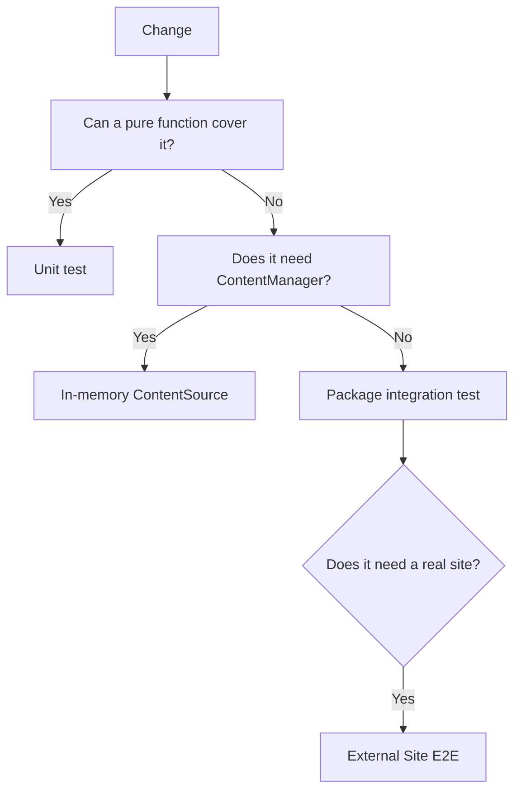
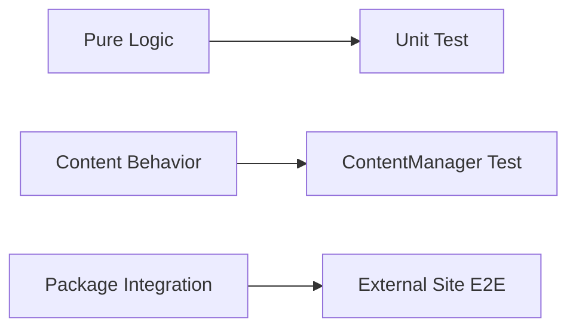

# Policy

## Adding tests to a package

1. Add `tsx` to the package's `devDependencies` and a `test` script:
   `node --import tsx --test "test/*.test.ts"`.
2. If the tests use the golden helpers, add `@riebeckite/test` to
   `devDependencies` and import them from `@riebeckite/test`.
3. If the package is a plugin, add its directory name to the `hasTests` list in
   `scripts/package_metadata.mjs`.
4. Run `pnpm install` when dependencies change, then `pnpm check:packages` to
   confirm the expected metadata matches.

`scripts/check_packages.mjs` compares each package's metadata against
`scripts/package_metadata.mjs`, so a missing `test` script or an unlisted plugin
is reported as a failure.

## What to test

Prefer deterministic, pure behavior:

- Option resolution, validation, and default handling.
- Content processing such as permalink resolution, TOC construction, and
  metadata extraction.
- Rendered HTML and generated JSON, captured as golden files.
- Boundary cases: empty input, missing frontmatter, duplicate slugs, and
  malformed attributes.

## Tests to avoid

Avoid tests that depend on the network, the wall clock, or absolute paths. These
external states make a test non-deterministic:

```text
Network
Current Time
Random Value
Machine-specific Absolute Path
Current Working Directory
```

For example, reading the time inside the code under test changes the result
depending on when the test runs:

```ts
const now = new Date();
```

Instead, make the needed value injectable:

```ts
function createEntry(now: Date) {
  // ...
}
```

The test then passes a fixed value:

```ts
const now = new Date("2026-01-01T00:00:00Z");

const entry = createEntry(now);
```

The same applies to randomness. Do not predict the real time or a random value in
the test; design the code so the value needed for the decision is passed in from
outside.

## How much to test

Start from the smallest scope closest to the change:



You do not need the External Site E2E suite to verify a simple renderer change.
Conversely, package distribution format, imports from an external consumer, a
real site build, and problems that cross integrations are not sufficiently
covered by unit tests and should be checked with External Site E2E.

## Basic policy

Riebeckite tests follow one principle: **write deterministic tests at the
smallest scope that can verify the changed behavior.**



Rather than reproducing a large build every time, test pure functions and
in-memory `ContentSource` behavior in a small scope. Problems that involve
package boundaries or a real external consumer are checked with E2E.

Treat a golden file not as a snapshot to make the test pass but as a **reviewable
expected output**.
