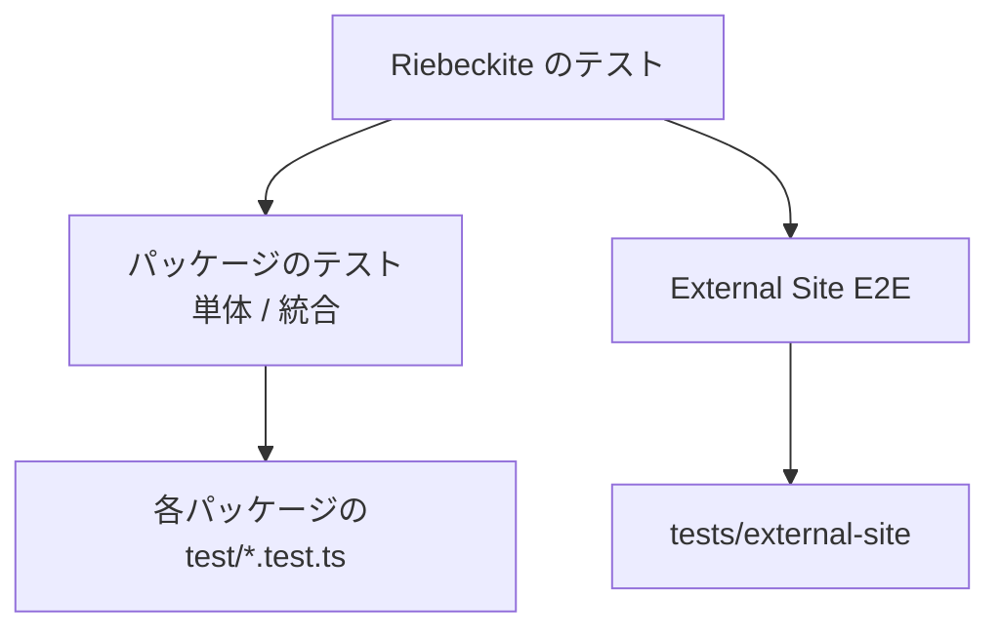

# 実行

## テストの種類には何があるか

Riebeckite のテストは大きく2種類に分かれます。



このページで主に扱うのは、**各パッケージに置くテスト**です。External Site E2E は次のコマンドで実行します。

```sh
pnpm test:e2e:external
```

また、第三者プラグインを外部パッケージの立場で検証する Fixture は `tests/plugin-dx` にあります（独立した pnpm workspace です）。

```sh
pnpm --dir tests/plugin-dx install --frozen-lockfile
pnpm test:plugin-dx            # Public API だけで書いた Plugin の Unit Test
pnpm test:plugin-dx:external   # packed tarball を隔離 Site へ install して検証
```

`test:plugin-dx:external` は `@riebeckite/core` と Fixture [[glossary/plugin|プラグイン]]を `pnpm pack` し、monorepo の外にある隔離サイトへインストールします。公開済みパッケージだけでプラグインが動作することを確認するテストで、外部に配布するプラグインの回帰検知に使えます。

## テストを実行する

よく使うコマンドは次のとおりです。

| コマンド | 内容 |
| --- | --- |
| `pnpm test` | `test` スクリプトを持つすべてのパッケージをテストする |
| `pnpm --filter <package> test` | 特定のパッケージだけをテストする |
| `pnpm test:update` | すべての Golden File を現在の出力で更新する |
| `pnpm test:e2e:external` | External Site E2E を実行する |
| `pnpm test:plugin-dx` | 外部パッケージの視点でプラグイン Fixture をテストする |
| `pnpm test:plugin-dx:external` | packed tarball を隔離サイトへインストールしてプラグインを検証する |
| `pnpm test:registry` | Scaffold のインストールの取り決めを npm で公開済みの artifact に対して実行する |

Scaffold のインストールの取り決めの検証では、既定で **workspace を `pnpm pack` した artifact** をインストールします。そのため、新しいパッケージを追加したブランチでも公開前に検証できます。`pnpm test:registry` は同じ取り決めを npm からのインストールに切り替え、公開済みの artifact が解決できることを確認します。リリース後に実行してください。

通常は、変更した範囲に近いテストから実行します。たとえば TOC プラグインだけを変更した場合は次のとおりです。

```sh
pnpm --filter @riebeckite/plugin-toc test
```

その後、変更が他のパッケージに影響しうる場合は、リポジトリ全体のテストを実行します。

```sh
pnpm test
```

## 特定の Golden File だけを更新する

1つのパッケージの Golden File だけを更新したい場合は、テストの実行前に `UPDATE_GOLDEN=1` を設定します。PowerShell では次のようになります。

```powershell
$env:UPDATE_GOLDEN=1; pnpm --filter @riebeckite/plugin-toc test
```

Golden File の更新は、テストを通すための作業ではありません。**新しい出力が正しいことを確認してから更新してください。**

## テストはどこに置くか

各パッケージのテストは `test/*.test.ts` に置き、パッケージ自身が `test` スクリプトを宣言します。ブラウザ専用のテストは `test/browser/` に置き、`test:browser*` という別のスクリプトで実行します。ルートの `test` コマンドには含まれません。

```json
{
  "scripts": {
    "test": "node --import tsx --test \"test/*.test.ts\""
  }
}
```

たとえば、次のような構成です。

```text
packages/plugins/example/
├─ src/
├─ test/
│  ├─ example.test.ts
│  └─ __golden__/
│     └─ example.html
├─ package.json
└─ index.ts
```

`test/` ディレクトリとテストファイルは、型チェック、パッケージのビルド、公開パッケージの `files` から除外されます。そのため、テストコードが利用者へ配布されることも、利用側のビルドに影響することもありません。

## 共有テストユーティリティはどこにあるか

複数のパッケージから使うテスト用の機能は、workspace パッケージ `@riebeckite/test` にあります。必要なパッケージの `devDependencies` に追加し、公開 API からインポートします。

```ts
import {
  assertGolden,
} from "@riebeckite/test";
```

テスト専用の共通処理を各プラグインにコピーしないでください。
