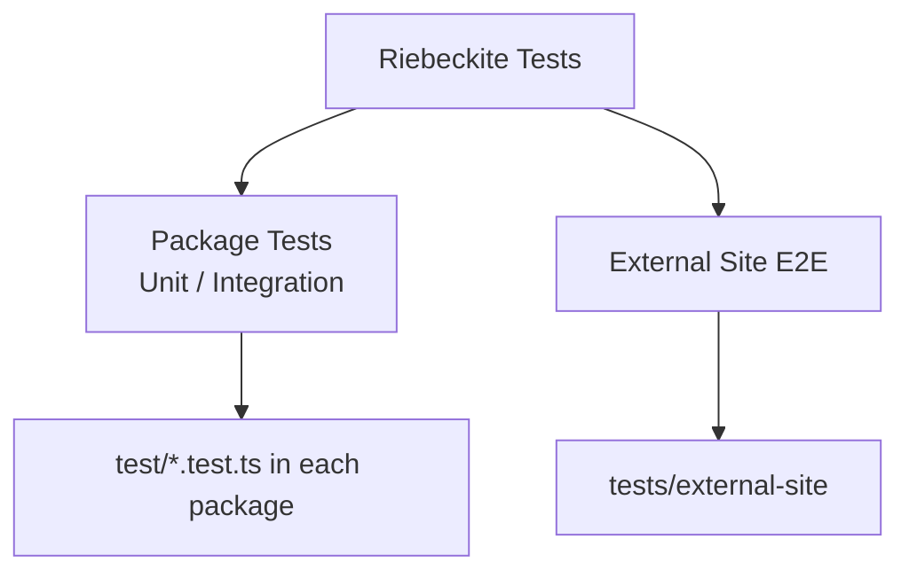

# Running

## Types of tests

Riebeckite has two broad kinds of tests:



This page mainly covers the **tests that live next to each package**.

Third-party plugin authoring and packaging are exercised from an external
package's perspective in `tests/plugin-dx` (its own pnpm workspace):

```sh
pnpm test:plugin-dx            # unit tests for plugins that use only public APIs
pnpm test:plugin-dx:external   # pack tarballs, install into an isolated site, verify
```

`test:plugin-dx:external` packs `@riebeckite/core` and fixture plugins, installs
them into a site outside this monorepo, and confirms the plugin works through
published packages only. Use it as a regression check for a plugin you
distribute.

## Running tests

|Command|What it does|
|---|---|
|`pnpm test`|Run every package that defines a `test` script (`pnpm -r test`)|
|`pnpm --filter @riebeckite/plugin-toc test`|Run one package's tests|
|`pnpm test:update`|Rewrite every golden file with the current output|
|`pnpm test:e2e:external`|Run the external-site integration suite|
|`pnpm test:plugin-dx`|Run the external-package plugin fixtures|
|`pnpm test:plugin-dx:external`|Pack tarballs, install into an isolated site, and verify plugins|
|`pnpm test:registry`|Run the scaffold install contracts against npm-published artifacts|

The scaffold install contracts validate the generated site against **locally
packed workspace artifacts** by default, so a branch that adds a new package can
be verified before it is published. `pnpm test:registry` switches the same
contracts to install from npm and assert the published artifacts resolve; run it
after a release.

Usually start with the tests closest to your change. If you only changed the TOC
plugin, for example:

```sh
pnpm --filter @riebeckite/plugin-toc test
```

Run the full repository suite with `pnpm test` afterwards when the change can
affect other packages.

For a single package you can also update only its golden files by setting
`UPDATE_GOLDEN=1` before its test script. In PowerShell:

```powershell
$env:UPDATE_GOLDEN=1; pnpm --filter @riebeckite/plugin-toc test
```

## Where tests live

Each package keeps its tests in `test/*.test.ts` and declares its own `test`
script (`node --import tsx --test "test/*.test.ts"`). Test directories and test
files are excluded from type checking, from builds, and from published `files`,
so they never ship or affect consumers. Browser-only tests live in
`test/browser/` and run through separate `test:browser*` scripts; the root
`test` command does not include them.

For example:

```text
packages/plugins/example/
├─ src/
├─ test/
│  ├─ example.test.ts
│  └─ __golden__/
│     └─ example.html
├─ package.json
└─ index.ts
```

Shared test utilities live in the workspace package `@riebeckite/test`. Add it
to a package's `devDependencies` and import from `@riebeckite/test`. Do not copy
test-only helpers into each plugin.
