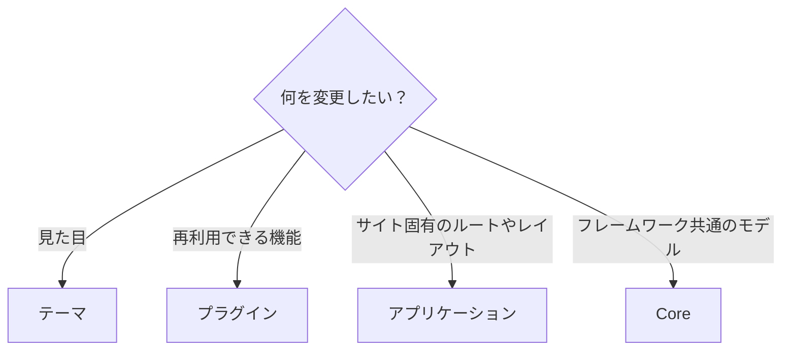
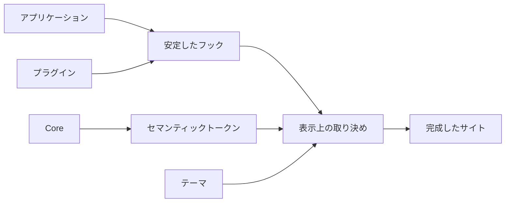

# テーマ作成の詳細

このページは、Riebeckiteのテーマを実際に設計・実装するときの詳細ガイドです。初めてテーマを作る場合は、先に[はじめてのテーマ作成](../themes/writing-a-theme.ja.md)を読んでください。

ここでは、その次の段階で必要になる次の内容を扱います。

- テーマの責務
- `defineTheme`
- カラーモード
- タイポグラフィ
- レイアウト
- デザイントークン
- 安定したCSSフック
- テーマ固有のオプション
- CSSのカスケード
- パッケージとしての配布

各型やフィールドの完全な定義を確認したい場合は [Theme API](../reference/theme-api.ja.md) を参照してください。


## このページの構成

- [カラーモード](./theme-system/color-mode.ja.md)
- [タイポグラフィと記事レイアウト](./theme-system/typography.ja.md)
- [デザイントークン](./theme-system/tokens.ja.md)
- [テーマのルートと属性](./theme-system/theme-root.ja.md)
- [安定したCSSフックとカスケード](./theme-system/css.ja.md)
- [テーマの配布と検証](./theme-system/distribution.ja.md)

## 1. テーマで変えてよいもの

[[glossary/theme|テーマ]]は**表示層**です。サイトの機能やコンテンツの意味は変えず、見た目だけを変更します。

| テーマでできること | テーマでしないこと |
| --- | --- |
| トークンの上書き・追加 | コンポーネントの置き換え |
| CSSルールの定義 | JSXの注入 |
| テーマ固有の `data-*` 属性 | ルートの追加 |
| カラーモードの宣言 | プラグインの追加・削除 |
| タイポグラフィの宣言 | クライアントスクリプトの実行 |
| レイアウトプリセットの宣言 | DOMの変換 |
| 安定したフックへのスタイル指定 | アイランドの登録 |
| `userCss` による最終的な上書き | ファイルシステムやContentManagerへのアクセス |

迷った場合は、次のように判断します。



判断の基準は次のとおりです。

```text id="kl9kkm"
機能
  → プラグイン

見た目
  → テーマ

サイト固有のルート
  → アプリケーション
```

見た目を変えるためだけにプラグインを作ったり、機能を追加するためにテーマを拡張したりしないでください。

## 2. 最小のテーマ

テーマは `defineTheme()` で定義します。

```ts id="yplspq"
import { defineTheme } from "@riebeckite/core";

export function exampleTheme() {
  return defineTheme({
    name: "example",

    styles: [
      {
        moduleSpecifier:
          "@riebeckite/theme-example/style.css",
      },
    ],
  });
}
```

サイトの設定では、`theme` に指定します。

```ts id="ij1yvm"
export default defineConfig({
  theme: exampleTheme(),
});
```

これが最小構成です。


## 3. `defineTheme` の取り決め

テーマが扱う主な項目は次のとおりです。

| 領域 | 内容 |
| --- | --- |
| 基本情報 | `name` |
| テーマ固有の設定 | `options` |
| CSS | `styles[].moduleSpecifier` |
| 共通設定 | `colorMode`, `typography`, `articleLayout`, `tokens`, `userCss` |
| 属性 | 安全な `data-*` 属性 |

たとえば、次のように定義できます。

```ts id="k0nh8m"
import { defineTheme } from "@riebeckite/core";

export function exampleTheme() {
  return defineTheme({
    name: "example",

    options: {
      // テーマ固有のオプション
    },

    styles: [
      {
        moduleSpecifier:
          "@riebeckite/theme-example/style.css",
      },
    ],

    attributes: {
      "data-example-flag": "on",
    },
  });
}
```

`styles[].moduleSpecifier` には、ホスト側のバンドラーが解決できるモジュール指定子を書きます。CSSファイルをアプリケーションのディレクトリへコピーするためのパスではありません。

## 4. サイト内だけで使うテーマ

テーマは、npmパッケージとして公開しなくても利用できます。たとえば、次のようにサイト内へ置けます。

```text id="10b70z"
site/
└─ extensions/
   ├─ local-theme.ts
   └─ theme.css
```

```ts id="31fzcq"
// site/extensions/local-theme.ts

import { defineTheme } from "@riebeckite/core";

export function localTheme() {
  return defineTheme({
    name: "site-local",

    styles: [
      {
        moduleSpecifier:
          "/extensions/theme.css",
      },
    ],

    attributes: {
      "data-site-local": "on",
    },
  });
}
```

サイト内に置いたテーマでも、`name`、`styles`、`attributes`、`tokens` は公開パッケージのテーマと同じく `resolveThemeConfig` で解決され、無害化されたうえで適用されます。

## 5. テーマ固有のオプション

テーマ固有の機能は、ファクトリのオプションとして定義します。

```ts id="94pd1f"
type NewspaperOptions = {
  density?:
    | "compact"
    | "comfortable";
};

export function newspaperTheme(
  options: NewspaperOptions = {},
) {
  return defineTheme({
    name: "newspaper",

    options,

    attributes: {
      "data-newspaper-density":
        options.density
        ?? "comfortable",
    },

    styles: [
      {
        moduleSpecifier:
          "@riebeckite/theme-newspaper/style.css",
      },
    ],
  });
}
```

このオプションはCoreの `ThemeConfig` には追加しません。テーマ固有の概念は、そのテーマのパッケージ内で完結させます。

```text id="2cqt02"
newspaper の density
  → newspaperTheme が所有

tokyonight の neon
  → tokyonightTheme が所有
```

## 6. テーマを作るときの基本方針

テーマの実装では、次の境界を保つことが重要です。



テーマは、アプリケーションやプラグインの内部構造を所有しません。フレームワークとプラグインが公開した次の取り決めを利用します。

```text id="ysb8qa"
安定したCSSフック
セマンティックデザイントークン
テーマ属性
CSSのカスケード
```

テーマ固有の設定はテーマのパッケージ内に閉じ込め、Coreへ漏らさないでください。また、テーマを変更しても次のものが変わらない状態を保ちます。

```text id="e6c5sk"
コンテンツ
ルート
マニフェスト
Content Graph
プラグインの動作
クライアントの動作
```

**機能はプラグイン、構造はフレームワークとアプリケーション、見た目はテーマ**という境界を守れば、テーマを交換しても同じサイトとプラグインをそのまま利用できます。

## 関連資料

- [[writing-a-theme|はじめてのテーマ作成]]：最初のテーマを作る
- [[theme-system|テーマシステム]]：テーマシステム全体の考え方
- [[plugin-system|プラグインシステム]]：プラグインとの責務の違い
- [[reference/README|フレームワークリファレンス]]：`defineTheme` などの公開API
