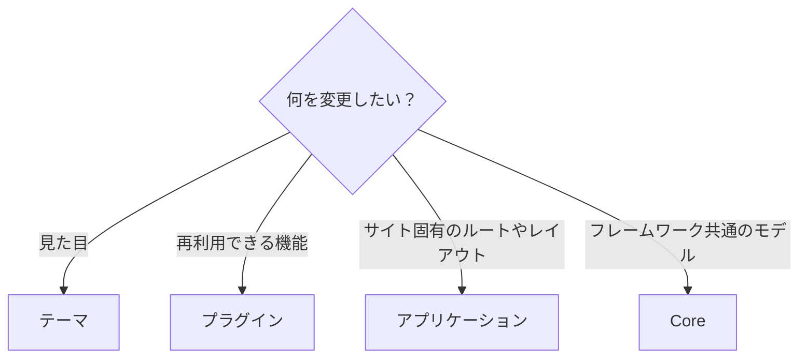
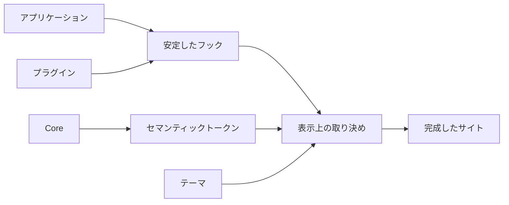

# テーマ作成の詳細

このページは、Riebeckite の[[glossary/theme|テーマ]]を実際に設計・実装するときの詳細ガイドです。初めてテーマを作る場合は、先に[はじめてのテーマ作成](../themes/writing-a-theme.ja.md)を読んでください。

ここでは、その次の段階で必要になる次の内容を扱います。

- テーマの責務
- `defineTheme`
- [[glossary/color-mode|カラーモード]]
- [[glossary/typography|タイポグラフィ]]
- レイアウト
- [[glossary/design-token|デザイントークン]]
- 安定した CSS フック
- テーマ固有のオプション
- CSS のカスケード
- パッケージとしての配布

各型やフィールドの完全な定義を確認したい場合は [Theme API](../reference/theme-api.ja.md) を参照してください。


## このページの構成

- [カラーモード](./theme-system/color-mode.ja.md)
- [タイポグラフィと記事レイアウト](./theme-system/typography.ja.md)
- [デザイントークン](./theme-system/tokens.ja.md)
- [テーマのルートと属性](./theme-system/theme-root.ja.md)
- [安定した CSS フックとカスケード](./theme-system/css.ja.md)
- [テーマの配布と検証](./theme-system/distribution.ja.md)

## 1. テーマで変えてよいもの

[[glossary/theme|テーマ]]は**[[glossary/presentation-layer|表示層]]**です。サイトの機能やコンテンツの意味は変えず、見た目だけを変更します。

| テーマでできること | テーマでしないこと |
| --- | --- |
| トークンの上書き・追加 | コンポーネントの置き換え |
| CSS ルールの定義 | JSX の注入 |
| テーマ固有の設定を `data-rb-setting-*` 属性として宣言 | ルートの追加 |
| カラーモードの宣言 | [[glossary/plugin|プラグイン]]の追加・削除 |
| タイポグラフィ設定の宣言 | クライアントスクリプトの実行 |
| レイアウトの宣言 | DOM の変換 |
| 安定したフックへのスタイル指定 | [[glossary/island|アイランド]]の登録 |
| `stylesheets` による最終的な上書き | ファイルシステムや[[glossary/content-manager|ContentManager]]へのアクセス |

迷った場合は、次のように判断します。



判断の基準は次のとおりです。

```text id="kl9kkm"
機能
  → プラグイン

見た目
  → テーマ

サイト固有のルート
  → アプリケーション
```

見た目を変えるためだけにプラグインを作ったり、機能を追加するためにテーマを拡張したりしないでください。

## 2. 最小のテーマ

テーマは `defineTheme()` で定義します。

```ts id="yplspq"
import { defineTheme } from "@riebeckite/core";

export const exampleTheme = defineTheme({
    name: "example",

    styles: [
      {
        moduleSpecifier:
          "@riebeckite/theme-example/style.css",
      },
    ],

```

サイトの設定では、`theme` に指定します。

```ts id="ij1yvm"
export default defineConfig({
  theme: exampleTheme(),
});
```

これが最小構成です。


## 3. `defineTheme` の取り決め

テーマ定義は、次の4つの部分から成ります。

| 領域 | 内容 |
| --- | --- |
| 基本情報 | `name` |
| CSS | `styles[].moduleSpecifier` |
| 設定 | 任意の `settings` スキーマ |
| プリセット | 任意の名前付き設定プリセット |
| 配色 | 任意の `light` / `dark` 画像色 |

配色（`palette`）は任意です。生成する Open Graph 画像の背景色・前景色・アクセント色を指定するもので、CSS には影響しません。テーマの `--rb-color-paper`、`--rb-color-ink`、`--rb-color-accent` と揃えてください。

たとえば、次のように定義できます。

```ts id="k0nh8m"
import { defineTheme, defineThemeSettings } from "@riebeckite/core";

export const exampleTheme = defineTheme({
  name: "example",

  styles: [
    {
      moduleSpecifier:
        "@riebeckite/theme-example/style.css",
    },
  ],

  settings: defineThemeSettings({
    density: {
      type: "select",
      label: "Density",
      default: "comfortable",
      options: [
        { value: "comfortable", label: "Comfortable" },
        { value: "compact", label: "Compact" },
      ],
    },
  }),

  presets: {
    compact: {
      label: "Compact",
      settings: { density: "compact" },
    },
  
```

テーマは呼び出し可能な定義です。サイト設定では、`ThemeOptions`（`colorMode`、`layout`、`preset`、`settings`、`stylesheets`）を渡して使います。解決順は、スキーマの既定値、プリセット、明示的な `settings` の順です。

`styles[].moduleSpecifier` には、ホスト側のバンドラーが解決できるモジュール指定子を書きます。CSS ファイルをアプリケーションのディレクトリへコピーするためのパスではありません。

## 4. サイト内だけで使うテーマ

テーマは、npm パッケージとして公開しなくても利用できます。たとえば、次のようにサイト内へ置けます。

```text id="10b70z"
site/
└─ extensions/
   ├─ local-theme.ts
   └─ theme.css
```

```ts id="31fzcq"
// site/extensions/local-theme.ts

import { defineTheme } from "@riebeckite/core";

export const localTheme = defineTheme({
    name: "site-local",

    styles: [
      {
        moduleSpecifier:
          "/extensions/theme.css",
      },
    ],

```

サイト内に置いたテーマも、公開パッケージのテーマと同じ `defineTheme` の定義と解決経路を使います。

## 5. テーマ固有の設定

テーマ固有の項目は、Core の `ThemeOptions` に追加せず、テーマの設定スキーマに宣言します。

```ts id="94pd1f"
export const newspaperTheme = defineTheme({
  name: "newspaper",

  styles: [
    {
      moduleSpecifier:
        "@riebeckite/theme-newspaper/style.css",
    },
  ],

  settings: defineThemeSettings({
    density: {
      type: "select",
      label: "Density",
      default: "comfortable",
      options: [
        { value: "comfortable", label: "Comfortable" },
        { value: "compact", label: "Compact" },
      ],
    },
  }),
});
```

テーマを選ぶときに設定を指定します。

```ts
export default defineConfig({
  theme: newspaperTheme({
    settings: { density: "compact" },
  }),
});
```

設定は `data-rb-setting-*` 属性として反映され、色と数値の設定は `--rb-setting-*` カスタムプロパティにも反映されます。テーマ固有の設定が Core や他のテーマへ漏れることはありません。

```text id="2cqt02"
newspaper の density
  → newspaperTheme の設定スキーマが所有

tokyonight の neon
  → tokyonightTheme の設定スキーマが所有
```

## 6. テーマを作るときの基本方針

テーマの実装では、次の境界を保つことが重要です。



テーマは、アプリケーションやプラグインの内部構造を所有しません。フレームワークとプラグインが公開した次の取り決めを利用します。

```text id="ysb8qa"
安定したCSSフック
セマンティックデザイントークン
テーマ属性
CSSのカスケード
```

テーマ固有の設定はテーマのパッケージ内に閉じ込め、Core へ漏らさないでください。また、テーマを変更しても次のものが変わらない状態を保ちます。

```text id="e6c5sk"
コンテンツ
ルート
マニフェスト
Content Graph
プラグインの動作
クライアントの動作
```

**機能はプラグイン、構造はフレームワークとアプリケーション、見た目はテーマ**という境界を守れば、テーマを交換しても同じサイトとプラグインをそのまま利用できます。

## 関連資料

- [[writing-a-theme|はじめてのテーマ作成]]：最初のテーマを作る
- [[theme-system|テーマシステム]]：テーマシステム全体の考え方
- [[plugin-system|プラグインシステム]]：プラグインとの責務の違い
- [[reference/README|フレームワークリファレンス]]：`defineTheme` などの公開 API
