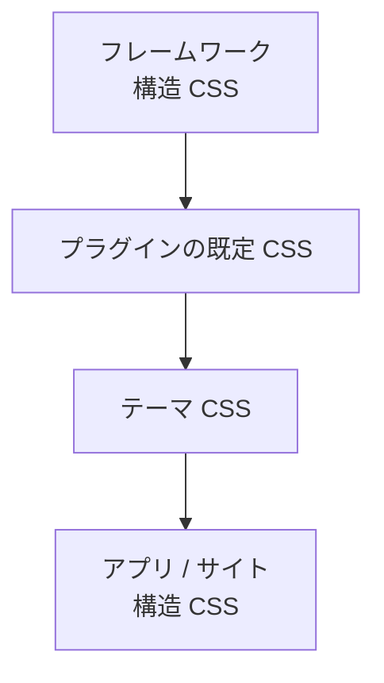
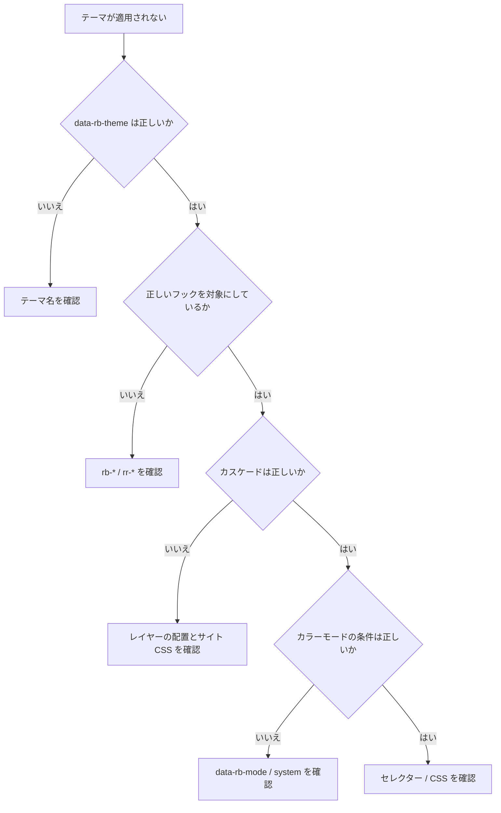

# 安定した CSS フックとカスケード

このページは[テーマ作成の詳細](../theme-system.ja.md)の一部で、`stylesheets`、安定した CSS フック、キャラクターレイヤー、CSS のカスケードを扱います。

## 3-5. `stylesheets`

`stylesheets` はアプリケーションのスタイルシートの後に読み込まれます。[[glossary/theme|テーマ]]をフォークせずに小さな最終調整をするためのものです。レイヤー外の通常宣言は、詳細度にかかわらずフレームワーク・プラグイン・テーマの通常宣言に勝ちます。ただし、インライン設定トークン、`!important`、アニメーション、トランジションは上書きしません。

```ts id="mphtk3"
theme: defaultTheme({
  stylesheets: [
    "/extensions/custom.css",
  ],
}),
```

## 5. 安定した CSS フック

テーマは、アプリケーションや[[glossary/plugin|プラグイン]]の内部マークアップではなく、文書化された安定したフックを対象にします。クラスの名前空間は2つあります。

- **`rb-*`** — フレームワークが提供する構造フックとセマンティックデザイントークン。`.rb-theme-root` は[[glossary/theme-root|テーマルート]]のコンテナです。
- **`rr-*`** — 新しいプラグインまたは機能が描画する最も外側の要素に付くルートフック。一部の組み込みプラグインは互換性のため、文書化された `rb-*` ルートも使います。

`rb-*` の構造フックは次のとおりです。

```text id="etblkj"
.rb-theme-root
.rb-site
.rb-article
.rb-article-layout
.rb-article-header
.rb-article-body
.rb-article-content
.rb-article-meta
.rb-article-footer
.rb-sidebar
```

レンダリングされた Markdown 本文は `.rb-article-content` に包まれます。Markdown のセマンティックなベースラインは、このラッパーが持ちます。対象となるのは、リストマーカーと字下げ、見出し、段落とブロックの余白、表、図、定義リスト、インラインコード、整形済みブロックです。テーマは `--rb-*` トークンとキャラクタールールを通じて、そのベースラインの見た目を整えます。構造を再宣言する必要はありません。ベースラインはレイヤー化されているため、テーマのキャラクタールールとユーティリティクラスは、どちらもベースラインに勝ちます。

`.rb-article-body` は、ヘッダー、メタデータ、レンダリングされた Markdown、[[glossary/plugin-component|プラグインコンポーネント]]を含む記事本文のシェルです。Markdown のタイポグラフィ自体は持たないため、プラグインコンポーネントはどこに置かれても独自の見出しを保ちます。

`rr-*` は新しいプラグインが公開するルートフックです。一部の組み込みプラグインは `rb-*` ルートも文書化しています。

```text id="rt44pe"
.rr-search
.rr-callout
.rr-table-of-contents
.rr-backlinks
.rr-local-graph
.rr-code
.rr-code-tabs
.rr-lightbox
.rr-excalidraw
.rr-mermaid
.rr-query
.rr-cardlink
.rr-diff-history
.rr-attachment
.rr-media
.rr-recent-posts
.rr-garden-explorer
```

テーマは、これらのルートフックと、プラグインが文書化した子孫要素だけを対象にします。BEM の要素（`__…`）と修飾子（`--…`）は内部実装の詳細です。たとえば、プラグインは内部で次のようなクラスを使う場合があります。

```text id="u7bmkr"
.rr-search
.rr-search__input
.rr-search__result
.rr-search--loading
```

公開フックは次のクラスです。

```text id="9k6dgy"
.rr-search
```

次のような部分は、プラグインが公開フックとして明示的に文書化していない限り、プラグイン内部のクラスとして扱います。

```text id="1ggxg1"
__input
__result
--loading
```

`.sr-only` のような汎用ヘルパークラスも、プラグインのフックではありません。プラグインのルートは、プラグインに応じて `.rr-*` または `.rb-*` フックを使います。各プラグインが文書化しているルートを対象にしてください。

フレームワーク CSS はリセットとベースの取り決めを担当します。サイト CSS はページの構造と配置を担当し、文書化されたプラグインのルートをサイトのレイアウト内に配置できます。プラグイン CSS は内部 [[glossary/ui|UI]] と操作を担当します。テーマ CSS は共通トークンと視覚表現を担当し、サイトのレイアウトや文書化されていないプラグイン内部を引き継ぎません。

### 5-1. キャラクターレイヤー

テーマはトークンの変更に限りません。テーマの境界の内側では、安定したフックを直接スタイルして、サイトに視覚的な個性を与えられます。

たとえば次のように、記事ヘッダーへ罫線を引けます。

```css id="n72uhc"
:is(:root, .rb-theme-root)
[data-rb-theme="example"]
.rb-article-header {
  border-bottom:
    var(--rb-rule-width)
    solid
    var(--rb-color-border);
}
```

対象にできるのは安定したフックだけです。テーマ側で、次のような新しいクラス名を発明しないでください。

```text id="mkmfyh"
rb-*
rr-*
```

これらをフレームワークの取り決めであるかのように扱ってはいけません。

トークンの定義は `@layer base` に置きます。

```css id="43rbsh"
@layer base {
  :is(:root, .rb-theme-root)
  [data-rb-theme="example"] {
    --rb-color-accent: #b45309;
  }
}
```

安定したフックに対するキャラクタールールは通常のテーマルールとして書きます。生成されたテーマエントリがテーマ全体を `rb-theme` に配置します。

```css id="s2xwqm"
:is(:root, .rb-theme-root)
[data-rb-theme="example"]
.rb-article-header {
  border-bottom:
    var(--rb-rule-width)
    solid
    var(--rb-color-border);
}
```

トークン定義は `@layer base` に置きます。生成時には `rb-theme.base` としてネストされるため、Tailwind の `base` レイヤーとは衝突しません。テーマの通常宣言はプラグインの通常宣言に勝ち、レイヤー外のサイト側通常宣言は詳細度にかかわらず両方に勝ちます。`!important` は使わないでください。

テーマパッケージには、セルフホストの Web フォントを含められます。フォントは次のように配置します。

```text id="8g43c5"
styles/
├─ theme.css
└─ fonts/
   └─ example-serif-latin.woff2
```

CSS では相対 URL を使います。

```css id="66ktv6"
@font-face {
  font-family: "Example Serif";

  src:
    url("./fonts/example-serif-latin.woff2")
    format("woff2");

  font-weight: 400 700;
  font-display: swap;
}
```

フォントを同梱する場合は、そのフォントのライセンスファイルもパッケージに含めてください。Latin サブセットのような比較的小さいフォントは同梱できます。日本語などの CJK フォントはファイルサイズが大きいため、基本的にはシステムフォントスタックへフォールバックします。

キャラクターレイヤーも表示専用です。コンテンツ、構造、振る舞いを変更してはいけません。

同一オリジンの通常宣言では、Riebeckite は次のカスケードレイヤー契約を定義します。

```text id="jz92ku"
base
        ↓
components
        ↓
utilities
        ↓
rb-plugins
        ↓
rb-theme
        ↓
レイヤー外のサイト CSS
```

フレームワークの構造 CSS は `base` と `components` を使い、プラグインは `rb-plugins`、テーマは `rb-theme` に import され、通常のサイト CSS はレイヤー外です。プラグイン内の `@layer utilities` は `rb-plugins.utilities`、テーマ内の `@layer base` は `rb-theme.base` になります。これにより、テーマは Tailwind のグローバルレイヤーに入らずにプラグインの外観を調整できます。サイト CSS は、フレームワーク・プラグイン・テーマの通常宣言を詳細度なしで上書きできます。

生成された import は文書化された順序のままにしてください。フレームワークのスタイルシートがレイヤー順を宣言するため、生成ファイルの順序を変えても通常宣言の契約は変わりません。サイトルールを意図して名前付きレイヤーへ置いた場合は、レイヤー外サイト CSS の保証ではなく、そのレイヤーの優先順位が適用されます。



この契約は同一オリジンの通常宣言だけを対象にします。`!important` はレイヤー順を反転し、インラインスタイルには別の author-origin 優先順位があり、アニメーションは通常宣言に、トランジションは重要宣言に勝ちます。CSS custom properties も同じカスケードに従って継承されるため、インライン設定トークンはスタイルシートのトークン定義を上書きします。生成ファイルを直接編集したり、契約を回避するために `!important` を使ったりしないでください。

```text id="4w8d9d"
Plugin
  → 標準の見た目

Theme
  → Plugin の見た目を変更

App / Site
  → ページ構造と配置

stylesheets
  → Site 利用者が最終調整
```

生成されたファイルを直接編集したり、インポート順を変更したりしないでください。生成される各ファイルには、カスケード上の位置を示すヘッダーコメントが付きます。カスケードは通常、`!important` に依存しません。

## トラブルシューティング: テーマが適用されない場合

テーマが期待どおりに適用されない場合は、次の順番で確認します。



特に確認する項目は次のとおりです。

1. `data-rb-theme` がテーマの `name` と一致しているか
2. `.rb-*` / `.rr-*` の正しい安定したフックを対象にしているか
3. 生成されたプラグインとテーマの import に `layer(rb-plugins)` と `layer(rb-theme)` が残っているか
4. `system` なのに `data-rb-mode=""` が残っていないか
5. テーマルートの外へセレクターが漏れていないか
