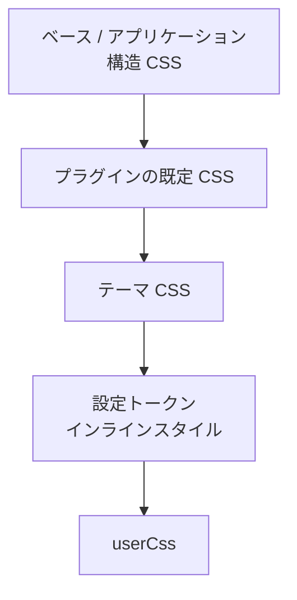
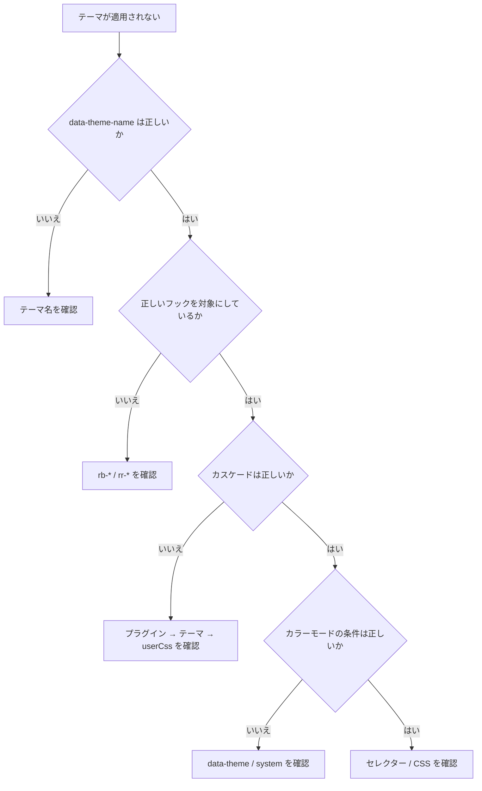

# 安定した CSS フックとカスケード

このページは[テーマ作成の詳細](../theme-system.ja.md)の一部で、`userCss`、安定した CSS フック、キャラクターレイヤー、CSS のカスケードを扱います。

## 3-5. `userCss`

`userCss` は最後に読み込まれ（カスケードの最上位）、最終的な上書きになります。テーマをフォークせずに1箇所だけ調整したいサイトのためのものです。テーマのスタイルシートは `userCss` より先に読み込まれるため、`userCss` が勝ちます。テーマパッケージは、`userCss` に打ち勝つために強いセレクターや `!important` の多用に頼らないでください。

```ts id="mphtk3"
theme: defaultTheme({
  userCss: [
    "/extensions/custom.css",
  ],
}),
```

## 5. 安定した CSS フック

テーマは、アプリケーションやプラグインの内部マークアップではなく、文書化された安定したフックを対象にします。クラスの名前空間は2つあります。

- **`rb-*`** — フレームワークが提供する構造フックとセマンティックデザイントークン。`.rb-theme-root` はテーマルートのコンテナです。
- **`rr-*`** — プラグインまたは機能が描画する最も外側の要素に付くルートフック。

`rb-*` の構造フックは次のとおりです。

```text id="etblkj"
.rb-theme-root
.rb-site
.rb-article
.rb-article-layout
.rb-article-header
.rb-article-body
.rb-article-content
.rb-article-meta
.rb-article-footer
.rb-sidebar
```

レンダリングされた Markdown 本文は `.rb-article-content` に包まれます。Markdown のセマンティックなベースラインは、このラッパーが持ちます。対象となるのは、リストマーカーと字下げ、見出し、段落とブロックの余白、表、図、定義リスト、インラインコード、整形済みブロックです。テーマは `--rb-*` トークンとキャラクタールールを通じて、そのベースラインの見た目を整えます。構造を再宣言する必要はありません。ベースラインはレイヤー化されているため、テーマのレイヤー外のキャラクタールールとユーティリティクラスは、どちらもベースラインに勝ちます。

`.rb-article-body` は、ヘッダー、メタデータ、レンダリングされた Markdown、プラグインコンポーネントを含む記事本文のシェルです。Markdown のタイポグラフィ自体は持たないため、プラグインコンポーネントはどこに置かれても独自の見出しを保ちます。

`rr-*` のルートフックには、次のようなものがあります。

```text id="rt44pe"
.rr-search
.rr-callout
.rr-table-of-contents
.rr-backlinks
.rr-local-graph
.rr-code
.rr-code-tabs
.rr-lightbox
.rr-excalidraw
.rr-mermaid
.rr-query
.rr-cardlink
.rr-diff-history
.rr-attachment
.rr-media
.rr-recent-posts
.rr-garden-explorer
```

テーマは、これらのルートフックと、プラグインが文書化した子孫要素だけを対象にします。BEM の要素（`__…`）と修飾子（`--…`）は内部実装の詳細です。たとえば、プラグインは内部で次のようなクラスを使う場合があります。

```text id="u7bmkr"
.rr-search
.rr-search__input
.rr-search__result
.rr-search--loading
```

公開フックは次のクラスです。

```text id="9k6dgy"
.rr-search
```

次のような部分は、プラグインが公開フックとして明示的に文書化していない限り、プラグイン内部のクラスとして扱います。

```text id="1ggxg1"
__input
__result
--loading
```

`.sr-only` のような汎用ヘルパークラスも、プラグインのフックではありません。プラグインの出力は `.rr-*` フックだけを使うため、テーマはそれらのフックを対象にします。

フレームワーク CSS はリセットとベースの取り決めを担当します。サイト CSS はページの構造と配置を担当し、文書化されたプラグインのルートをサイトのレイアウト内に配置できます。プラグイン CSS は内部 UI と操作を担当します。テーマ CSS は共通トークンと視覚表現を担当し、サイトのレイアウトや文書化されていないプラグイン内部を引き継ぎません。

### 5-1. キャラクターレイヤー

テーマはトークンの変更に限りません。テーマの境界の内側では、安定したフックを直接スタイルして、サイトに視覚的な個性を与えられます。

たとえば次のように、記事ヘッダーへ罫線を引けます。

```css id="n72uhc"
:is(:root, .rb-theme-root)
[data-theme-name="example"]
.rb-article-header {
  border-bottom:
    var(--rb-rule-width)
    solid
    var(--rb-color-border);
}
```

対象にできるのは安定したフックだけです。テーマ側で、次のような新しいクラス名を発明しないでください。

```text id="mkmfyh"
rb-*
rr-*
```

これらをフレームワークの取り決めであるかのように扱ってはいけません。

トークンの定義は `@layer base` に置きます。

```css id="43rbsh"
@layer base {
  :is(:root, .rb-theme-root)
  [data-theme-name="example"] {
    --rb-color-accent: #b45309;
  }
}
```

安定したフックに対するキャラクタールールは **レイヤー外（unlayered）** にします。

```css id="s2xwqm"
:is(:root, .rb-theme-root)
[data-theme-name="example"]
.rb-article-header {
  border-bottom:
    var(--rb-rule-width)
    solid
    var(--rb-color-border);
}
```

アプリケーションの構造 CSS とプラグイン CSS もレイヤー外です。テーマ CSS はそれらより後に読み込まれるため、通常は `!important` を使わなくても上書きできます。`!important` は使わないでください。

テーマパッケージには、セルフホストの Web フォントを含められます。フォントは次のように配置します。

```text id="8g43c5"
styles/
├─ theme.css
└─ fonts/
   └─ example-serif-latin.woff2
```

CSS では相対 URL を使います。

```css id="66ktv6"
@font-face {
  font-family: "Example Serif";

  src:
    url("./fonts/example-serif-latin.woff2")
    format("woff2");

  font-weight: 400 700;
  font-display: swap;
}
```

フォントを同梱する場合は、そのフォントのライセンスファイルもパッケージに含めてください。Latin サブセットのような比較的小さいフォントは同梱できます。日本語などの CJK フォントはファイルサイズが大きいため、基本的にはシステムフォントスタックへフォールバックします。

キャラクターレイヤーも表示専用です。コンテンツ、構造、振る舞いを変更してはいけません。

## 6. CSS のカスケード

読み込み順は、表示拡張のための重要な取り決めです。

```text id="jz92ku"
Framework Structural CSS
        ↓
Base / Application CSS
        ↓
Plugin Default CSS
        ↓
Theme CSS
        ↓
Config Token Inline Style
        ↓
userCss
```



この順番は偶然ではなく、保証されています。`@riebeckite/honox` は次のファイルを生成します。

```text id="i2y97j"
.riebeckite/framework-styles.css
.riebeckite/plugin-styles.css
.riebeckite/theme-styles.css
```

`.riebeckite/framework-styles.css` はフレームワークの構造 CSS、`.riebeckite/plugin-styles.css` は解決されたプラグイン順のプラグインスタイル、`.riebeckite/theme-styles.css` はテーマスタイルです。サイトは、フレームワークのスタイルシートをプラグインのスタイルシートより先に、プラグインのスタイルシートをテーマのスタイルシートより先に読み込みます。そのため、テーマ CSS は常にプラグインの既定を上書きし、`userCss` が最終的な上書きになります。

その結果、次の関係になります。

```text id="4w8d9d"
Plugin
  → 標準の見た目

Theme
  → Plugin の見た目を変更

userCss
  → Site 利用者が最終調整
```

生成されたファイルを直接編集したり、インポート順を変更したりしないでください。生成される各ファイルには、カスケード上の位置を示すヘッダーコメントが付きます。カスケードは通常、`!important` に依存しません。

## トラブルシューティング: テーマが適用されない場合

テーマが期待どおりに適用されない場合は、次の順番で確認します。



特に確認する項目は次のとおりです。

1. `data-theme-name` がテーマの `name` と一致しているか
2. `.rb-*` / `.rr-*` の正しい安定したフックを対象にしているか
3. プラグイン CSS → テーマ CSS → `userCss` の順になっているか
4. `system` なのに `data-theme=""` が残っていないか
5. テーマルートの外へセレクターが漏れていないか
