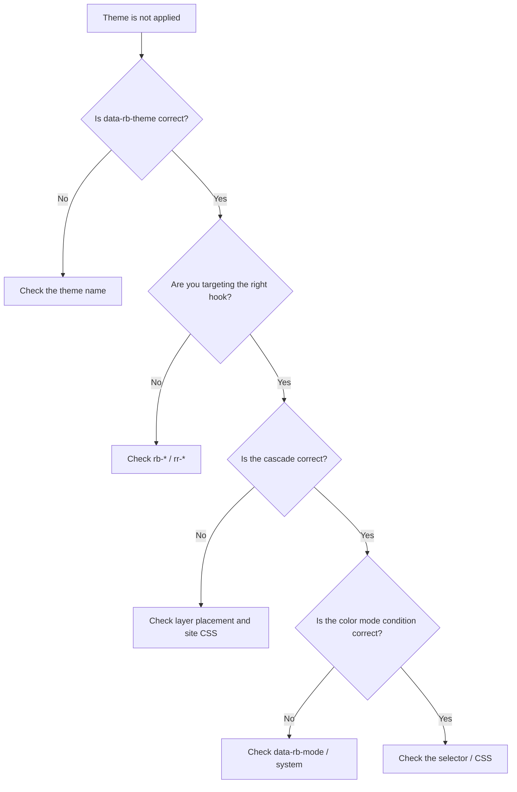

This page is part of [Themes in Depth](../theme-system.md) and covers stable CSS hooks and the cascade.

# Stable CSS hooks and the cascade

## 3-5. stylesheets

`stylesheets` loads after the application stylesheet and is intended for small final adjustments without forking a [[glossary/theme|Theme]]. Its unlayered normal declarations beat framework, plugin, and theme normal declarations, regardless of selector specificity. It does not override inline configuration tokens, `!important`, animations, or transitions.

```ts
theme: defaultTheme({
  stylesheets: ["/extensions/custom.css"],
}),
```

## 5. Stable CSS hooks

Themes target documented stable hooks, not internal markup. There are two class namespaces.

- **`rb-*`** — structural hooks and semantic design tokens provided by the framework. Structural hooks: `.rb-theme-root` (the theme root container), `.rb-site`, `.rb-article`, `.rb-article-layout`, `.rb-article-header`, `.rb-article-body`, `.rb-article-content`, `.rb-article-meta`, `.rb-article-footer`, `.rb-sidebar`.
- **`rr-<feature>`** — the root hook on the outermost element rendered by a new plugin or feature. Examples: `.rr-search`, `.rr-callout`, `.rr-table-of-contents`, `.rr-backlinks`, `.rr-local-graph`, `.rr-code`, `.rr-code-tabs`, `.rr-lightbox`, `.rr-excalidraw`, `.rr-mermaid`, `.rr-query`, `.rr-cardlink`, `.rr-diff-history`, `.rr-attachment`, `.rr-media`, `.rr-recent-posts`, `.rr-garden-explorer`. Some built-in plugins still document `rb-*` roots; follow each plugin's documentation.

A theme should style only these root hooks and the descendants a plugin documents. BEM elements (`__…`) and modifiers (`--…`) are internal implementation details. For example, a plugin may internally use:

```text
.rr-search
.rr-search__input
.rr-search__result
.rr-search--loading
```

The public hook is `.rr-search`; `__input`, `__result`, and `--loading` are treated as internal implementation unless the plugin explicitly documents them as public hooks. Generic helpers such as `.sr-only` are not plugin hooks. [[glossary/plugin|Plugin]] roots use either `rr-*` or `rb-*` hooks depending on the plugin; target the root hook that plugin documents.

Framework CSS owns the reset and base contracts. Site CSS owns page structure and placement, including positioning a documented plugin root in a site layout. Plugin CSS owns its internal [[glossary/ui|UI]] and interactions. Theme CSS owns shared tokens and visual expression; it does not take over site layout or undocumented plugin internals.

### 5-1. Character layer

A theme is not limited to tokens. Within the theme boundary it may style the
stable hooks directly to give a site a visual character.

- Put token definitions inside `@layer base`; keep visual character rules as
  normal theme rules. The generated theme entry places the complete theme in
  `rb-theme`, so internal layers become nested (for example,
  `rb-theme.base`) and do not collide with Tailwind's `base` layer. Theme normal
  declarations beat plugin normal declarations, while unlayered site normal
  declarations beat both regardless of specificity. Never use `!important`.
- Target only stable hooks: `.rb-site`, `.rb-article`, `.rb-article-layout`,
  `.rb-article-header`, `.rb-article-body`, `.rb-article-content`,
  `.rb-article-meta`, `.rb-article-footer`, `.rb-sidebar`, and the `rr-*` plugin
  roots above. Do not invent new `rb-*` / `rr-*` class names; `.rr-*` BEM parts
  are internal.
- `.rb-article-content` is where the Markdown semantic baseline lives: the
  structural rules that keep Markdown readable after the CSS reset (list
  markers and indentation, headings, paragraph and block spacing, tables,
  figures, definitions, inline code, and preformatted blocks). A theme styles
  the appearance of that baseline through `--rb-*` tokens and character rules;
  it does not need to re-declare the structure. The baseline is layered, so a
  theme character rules and utility classes both win over it.
- `.rb-article-body` is the article body shell that hosts the header, metadata,
  rendered Markdown, and plugin components. It carries no Markdown typography itself,
  so plugin components keep their own headings wherever they are placed.
- A theme may ship self-hosted webfonts (Latin subsets) in its package under
  `styles/fonts/`, reference them with relative `url()`, and include the font
  license file. Japanese and other CJK text should fall back to system font
  stacks rather than shipping large font files.

```text
styles/
├─ theme.css
└─ fonts/
   └─ example-serif-latin.woff2
```

```css
/* Tokens stay layered. */
@layer base {
  :is(:root, .rb-theme-root)[data-rb-theme="example"] {
    --rb-color-accent: #b45309;
  }
}

/* Character rules are in rb-theme, so they beat plugin CSS. */
:is(:root, .rb-theme-root)[data-rb-theme="example"] .rb-article-header {
  border-bottom: var(--rb-rule-width) solid var(--rb-color-border);
}

@font-face {
  font-family: "Example Serif";
  src: url("./fonts/example-serif-latin.woff2") format("woff2");
  font-weight: 400 700;
  font-display: swap;
}
```

Character rules are still presentation-only: they must not change content,
structure, or behavior.

## 6. CSS cascade

For same-origin normal declarations, Riebeckite establishes this cascade-layer
contract:

```text
base
→ components
→ utilities
→ rb-plugins
→ rb-theme
→ unlayered site CSS
```

Framework structural CSS uses `base` and `components`; plugins are imported into
`rb-plugins`; themes are imported into `rb-theme`; ordinary site CSS is
unlayered. A plugin's own `@layer utilities` therefore becomes
`rb-plugins.utilities`, and a theme's `@layer base` becomes `rb-theme.base`.
Theme CSS can customize plugin appearance without entering Tailwind's global
layers. Site CSS can override framework, plugin, and theme normal declarations
without matching their selector specificity.

Keep the generated imports in their documented order. The framework stylesheet
declares the layer order, so reordering the generated imports cannot change the
normal-declaration contract. A site rule intentionally put in a named layer gets
that layer's priority, not the unlayered-site guarantee.

This contract only covers same-origin normal declarations. `!important` reverses
layer order; inline styles have their own author-origin precedence; animations
beat normal declarations; transitions beat important declarations. Custom
properties follow the same cascade and inherit, so inline configuration tokens
override stylesheet token definitions. Do not edit generated files or use
`!important` to bypass the contract.

## Troubleshooting: the theme is not applied

If a theme does not apply as expected, check in this order:



In particular, verify:

1. `data-rb-theme` matches the theme's `name`.
2. You target the correct `.rb-*` / `.rr-*` stable hook.
3. The generated plugin and theme imports retain `layer(rb-plugins)` and `layer(rb-theme)`.
4. `data-rb-mode=""` is not left behind when using `system`.
5. The selector does not leak outside the theme root.
