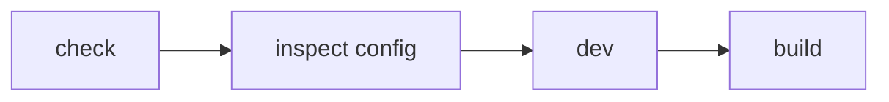

# テーマの配布と検証

このページは[テーマ作成の詳細](../theme-system.ja.md)の一部で、テーマのパッケージ化、配布、検証を扱います。

## 8. 配布用にパッケージ化する

公開するテーマは、たとえば次のような構成にできます。

```text id="c4cx40"
packages/themes/example/
├─ src/
│  └─ index.ts
├─ styles/
│  ├─ theme.css
│  └─ fonts/          # 必要な場合のみ
├─ package.json
├─ README_ja.md
└─ README.md
```

Riebeckite リポジトリ内では、次の構成が雛形になります。

```text id="7s39yd"
packages/themes/minimal
```

`src/index.ts` では、テーマのファクトリを公開します。

```ts id="lhhz91"
import { defineTheme } from "@riebeckite/core";

export function exampleTheme() {
  return defineTheme({
    name: "example",

    styles: [
      {
        moduleSpecifier:
          "@riebeckite/theme-example/style.css",
      },
    ],
  });
}
```

`package.json` では、スタイルシートを `./style.css` としてエクスポートします。

```text id="8md3uw"
./style.css
```

外部に配布するテーマのパッケージは、Riebeckite の monorepo の内部構造に依存させません。基本的には、次のパッケージの公開 API だけを利用します。

```text id="a8r4we"
@riebeckite/core
```

次のような内部インポートは避けてください。

```ts id="0q5wfe"
import {
  something,
} from "@riebeckite/core/src/...";
```

また、次のような monorepo 内部のパスにも依存させないでください。

```text id="mpy5js"
../../../../packages/core/...
```

テーマのスタイルシートも、パッケージ自身のエクスポートとして公開します。

## 9. 検証する

テーマを作成または変更したら、次の順番で確認します。



まず、設定とプラグインの解決を検証します。

```sh id="cb8y30"
pnpm exec riebeckite check
```

次に、解決されたテーマ設定を確認します。

```sh id="56lmdw"
pnpm exec riebeckite inspect config
```

実際の表示を確認する場合は、開発サーバーを起動します。

```sh id="i9vjkb"
pnpm exec riebeckite dev
```

最後に、生成物まで確認します。

```sh id="tsbdjv"
pnpm exec riebeckite build
```

`check`、`doctor`、`inspect` はビルド出力を変更しません。テーマを交換しても、次のものは変わらないのが基本です。

- ルート
- マニフェスト
- コンテンツグラフ
- クライアントの動作

表示が意図と違うときは、カスケードの順序（`userCss` が最後）と、`rr-*` と `rb-*` のどちらを対象にしているかを確認してください。
