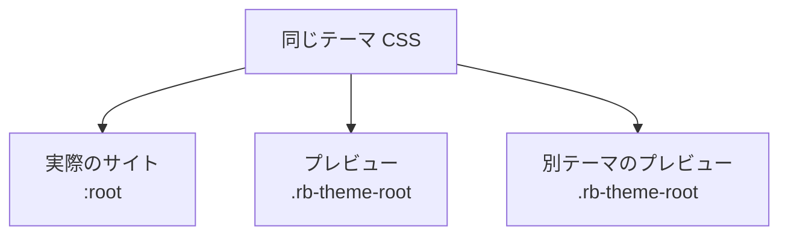

# テーマルートと属性

このページは[テーマ作成の詳細](../theme-system.ja.md)の一部で、テーマルートとテーマ固有の属性を扱います。

## 3-6. テーマルートセレクター

組み込みテーマは、`:root` 単体を対象にしません。すべてのルールをテーマの識別名でスコープするため、同じスタイルシートを実際のドキュメントと埋め込みプレビューの両方に使えます。

```css id="36j35i"
:is(:root, .rb-theme-root)[data-theme-name="<name>"]
```

`<name>` はテーマの識別名です。既定テーマは `riebeckite` です。組み込みテーマには次のものがあります。

```text id="l0yyse"
riebeckite
minimal
gruvbox
sakura
tokyonight
rerurate
```

実際のサイトでは、アプリが `<html>` にテーマ名を付けます。

```html id="18amdy"
<html data-theme-name="minimal">
```

この場合、`:root` がテーマルートになります。

一方、テーマギャラリーでは、同じドキュメント内に複数のテーマを表示できます。

```html id="3ynnb9"
<div
  class="rb-theme-root"
  data-theme-name="minimal"
>
  ...
</div>

<div
  class="rb-theme-root"
  data-theme-name="gruvbox"
>
  ...
</div>
```



テーマ CSS を `:root` 単体に対して定義しないでください。

```css id="69pszy"
:root {
  /* ... */
}
```

ライト、ダーク、システム、タイポグラフィ、テーマオプション、要素と疑似クラスのルールは、すべて同じ接頭辞を持ちます。

```css id="bsov79"
/* Light */
:is(:root, .rb-theme-root)
[data-theme-name="<name>"] {
  /* ... */
}

/* Dark */
:is(:root, .rb-theme-root)
[data-theme-name="<name>"]
[data-theme="dark"] {
  /* ... */
}

/* System */
@media (prefers-color-scheme: dark) {
  :is(:root, .rb-theme-root)
  [data-theme-name="<name>"]
  :not([data-theme]) {
    /* ... */
  }
}

/* Typography */
:is(:root, .rb-theme-root)
[data-theme-name="<name>"]
[data-typography="serif"] {
  /* ... */
}

/* Theme Option */
:is(:root, .rb-theme-root)
[data-theme-name="<name>"]
[data-example-option="on"] {
  /* ... */
}

/* Elements */
:is(:root, .rb-theme-root)
[data-theme-name="<name>"]
:focus-visible {
  /* ... */
}
```

`data-theme-name` はアプリが出力します。プレビューのコンテナに必要なのは、`.rb-theme-root` フックと一致するテーマ名だけです。

## 4. カラーモード・属性・オプションの詳細

3-1 で説明した取り決めに加えて、テーマ固有のオプションは安全な `data-*` 属性を通じて CSS へ渡せます。

```ts id="ylx4jp"
return defineTheme({
  name: "newspaper",

  attributes: {
    "data-newspaper-density":
      "compact",
  },
});
```

その属性は、CSS から次のように対象にできます。

```css id="4evhcs"
:is(:root, .rb-theme-root)
[data-theme-name="newspaper"]
[data-newspaper-density="compact"] {
  /* ... */
}
```

テーマ API は、`class`、`style`、`id`、`lang` を自由に変更できるようには設計されていません。

```text id="cn9sza"
class
style
id
lang
```

フレームワークが所有する属性の名前空間と、テーマ固有の属性の名前空間を分けて保ちます。

## テーマルートと themeRootAttributes

フレームワークは `ThemeRoot` という UI プリミティブを提供しています。`<html>` 要素へのテーマ属性の設定を担当します。

```tsx
import { ThemeRoot } from "@riebeckite/honox/ui";

<ThemeRoot
  theme={config.theme}
  lang={c.get("htmlLanguage") ?? config.site.locale}
>
  {children}
</ThemeRoot>
```

`ThemeRoot` は次の属性を持つ `<html>` 要素を描画します。

```html
<html
  lang="ja"
  data-theme-name="minimal"
  data-theme="dark"
  data-typography="system"
  data-article-layout="article"
>
```

フレームワークは `themeRootAttributes(theme)` を使い、テーマ自身の `attributes` に予約属性を加えて出力します。

- `data-theme`: カラーモードの状態（`"light"` / `"dark"`。`"system"` のときは省略）
- `data-theme-name`: テーマの識別子
- `data-typography`: タイポグラフィプリセットの値
- `data-article-layout`: 記事レイアウトプリセットの値

`<html>` に独自の属性を追加したい場合は、`ThemeRoot` の代わりに `themeRootAttributes` ヘルパーを直接使います。

```tsx
import { themeRootAttributes } from "@riebeckite/honox/ui";

<html
  lang={c.get("htmlLanguage") ?? config.site.locale}
  {...themeRootAttributes(config.theme)}
  data-custom-attr="..."
>
  ...
</html>
```

ただし、フレームワークが予約している `data-theme`、`data-theme-name`、`data-typography`、`data-article-layout` は、テーマの `attributes` では上書きされません。

プラグインやテーマが以前に独自の `themeAttributes()` を実装していた場合は、フレームワークが提供する `ThemeRoot` / `themeRootAttributes()` への移行を検討してください。これにより、フレームワークが所有する属性の名前空間と、テーマ固有の名前空間の分離が明確になります。
