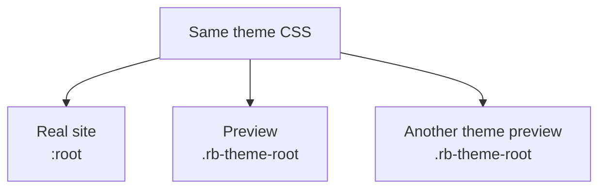

This page is part of [Themes in Depth](../theme-system.md) and covers the theme root and theme attributes.

# Theme root and attributes

## 3-6. Theme root selector

Built-in themes do not target the bare `:root`. Every rule is scoped to the
theme's identity name so the same stylesheet can style the real document and
an embedded preview:

```css
:is(:root, .rb-theme-root)[data-rb-theme="<name>"]
```

`<name>` is the theme's identity name: `riebeckite` for the default theme,
otherwise one of `editorial`, `fieldnotes`, `folio`, `garden`, `gruvbox`,
`minimal`, `module`, `rerurate`, `sakura`, `signal`, `technical`, `terminal`,
or `tokyonight`.

- On a real site the app sets `data-rb-theme` on `<html>`, so the `:root`
  branch matches the document root.
- In a preview such as a theme gallery, the same stylesheet styles any
  element carrying `class="rb-theme-root" data-rb-theme="<name>"`, so
  several themes can render side by side in one document.



Never define the theme CSS against a bare `:root`:

```css
:root {
  /* ... */
}
```

Light, dark, system, typography, theme options, and element/pseudo rules all
carry the same prefix:

```css
:is(:root, .rb-theme-root)[data-rb-theme="<name>"] { /* light */ }
:is(:root, .rb-theme-root)[data-rb-theme="<name>"][data-rb-mode="dark"] { /* dark */ }
@media (prefers-color-scheme: dark) {
  :is(:root, .rb-theme-root)[data-rb-theme="<name>"]:not([data-rb-mode]) { /* system */ }
}
:is(:root, .rb-theme-root)[data-rb-theme="<name>"][data-rb-setting-typography="serif"] { /* typography */ }
:is(:root, .rb-theme-root)[data-rb-theme="<name>"][data-rb-setting-neon="true"] { /* theme setting */ }
:is(:root, .rb-theme-root)[data-rb-theme="<name>"] :focus-visible { /* element/pseudo */ }
```

The app provides `data-rb-theme`; a preview container only needs the
`.rb-theme-root` hook and the matching name.

## 4. Theme settings and attributes

Theme-specific options are declared in the theme's settings schema; they are not passed as arbitrary attributes in `defineTheme`.

```ts
export const newspaperTheme = defineTheme({
  name: "newspaper",
  styles: [
    { moduleSpecifier: "@riebeckite/theme-newspaper/style.css" },
  ],
  settings: defineThemeSettings({
    density: {
      type: "select",
      label: "Density",
      default: "comfortable",
      options: [
        { value: "comfortable", label: "Comfortable" },
        { value: "compact", label: "Compact" },
      ],
    },
  }),
});
```

The resolved settings are reflected on the theme root as safe `data-rb-setting-*` attributes:

```css
:is(:root, .rb-theme-root)[data-rb-theme="newspaper"][data-rb-setting-density="compact"] {
  /* ... */
}
```

The theme API is not designed to modify `class`, `style`, `id`, or `lang` freely. The framework owns `data-rb-theme`, `data-rb-mode`, and `data-rb-layout`; theme settings use the separate `data-rb-setting-*` namespace.

## Theme Root and themeRootAttributes

The framework provides `ThemeRoot`, a [[glossary/ui|UI]] primitive that handles setting theme attributes on the `<html>` element.

```tsx
import { ThemeRoot } from "@riebeckite/honox/ui";

<ThemeRoot
  theme={config.theme}
  lang={c.get("htmlLanguage") ?? config.site.locale}
>
  {children}
</ThemeRoot>
```

`ThemeRoot` renders the `<html>` element with the following attributes:

```html
<html
  lang="en"
  data-rb-theme="minimal"
  data-rb-mode="dark"
  data-rb-setting-typography="system"
  data-rb-layout="article"
>
```

The framework uses `themeRootAttributes(theme)` to emit the resolved settings plus reserved attributes:

- `data-rb-mode`: [[glossary/color-mode|Color Mode]] state (`"light"` / `"dark"` / omitted for "system")
- `data-rb-theme`: [[glossary/theme|Theme]] identity name
- `data-rb-setting-*`: each resolved theme setting, for example `data-rb-setting-typography`
- `data-rb-layout`: Article layout value

To add your own `<html>` attributes, use the `themeRootAttributes` helper directly instead of `ThemeRoot`:

```tsx
import { themeRootAttributes } from "@riebeckite/honox/ui";

<html
  lang={c.get("htmlLanguage") ?? config.site.locale}
  {...themeRootAttributes(config.theme)}
  data-custom-attr="..."
>
  ...
</html>
```

Theme settings cannot overwrite the framework-reserved `data-rb-mode`, `data-rb-theme`, or `data-rb-layout`.

If a plugin or theme previously implemented its own `themeAttributes()`, consider migrating to the framework-provided `ThemeRoot` / `themeRootAttributes()`. This clarifies the separation between framework-owned and theme-specific attribute namespaces.
