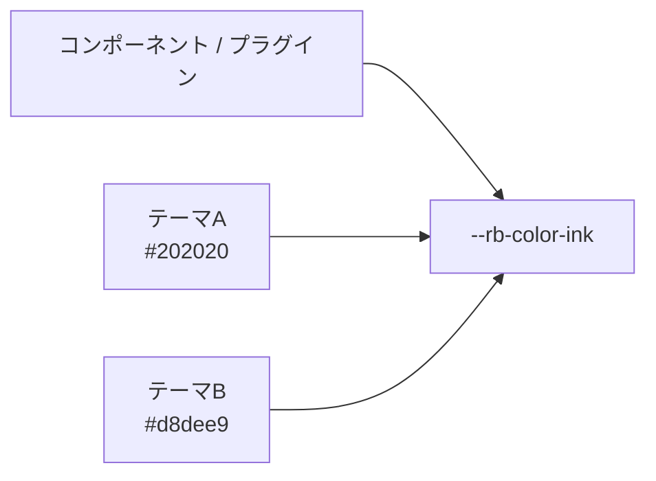

# デザイントークン

このページは[テーマ作成の詳細](../theme-system.ja.md)の一部で、デザイントークンを扱います。

## 3-4. デザイントークン（tokens）

Coreの `ThemeDesignTokens` は、次のセマンティックなグループに分かれています。スタイルシートでは、これらを `--rb-*` というセマンティックなCSSカスタムプロパティとして扱います。

コンポーネントやプラグインは、「このテーマの黒」「このテーマの灰色」のようなテーマ固有の値ではなく、**意味**を参照します。本文色、背景、アクセント、ボーダーなどがその例です。



これにより、コンポーネントに手を加えずにテーマを交換できます。

### 色

| トークン | CSS変数 |
| --- | --- |
| `paper` | `--rb-color-paper` |
| `ink` | `--rb-color-ink` |
| `muted` | `--rb-color-muted` |
| `accent` | `--rb-color-accent` |
| `border` | `--rb-color-border` |
| `borderStrong` | `--rb-color-border-strong` |
| `surface` | `--rb-color-surface` |
| `surfaceHover` | `--rb-color-surface-hover` |
| `overlay` | `--rb-color-overlay` |
| `danger` | `--rb-color-danger` |
| `success` | `--rb-color-success` |
| `codeBackground` | `--rb-color-code-background` |

### タイポグラフィ

| トークン | CSS変数 |
| --- | --- |
| `bodyFont` | `--rb-font-body` |
| `headingFont` | `--rb-font-heading` |
| `monoFont` | `--rb-font-mono` |

### レイアウト

| トークン | CSS変数 |
| --- | --- |
| `pageMaxWidth` | `--rb-layout-page-max` |
| `articleMaxWidth` | `--rb-layout-article-max` |
| `sidebarWidth` | `--rb-layout-sidebar` |
| `contentGap` | `--rb-layout-gap` |

CSSでは次のように定義します。

```css id="u6csj3"
@layer base {
  :is(:root, .rb-theme-root)[data-theme-name="<name>"] {
    --rb-color-paper: #fafafa;
    --rb-color-ink: #202020;
    --rb-color-accent: #555;

    --rb-font-body:
      system-ui, sans-serif;

    --rb-layout-article-max: 48rem;
  }
}
```

CSS変数名は、トークン名をケバブケースにしたものです。指定するトークン名とCSS変数名は異なります。

```text id="avjyrb"
borderStrong
  → --rb-color-border-strong

surfaceHover
  → --rb-color-surface-hover

codeBackground
  → --rb-color-code-background
```

**なぜセマンティックトークンが必要か**：コンポーネントやプラグインが特定のテーマの色名を直接参照すると、テーマを交換できなくなります。

```css id="0ld7xq"
/* Good */

.rr-example {
  color:
    var(--rb-color-ink);

  background:
    var(--rb-color-surface);
}
```

次のように、テーマ固有の色を直接指定することは避けます。

```css id="5tkz4j"
/* Avoid */

.rr-example {
  color: #171717;
  background: #f6efe2;
}
```

後者では、テーマを交換してもプラグインの色が変わりません。

プラグイン固有の意味を持つトークンは、プラグインが `--rr-*` として所有し、利用できる場合は `--rb-*` にフォールバックします。

```css id="8qr5yn"
--rr-example-background:
  var(--rb-color-surface);
```
