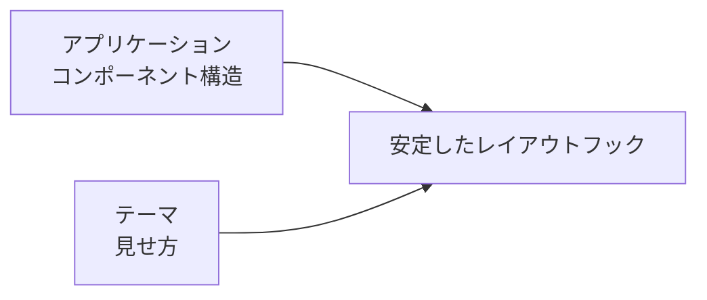

# タイポグラフィと記事レイアウト

このページは[テーマ作成の詳細](../theme-system.ja.md)の一部で、[[glossary/typography|タイポグラフィ]]と[[glossary/article-layout|記事レイアウト]]を扱います。

## 3-2. タイポグラフィ（typography）

タイポグラフィは Core の型ではなく、テーマの設定です。テーマの設定スキーマに宣言します。

```ts id="6q5em7"
settings: defineThemeSettings({
  typography: {
    type: "select",
    label: "Typography",
    default: "system",
    options: [
      { value: "system", label: "System" },
      { value: "serif", label: "Serif" },
      { value: "sans", label: "Sans" },
    ],
  },
}),
```

解決された値は、テーマルートの `data-rb-setting-typography` 属性として反映されます。テーマの CSS が、それをセマンティックなフォントトークンへ対応付けます。

```css
:is(:root, .rb-theme-root)[data-rb-theme="<name>"][data-rb-setting-typography="serif"] {
  --rb-font-body: Georgia, serif;
  --rb-font-heading: "Libre Baskerville", serif;
}
```

## 3-3. 記事レイアウト（layout）

`layout` は `ThemeOptions` のフィールドで、型は `"article" | "sidebar" | "full-width"` です。テーマルートの `data-rb-layout` 属性として反映されます。[[glossary/theme|テーマ]]が定義するのは各レイアウトの見せ方であり、ルートやコンポーネントツリーを置き換えるものではありません。

```ts
theme: exampleTheme({ layout: "sidebar" })
```


