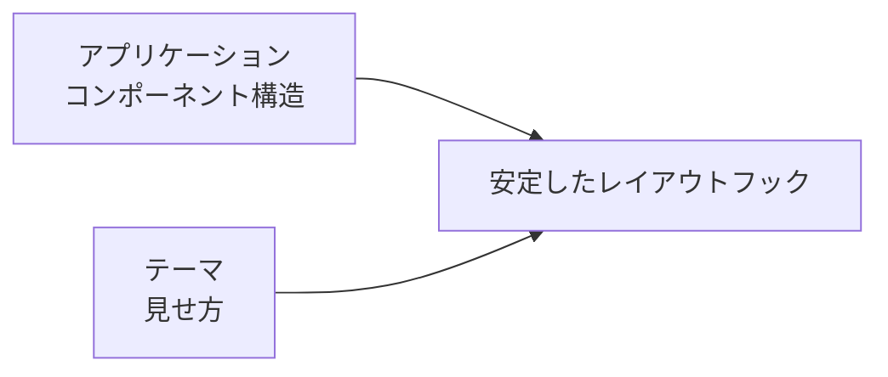

# タイポグラフィと記事レイアウト

このページは[テーマ作成の詳細](../theme-system.ja.md)の一部で、タイポグラフィと記事レイアウトを扱います。

## 3-2. タイポグラフィ（typography）

```ts id="6q5em7"
type ThemeTypographyPreset =
  | "system"
  | "serif"
  | "sans";
```

プリセットは、本文や見出しなどのセマンティックフォントトークンに反映されます。

## 3-3. 記事レイアウト（articleLayout）

```ts id="l0kwo9"
type ThemeArticleLayoutPreset =
  | "article"
  | "sidebar"
  | "full-width";
```

テーマが定義するのは、レイアウトプリセットの見せ方です。ルートやコンポーネントツリーを置き換えるものではありません。


