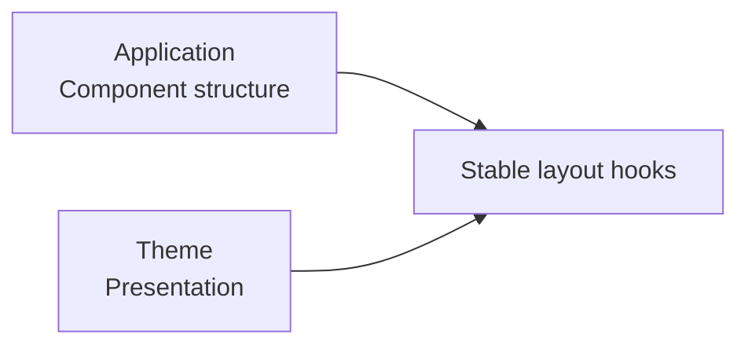

This page is part of [Themes in Depth](../theme-system.md) and covers typography and article layout.

# Typography and article layout

## 3-2. typography

Typography is a theme setting, not a Core type. Declare it in the theme's settings schema:

```ts
settings: defineThemeSettings({
  typography: {
    type: "select",
    label: "Typography",
    default: "system",
    options: [
      { value: "system", label: "System" },
      { value: "serif", label: "Serif" },
      { value: "sans", label: "Sans" },
    ],
  },
}),
```

The resolved value is reflected as `data-rb-setting-typography` on the theme root. The theme CSS maps it to semantic font tokens:

```css
:is(:root, .rb-theme-root)[data-rb-theme="<name>"][data-rb-setting-typography="serif"] {
  --rb-font-body: Georgia, serif;
  --rb-font-heading: "Libre Baskerville", serif;
}
```

## 3-3. layout

`layout` is a `ThemeOptions` field with the type `"article" | "sidebar" | "full-width"`. It is reflected as `data-rb-layout` on the theme root. A theme defines the presentation of each layout; it does not replace the route or the component tree.

```ts
theme: exampleTheme({ layout: "sidebar" })
```


