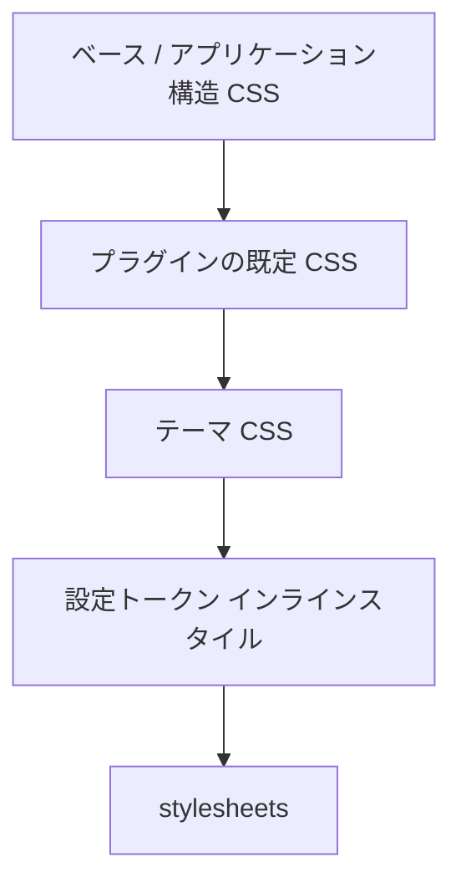

# CSS Contract

安定した CSS フックとコンポーネントが依存できるカスケード順序。テーマは documentd hooks (rb-* と rr-*) を公開するため、コンポーネントは特定のテーマをハードコードせずにスタイルできます。

## Stable hooks
2つのクラス名前空間が提供されます：
- `rb-*` — フレームワークが提供する構造フックとセマンティックデザイントークン（'.rb-theme-root', '.rb-site', '.rb-article', '.rb-article-body', など）
- `rr-<feature>` — プラグインによって描画された最も外側の要素に付くルートフック（'.rr-search', '.rr-callout', など）

## Cascade order

推奨されるカスケード順序は：framework structural CSS → base/app structural CSS → Plugin default CSS → Theme CSS → config token inline style → stylesheetsです。これは `@riebeckite/honox` が使用する典型的な順序ですが、絶対的な保証ではありません - アプリケーションでの実際のインポート順序が実効的なカスケードを決定します。`stylesheets` は小さなサイト固有の調整のための最終的な上書きとして意図されています。

## カスケード順序確認

典型的なカスケード順序は：framework structural CSS → base/app structural CSS → Plugin default CSS → Theme CSS → config token inline style → stylesheetsです。この順序は、各レイヤーでヘッダーコメントでカスケード位置を記す `@riebeckite/honox` がデフォルトで使用する順序です。`stylesheets` は小さなサイト固有の調整のための最終的な上書きとして意図されています。

## テーマ CSS 作成ガイドライン

テーマは安定したフックと文書化された子孫要素だけをスタイル対象とします。新しい `rb-*` / `rr-*` クラス名を発明しないでください。`.rb-site`, `.rb-article`, `.rb-article-layout`, `.rb-article-header`, `.rb-article-body`, `.rb-article-content`, `.rb-article-meta`, `.rb-sidebar` および各プラグインが文書化した `rr-*` プラグインルートのみを対象とします。BEM 要素（`__…`）と修飾子（`--…`）は内部実装の詳細です。

## 関連用語
- [[glossary/theme|Theme]]
- [[design-token|Design Token]]
- [[glossary/typography|Typography]]
- [[glossary/color-mode|Color Mode]]

## 参考文献
- [CSS](../framework/theme-system/css.md)