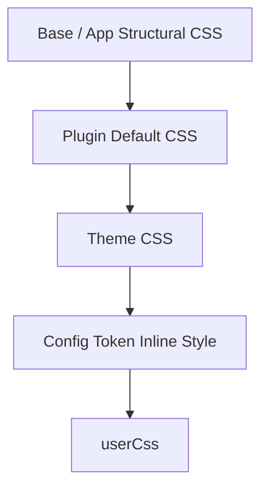

# CSS コントラクト

コンポーネントが依存できる安定した CSS フックとカスケード順序です。テーマは documented hooks (rb-* と rr-*) を公開し、コンポーネントが特定のテーマをハードコードせずにスタイルを設定できるようにします。

## 安定したフック

2つのクラスネームスペースが提供されます:
- `rb-*` — フレームワークが提供する構造的フックと意味的デザイントークン ('.rb-theme-root', '.rb-site', '.rb-article', '.rb-article-body', 等)
- `rr-<feature>` — プラグインがレンダリングする最外側の要素のルートフック ('.rr-search', '.rr-callout', 等)

## カスケード順

読み込み順はテーマ CSS がプラグインの上書きに勝ち、userCss が最終的な上書きになることを保証します:

framework structural CSS → base/app structural CSS → Plugin default CSS → Theme CSS → config token inline style → userCss

Theme は安定したフックと文書化された子孫要素のみにスタイルを当ててください。新しい rb-* / rr-* クラス名を発明しないでください。

## 関連用語

- [[glossary/theme|Theme]]
- [[design-token|Design Token]]
- [[glossary/typography|タイポグラフィ]]
- [[glossary/color-mode|色調モード]]

## さらに詳しく

- [CSS](../framework/theme-system/css.ja.md)
