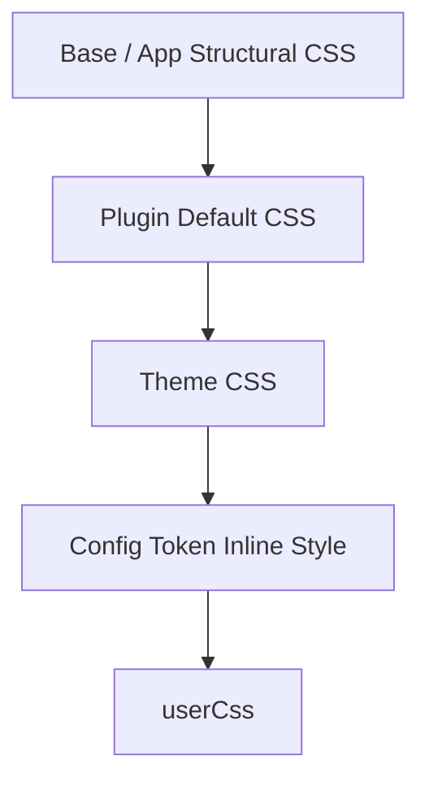

# CSS Contract

CSS Contractは、コンポーネントが依存できる安定したCSSのhookと、カスケードの順序です。Themeは`rb-*`と`rr-*`のhookを公開し、コンポーネントが特定のThemeを前提にせずスタイルを当てられるようにします。

## 安定したフック
クラスの名前空間は2つあります。

- `rb-*`：フレームワークが提供する構造のhookと意味的なDesign Token（`.rb-theme-root`、`.rb-site`、`.rb-article`、`.rb-article-body`など）
- `rr-<feature>`：Pluginが描画する最も外側の要素に付くroot hook（`.rr-search`、`.rr-callout`など）

## カスケード順
読み込み順は、ThemeのCSSがPluginの既定スタイルを上書きし、userCssが最後の上書きになるように決まります。

frameworkの構造CSS → base/appの構造CSS → Pluginの既定CSS → ThemeのCSS → configのtokenインラインスタイル→ userCss

## カスケード順の検証
読み込み順は、frameworkの構造CSS → base/appの構造CSS → Pluginの既定CSS → ThemeのCSS → configのトークンによるインラインstyle → userCssの順で保証されています。`@riebeckite/honox`が各レイヤー用に別々のstylesheetを生成し、ヘッダーのコメントでカスケード位置を示します。`userCss`は最後の上書きとなり、サイト固有の小さな調整に適しています。

## Theme CSSの書き方
Themeは安定したhookと、文書化された子孫要素だけにスタイルを当ててください。新しい`rb-*`/`rr-*`のクラス名は増やさないでください。`.rb-site`, `.rb-article`, `.rb-article-layout`, `.rb-article-header`, `.rb-article-body`, `.rb-article-content`, `.rb-article-meta`, `.rb-article-footer`, `.rb-sidebar`および各プラグインが文書化した`rr-*`root hookのみをターゲットにしてください。BEM要素（`__…`）と修飾子（`--…`）は内部実装の詳細です。

## 関連用語
- [[glossary/theme|Theme]]
- [[design-token|Design Token]]
- [[glossary/typography|Typography]]
- [[glossary/color-mode|Color Mode]]

## さらに詳しく
- [CSS](../framework/theme-system/css.ja.md)