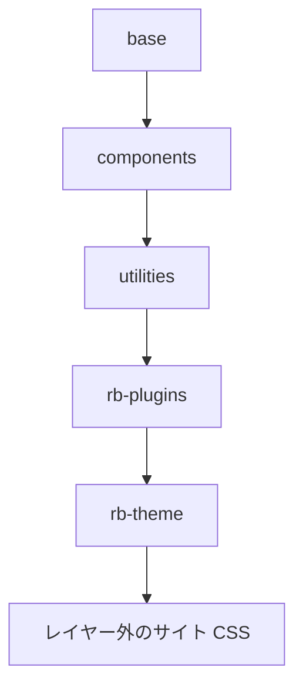

# CSS Contract

安定した CSS フックとコンポーネントが依存できるカスケード順序。テーマは documentd hooks (rb-* と rr-*) を公開するため、コンポーネントは特定のテーマをハードコードせずにスタイルできます。

## Stable hooks
2つのクラス名前空間が提供されます：
- `rb-*` — フレームワークが提供する構造フックとセマンティックデザイントークン（'.rb-theme-root', '.rb-site', '.rb-article', '.rb-article-body', など）
- `rr-<feature>` — プラグインによって描画された最も外側の要素に付くルートフック（'.rr-search', '.rr-callout', など）

## Cascade order

同一オリジンの通常宣言では、契約は `base` → `components` → `utilities` → `rb-plugins` → `rb-theme` → レイヤー外のサイト CSS です。フレームワーク CSS が最初のレイヤーを提供し、生成されたプラグインとテーマのエントリは `rb-plugins` と `rb-theme` を使い、通常のサイト CSS はレイヤー外です。そのため、レイヤー外のサイトルールは詳細度にかかわらずテーマルールを上書きします。

## カスケード順序確認

フレームワークのスタイルシートがレイヤー順を固定します。プラグイン内部のレイヤーは `rb-plugins`、テーマ内部のレイヤーは `rb-theme` の下にネストされます。`!important`、インラインスタイル、アニメーション、トランジションなどのカスケード起点は、この通常宣言の契約の対象外です。CSS custom properties も同じカスケードに従って継承されます。

## テーマ CSS 作成ガイドライン

テーマは安定したフックと文書化された子孫要素だけをスタイル対象とします。新しい `rb-*` / `rr-*` クラス名を発明しないでください。`.rb-site`, `.rb-article`, `.rb-article-layout`, `.rb-article-header`, `.rb-article-body`, `.rb-article-content`, `.rb-article-meta`, `.rb-sidebar` および各プラグインが文書化した `rr-*` または `rb-*` のプラグインルートのみを対象とします。BEM 要素（`__…`）と修飾子（`--…`）は内部実装の詳細です。

## 関連用語
- [[glossary/theme|Theme]]
- [[design-token|Design Token]]
- [[glossary/typography|Typography]]
- [[glossary/color-mode|Color Mode]]

## 参考文献
- [CSS](../framework/theme-system/css.md)
